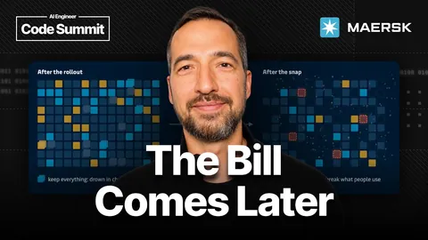

# Agents Made Code Free. Maintaining It Didn't Get Cheaper. - Dmitry Buykin, Maersk

**AI Engineer** · 2026-11-11 · 18:04 · relevance 4/5 · [Watch on YouTube](https://www.youtube.com/watch?v=oeknLUsN_GE)

## Summary

A conference talk from Maersk's Dmitry Buykin on maintaining a large production system where coding agents write most of the code and about three quarters of the system is prose instructions running across 110 countries. He frames six 'stones' (time, space, reality, mind, power, soul) as questions for staying under the line where change outpaces review: expert-owned prose, decision tables, runtime-controlled context, guarded writes, replay-based evidence and weekly pruning. The main takeaway is that verification speed and human attention, not code generation, are the bottleneck, so feedback loops, ledgers and evidence-based pruning must be built into the system instead of routed through one tech lead.

## Key insights

- Prose instructions need engineering like code: they applied mutation testing (deliberately breaking one sentence) and almost no tests turned red, then built a linter ('compiler') for prose that runs on every changed file.
  - _Relies on:_ ~10,000 scenarios of prose instructions; 110 countries; prose is ~3/4 of the system (speaker estimate) _(as of 2026-11-11)_
- Keep a single copy of each instruction document: exact blocks that agents read, plus surrounding plain text that experts read and sign off. A second copy would drift.
- Let the runtime, not the model, decide what goes into context. When the model was allowed to load everything, it invented a pricing check just because prices were visible. For large data, the model passes a short handle that the runtime validates before any write.
- Promote repeated agent 'walks' through prose into workflow tools only when the walk repeats and agrees across countries. The prose must then keep only the decisions, not the step names, or agents re-run those steps. Experts own a decision table, the model only picks a row, and a person takes over when no row fits.
- Verification is the real limit: agents spent almost 9/10 of their time checking a change. Evidence is ranked with replay of frozen real tasks (old vs new version) at the top, and every new check must fail once on purpose before it is trusted.
  - _Relies on:_ ~90% of agent time spent checking changes _(as of 2026-11-11)_
- Use a second agent that reviews with a checklist and without the author's reasoning. Use ledgers to catch coding agents that quietly skip parts of a batch: in one backlog only about a quarter of items that looked covered could actually be closed.
  - _Relies on:_ ~1/4 of apparently covered backlog items truly closable _(as of 2026-11-11)_
- Replay new checks over past sessions to estimate blast radius before shipping. One rule replayed over several thousand sessions would have fired on less than 1%. Prune weekly with a ratchet: anything no real task reaches gets named with evidence and is removed along with its tests.
  - _Relies on:_ new check fired on <1% of several thousand past sessions _(as of 2026-11-11)_

## How this applies to AX / design systems

The 'every user is an evaluator with a screen' idea suggests an AI component library pattern: a review panel that shows the task exactly as the agent saw it, with accept/reject outcomes and expert notes that turn into evals. Decision-table row selection with a human-takeover fallback is a concrete approval-UI pattern worth prototyping in Lit. The weekly ratchet pruning and 'retire variant with its test' rule apply directly to design-system component governance and to auditing agent-written component sprawl. A developer portal page could document the 'one document, two readers' format, with exact blocks for agents and signed prose for experts.

_Relevance 4/5: Strongly relevant to AX: it covers expert-in-the-loop review screens, decision tables with human takeover, the human as evaluator, and governance of sprawl, all of which map onto approval UI and design-system governance._

## Best moments

- [2:07](https://www.youtube.com/watch?v=oeknLUsN_GE&t=127s): Mutation testing applied to prose instructions
- [5:19](https://www.youtube.com/watch?v=oeknLUsN_GE&t=319s): Prose vs code limit mismatch and the prose compiler/linter
- [7:23](https://www.youtube.com/watch?v=oeknLUsN_GE&t=443s): Runtime controls context; handles instead of data
- [10:27](https://www.youtube.com/watch?v=oeknLUsN_GE&t=627s): Human attention as a gauge, blast radius replays
- [13:05](https://www.youtube.com/watch?v=oeknLUsN_GE&t=785s): Verification speed as the limit, evidence ranking, second-agent review
