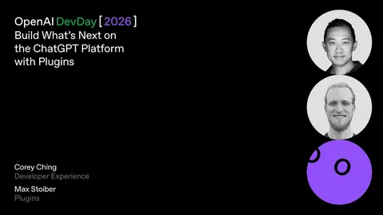

# Build What’s Next on the ChatGPT Platform with Plugins | DevDay 2026

**OpenAI** · 2026-11-11 · 27:45 · relevance 5/5 · [Watch on YouTube](https://www.youtube.com/watch?v=pIW_8VyvCuQ)

## Summary

An OpenAI DevDay 2026 workshop session where Corey (Developer Experience) and Max Neuber (Plugins Developer Platform engineering) present what's new for ChatGPT and Codex plugins. They demo plugin extensions (sidebar homes, side panel, composer @-mention search, file viewers, onboarding skills, settings) built on MCP and MCP apps, plus in-conversation discovery, Sign in with ChatGPT, an MCP events spec for automations, and a reworked submission process. The takeaway is that third-party products can now render as native-feeling surfaces beside the agent conversation with bidirectional context sharing, and the build-and-ship path is meant to run through Codex, Plugin Creator and Sites.

## Key insights

- Plugin extensions are built on MCP and MCP apps. To give a plugin a sidebar home you add an entry points configuration to the MCP tool that opens your widget, and one more entry to open it in the side panel; existing widgets stay unchanged.
  - _Relies on:_ plugin extensions built on MCP and MCP apps; entry points configuration on the MCP tool; works in ChatGPT and Codex across web, mobile, desktop _(as of 2026-11-11)_
- Side-panel widgets share user selection state with the model, so selecting an element (e.g. a molecule region or a page element) becomes conversational context. This uses MCP app methods such as update model context and send message.
  - _Relies on:_ MCP app methods: update model context, send message; demos: Rosalind Workbench 3D viewer, Magic Path canvas _(as of 2026-11-11)_
- Composer @-mention search requires a read-only MCP tool marked for mention search that takes a query string and returns a list of matching objects; ChatGPT calls it when the user types @ in the composer.
  - _Relies on:_ read-only MCP tool marked for mentioned search; schema: query string in, list of matching objects out _(as of 2026-11-11)_
- Plugins can ship an onboarding skill referenced in plugin.json as the onboarding skill. They can also expose settings through a read tool (setting schema plus current values) and an update tool, which ChatGPT renders as native controls in its settings screen.
  - _Relies on:_ onboarding skill referenced in plugin.json; settings via read tool + update tool with schema _(as of 2026-11-11)_
- ChatGPT is described as the first major MCP client to support the upcoming MCP event spec. Servers implement events/list, ChatGPT calls events/subscribe with a callback URL and signing secret, and the server sends a signed webhook to trigger an automation.
  - _Relies on:_ MCP methods events/list and events/subscribe; callback URL + signing secret, signed webhook _(as of 2026-11-11)_
- Discovery and in-conversation plugin suggestions are ranked on three signals: conversion after install, daily/weekly active usage, and retention. The directory holds 4,000 plugins.
  - _Relies on:_ 4,000 plugins in directory; signals: conversion, active usage, retention _(as of 2026-11-11)_
- Sign in with ChatGPT tripled Supabase's weekly plugin installations and lets eligible users bring ChatGPT token entitlements into a partner product. Submissions now drop the form in favor of plugin.json metadata, run automated review checks on upload, and auto-update with MCP server deploys.
  - _Relies on:_ Supabase saw 3x weekly installations; submissions up almost an order of magnitude since start of year; submission metadata lives in plugin.json _(as of 2026-11-11)_

## Tools, models & APIs mentioned

- **ChatGPT plugin extensions** (framework)
- **Apps SDK** (sdk)
- **Model Context Protocol (MCP)** (protocol)
- **MCP Apps** (protocol)
- **MCP event spec** (protocol)
- **Codex** (product)
- **Sites** (product)
- **App Plugin Creator** (product)
- **Sign in with ChatGPT** (api)
- **Responses API** (api)
- **Agents API** (api)
- **Magic Path** (product)
- **Rosalind Workbench** (product)
- **Supabase** (product)
- **Vercel** (product)
- **Atlassian Jira/Confluence** (product)
- **Canva** (product)
- **Shopify** (product)

## How this applies to AX / design systems

The sidebar, side panel, composer @-mention, file viewer and schema-rendered settings surfaces form a concrete component inventory for an AI component library. Parag could prototype a side-panel Web Component that emits selection events to the model as context, mirroring update model context. For a developer portal, the OpenAI developers plugin is a reference for docs-as-plugin: action cards that open a new thread with a pre-filled prompt, an @-searchable API reference via a mention-search tool, and an onboarding skill. The MCP events spec also suggests designing a 'watch and act while away' automation UI with clear subscription and notification patterns.

_Relevance 5/5: Defines concrete new agent-adjacent UI surfaces (sidebar, side panel, composer mentions, file viewers, schema-rendered settings) and context-sharing patterns that directly shape how Parag would design AX, AI component libraries and developer-portal plugins._

## Best moments

- [6:31](https://www.youtube.com/watch?v=pIW_8VyvCuQ&t=391s): Plugin extensions overview: sidebar, side panel, layout and navigation control
- [7:07](https://www.youtube.com/watch?v=pIW_8VyvCuQ&t=427s): Side panel shares the user's selection with the model, enabling bidirectional context
- [12:46](https://www.youtube.com/watch?v=pIW_8VyvCuQ&t=766s): Magic Path voice-driven canvas demo with editable elements and a custom cursor
- [20:38](https://www.youtube.com/watch?v=pIW_8VyvCuQ&t=1238s): Under the hood: entry points config, MCP app methods, file entry points
- [22:10](https://www.youtube.com/watch?v=pIW_8VyvCuQ&t=1330s): Composer mention search schema, onboarding skill, settings tools, MCP events spec
