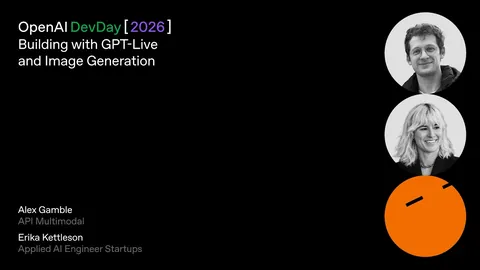

# Building with GPT-Live and Image Generation | DevDay 2026

**OpenAI** · 2026-11-11 · 22:38 · relevance 5/5 · [Watch on YouTube](https://www.youtube.com/watch?v=jDxKzlGLCas)

## Summary

An OpenAI DevDay 2026 session in which two presenters run the whole talk by voice through GPT-Live 1, a full-duplex voice model, with three live demos: personality, delegation and turnless architecture. They show the model listening and speaking at the same time, handing complex work off to backend agents while it keeps talking, and getting backend updates through three streams: silent context, speakable commentary and instructions. The main takeaway is that voice becomes a conversational front end over an existing agent harness, and deciding what the backend tells the voice model, what the UI shows and what gets spoken aloud is a product design decision.

## Key insights

- GPT-Live is full duplex: it streams audio in and out continuously and handles turn-taking itself, so builders can drop the separate voice activity detection model and silence heuristics they use today.
  - _Relies on:_ GPT-Live 1 is a full-duplex voice model; No separate VAD model is needed for turn-taking _(as of 2026-11-11)_
- Everything about conversational behaviour can be set in the prompt: tone, accent, back-channelling, laughter, how eager or patient the model is when interrupted, and even whether it speaks at all. The presenters prompted Marin to sometimes interject and sometimes give the speakers room.
  - _Relies on:_ Steerable via prompt: tone, accent, back channels, laughter, interruption patience, whether to speak _(as of 2026-11-11)_
- The backend can feed the voice model through three streams, each with a different job. Silent context updates change what it knows, speakable commentary gives it something to say aloud, and the instructions stream changes how it behaves (guardrails, conciseness).
  - _Relies on:_ Silent context goes to the model's thinking stream; Speakable content goes through the commentary stream; Steering goes through the instructions stream _(as of 2026-11-11)_
- When OpenAI dogfooded voice in Codex, people complained that progress updates were too verbose and too frequent. The recommended pattern is to keep the voice model silently informed and only speak when the user asks, while accounting for what the UI already shows.
  - _Relies on:_ Example: a 20-minute Codex task should not narrate tool calls every 30 seconds; Codex Voice is built with client delegation _(as of 2026-11-11)_
- There are two delegation modes. Client delegation sends delegation events (with an ID and timestamp) to your own harness, including cascaded STT→agent→TTS stacks. Responses delegation lets OpenAI run a model from the Responses API with function tools and hosted tools such as web search and image generation.
  - _Relies on:_ Client delegation event includes an ID and a timestamp; Responses delegation uses the OpenAI Responses API; Hosted tools: web search, image generation _(as of 2026-11-11)_
- A second GPT-Live session can act as a simulated user with its own persona and goal, which makes it a way to evaluate production voice scenarios. The presenters say they evaluated the whole demo this way.
  - _Relies on:_ Colin was a separate GPT-Live session with his own voice and instructions _(as of 2026-11-11)_
- Voice flattens deep settings menus: users can just ask for niche controls (for example, an '1880s wax cylinder' audio vibe) instead of hunting for where the setting lives, and the turnless model keeps working through loud background noise.

## Tools, models & APIs mentioned

- **GPT-Live** 1 (model)
- **Astra** 6 (model)
- **Responses API** (api)
- **Live API** (api)
- **Codex** (product)
- **OpenAI Developer plugin** (other)
- **GPT-Live Starter app** (other)

## How this applies to AX / design systems

The three-stream model (silent context / speakable / instructions) maps onto an AX status component that separates passive background state, announced updates and steering controls. The Codex verbosity lesson argues for designing tool-call and progress UI that stays quiet by default but can answer 'what's happening?' on demand. For a developer portal, the client-delegation vs responses-delegation choice is a good candidate for a decision-tree doc page. The 'flatten controls via intent' point supports intent-driven entry points alongside traditional navigation.

_Relevance 5/5: It lays out concrete delegation and update patterns (silent context, speakable content, instructions, update verbosity) that bear directly on how Parag designs agent supervision and delegation UX._

## Best moments

- [4:06](https://www.youtube.com/watch?v=jDxKzlGLCas&t=246s): Conversation diagram: full duplex and why no VAD is needed
- [10:08](https://www.youtube.com/watch?v=jDxKzlGLCas&t=608s): Live dashboard explaining delegation threads
- [11:41](https://www.youtube.com/watch?v=jDxKzlGLCas&t=701s): Event diagram: silent context, speakable and instruction streams
- [12:56](https://www.youtube.com/watch?v=jDxKzlGLCas&t=776s): Codex dogfooding lesson on update verbosity as a product decision
- [13:47](https://www.youtube.com/watch?v=jDxKzlGLCas&t=827s): Client vs responses delegation explained
