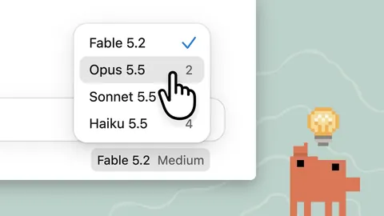

# Fable 5.2 or Opus? When to use each model in Claude Code

**Claude** · 2026-11-11 · 3:28 · relevance 3/5 · [Watch on YouTube](https://www.youtube.com/watch?v=C33hJGt-ySg)

## Summary

A short official Claude video explaining how to choose between Fable 5.2, Opus 5.5, Sonnet 5.5 and Haiku 5.5 in Claude Code and the Claude API. Using an online shop example, it recommends starting on Opus 5.5 at medium effort, raising effort before switching models, escalating to Fable for ambitious open-ended work, dropping to Sonnet or Haiku for well-scoped or high-volume work, and splitting one job across models via subagents. The takeaway is a tiered model-routing heuristic tied to task scope, judgment needs and cost.

## Key insights

- Opus 5.5 on medium effort is the recommended default starting point for complex coding and knowledge work in Claude Code. If results fall short, raise the effort level before switching models, because it is a smaller step and usually keeps the prompt cache.
  - _Relies on:_ Opus 5.5; medium effort is the default recommendation; raising effort usually preserves prompt cache _(as of 2026-11-11)_
- Fable 5.2 is positioned for ambitious, loosely defined, multi-milestone work where judgment and accuracy matter, and it costs twice Opus per token. Giving it a goal plus explicit non-negotiables (e.g. checkout can't go down, orders can't be lost) lets it plan, execute and test toward done.
  - _Relies on:_ Fable 5.2 is the most capable generally available model for technical fields; Fable is 2x Opus price per token _(as of 2026-11-11)_
- Sonnet 5.5 suits well-scoped tasks where 'done' fits in one sentence, such as a bug with a clear reproduction. It is faster than Opus at half the price per token.
  - _Relies on:_ Sonnet 5.5; half Opus price per token; faster than Opus _(as of 2026-11-11)_
- Haiku 5.5 is the fastest and cheapest model and fits high-volume, cost-sensitive work like summarization, classification and routing. The example is sorting incoming customer messages via the Claude API many times a day.
  - _Relies on:_ Haiku 5.5; fastest and cheapest of the family; used through the Claude API _(as of 2026-11-11)_
- In Claude Code, a lead session on Fable can delegate well-scoped subtasks, such as upgrading each package and fixing its tests, to Sonnet subagents. Each subagent has its own context, does one part of the job and reports back.
  - _Relies on:_ Claude Code subagents; subagent = separate Claude with its own context that reports back _(as of 2026-11-11)_

## Tools, models & APIs mentioned

- **Claude Fable** 5.2 (model)
- **Claude Opus** 5.5 (model)
- **Claude Sonnet** 5.5 (model)
- **Claude Haiku** 5.5 (model)
- **Claude Code** (product)
- **Claude API** (api)

## How this applies to AX / design systems

For AI developer portals, the scope-to-model mapping (default, escalate, de-escalate, split) is a good template for a 'Choosing a model' doc page or an interactive picker that starts from the user's task intent. In agentic UX, the ordering of 'raise effort before changing model' and the subagent pattern suggest UI affordances: an effort control near the model selector, and a delegation view showing the lead agent, subagents and their reports. Stating explicit non-negotiables to Fable is a useful pattern for a constraints field in task-delegation components.

_Relevance 3/5: Useful background on model selection and subagent delegation in coding tools Parag works next to, but it does not directly change AX, design system or portal design._

## Best moments

- [0:31](https://www.youtube.com/watch?v=C33hJGt-ySg&t=31s): Advice to raise effort before switching models, with the prompt-cache rationale
- [1:05](https://www.youtube.com/watch?v=C33hJGt-ySg&t=65s): Fable pricing and the goal-plus-non-negotiables delegation pattern
- [1:36](https://www.youtube.com/watch?v=C33hJGt-ySg&t=96s): Sonnet vs Haiku for scoped and high-volume work, with relative pricing
- [2:17](https://www.youtube.com/watch?v=C33hJGt-ySg&t=137s): Splitting one migration across Fable lead and Sonnet subagents
