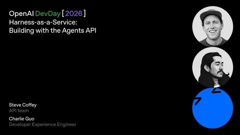

# Harness-as-a-Service: Building with the Agents API | DevDay 2026

**OpenAI** · 2026-11-11 · 19:45 · relevance 4/5 · [Watch on YouTube](https://www.youtube.com/watch?v=b7l_Dhe1h8M)

## Summary

OpenAI DevDay 2026 talk by Charlie (developer experience) and Steve (API team) introducing the Agents API, a managed "harness as a service" built on the Codex harness. They walk through three engineering problems—separating the harness from the execution environment, exposing a useful view of non-deterministic agent work (turns), and preserving state for hours-long sessions across deploys—then demo an airline rebooking dashboard using sessions, skills, subagents and human-approval holds. The takeaway is that developers define tools, data, instructions and environment while OpenAI runs the harness, letting teams focus on product rules and approval UX rather than agent infrastructure.

## Key insights

- Raw tool calls and model responses were not enough for teams to build good agent UIs; OpenAI added turn information to the Agents API so apps can group tool calls and responses by user-agent turn without reconstructing conversation history.
  - _Relies on:_ Agents API exposes turn information for multi-round sessions; Change driven by an internal OpenAI team building on the API _(as of 2026-11-11)_
- The Agents API separates the Codex harness (run by OpenAI in the cloud) from the execution environment, so developers can bring their own sandbox, use an OpenAI-hosted sandbox, or a third-party sandbox provider; computer use (GUI control) was added over the API for OpenAI-hosted environments.
  - _Relies on:_ Agents API built on the Codex harness; Computer use over the API announced at DevDay 2026, OpenAI-hosted environments only; Bring-your-own sandbox and third-party sandbox providers supported _(as of 2026-11-11)_
- A session can be created in under a dozen lines of JavaScript, specifying environment, network access (disabled in the demo) and event streaming for live UI updates; skills, plugins and MCP servers are shared via a 'capability directories' field.
  - _Relies on:_ Session is the fundamental building block of the Agents API; capability directories field accepts skills, plugins and MCP server paths; Session events can be streamed to update UI live _(as of 2026-11-11)_
- Human-in-the-loop was implemented as tool semantics: the flight inventory tool's description marks results as 'advisory' and creates holds, and nothing is locked in until a human approves the proposal in the UI.
  - _Relies on:_ search flight inventory tool creates seat holds requiring human confirmation _(as of 2026-11-11)_
- Multi-agent mode with a configurable max concurrent subagents (set to 2 in the demo) lets the agent delegate parallel checks; higher values increase token usage.
  - _Relies on:_ multi-agent mode setting; max concurrent subagents = 2 in demo; Higher concurrency likely incurs more token usage _(as of 2026-11-11)_
- Asking the agent to return artifacts—a final proposal JSON, an options-comparison JSON, and a Python script that deterministically checks its logic against constraints—makes recommendations auditable and explainable (e.g., why AL314 and AL744 were ruled out).
- For long-running work the harness handles compaction across context windows and durable state so sessions resume after deploys or server failure, including ambiguous cases like a dropped connection during a file edit where replaying could be unsafe.
  - _Relies on:_ Target of three nines of reliability; GPT-6 described as able to work for days; Compaction carries information across context windows _(as of 2026-11-11)_

## Tools, models & APIs mentioned

- **Agents API** (api)
- **Responses API** (api)
- **Assistants API** (api)
- **Agents SDK** (sdk)
- **Codex** (product)
- **ChatGPT work** (product)
- **GPT-6 Astra** (model)
- **GPT 6.1 Sol** (model)
- **GPT-4 Turbo** (model)
- **Model Context Protocol** (protocol)
- **Bedrock managed agents** (product)
- **Notion external agents** (product)

## How this applies to AX / design systems

The rebooking demo is a ready-made AX reference: an Activity tab (timeline of sandbox, tool and subagent steps), a Workspace tab (constraint checks and rejected options), a Files tab (artifacts) and an approve-hold action—each maps to a candidate component in an AI component library (turn-grouped activity log, rationale/ruled-out list, artifact viewer, approval card). Since the API now exposes turn boundaries and streamed session events, a Lit web component could render a turn-grouped agent timeline directly from the event stream; prototype that against the documented event shape. For developer portals, the session/capability directories/multi-agent fields deserve a guided 'anatomy of a session' doc page with a cost callout on subagent concurrency.

_Relevance 4/5: The demo and the 'what do you show people while it's working' section directly inform AX patterns (activity tabs, turn grouping, approval holds, workspace/files views) and how a developer portal would document a session-based agent API, though it is primarily an infrastructure/API talk._

## Best moments

- [7:36](https://www.youtube.com/watch?v=b7l_Dhe1h8M&t=456s): Problem framing: what to show users while a non-deterministic agent works, and why turn info was added.
- [10:43](https://www.youtube.com/watch?v=b7l_Dhe1h8M&t=643s): Dropped-connection file edit example showing why durable state and non-replay matter.
- [12:17](https://www.youtube.com/watch?v=b7l_Dhe1h8M&t=737s): Session creation code: environment, network access, streaming events, skills via capability directories.
- [13:48](https://www.youtube.com/watch?v=b7l_Dhe1h8M&t=828s): Advisory tool + seat holds as human-in-the-loop design, plus subagent concurrency settings.
- [14:50](https://www.youtube.com/watch?v=b7l_Dhe1h8M&t=890s): Demo UI walkthrough: activity, workspace and files tabs and the approval flow.
