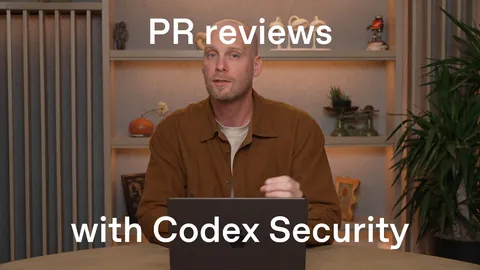

# How to enable PR security reviews with Codex Security

**OpenAI** · 2026-11-11 · 6:31 · relevance 3/5 · [Watch on YouTube](https://www.youtube.com/watch?v=vdBDMj2UhDg)

## Summary

A short OpenAI walkthrough by Dan Shanahan (cyber deployment engineering) showing how to use Codex Security to run security reviews on GitHub pull requests. He checks the ChatGPT Codex connector GitHub app, tags Codex in a PR comment to request a review, hands the cross-site scripting finding to Codex to commit a fix, re-runs the review to verify, then configures automatic personal and repository-level reviews with triggers and severity thresholds. The takeaway is that security review can be a request, fix, re-verify loop inside the PR, and it can be automated for every PR in a repo and steered with AGENTS.md and SECURITY.md instruction files.

## Key insights

- You request a Codex security review on demand by tagging Codex in a new GitHub PR comment, and it posts a summary comment with findings you can work with directly inside the PR.
  - _Relies on:_ Requires the ChatGPT Codex connector GitHub app installed on the repo (checked under Settings > GitHub Apps); Installing it may need the workspace admin and the GitHub repo or org owner _(as of 2026-11-11)_
- The remediation loop is: paste the PR link into Codex, ask it to fix the finding, let it publish a commit to the PR, then tag Codex again to re-review. In the demo the re-review reported no issues.
  - _Relies on:_ Demo finding was a cross-site scripting issue _(as of 2026-11-11)_
- Automatic reviews are set in the Codex app under Settings > Code review. Personal security review preferences can trigger when a PR is opened or on every push, with separate severity thresholds for manual and automatic reviews.
  - _Relies on:_ Trigger options: when PRs are opened, or on every push; Separate alert severity thresholds for manual and automatic reviews _(as of 2026-11-11)_
- Personal settings only cover PRs you open yourself. To scan every contributor's PRs, enable 'review security vulnerabilities' at the repository level and change the review cadence from the personal preference to 'all PRs'.
  - _Relies on:_ Repository review cadence options include following the personal preference or all PRs _(as of 2026-11-11)_
- AGENTS.md and SECURITY.md files in the repo act as instruction sets that help Codex understand the repository's nuances during security reviews.
  - _Relies on:_ AGENTS.md; SECURITY.md _(as of 2026-11-11)_

## Tools, models & APIs mentioned

- **Codex Security** (product)
- **Codex** (product)
- **ChatGPT Codex connector (GitHub app)** (product)
- **GitHub** (product)
- **AGENTS.md** (other)

## How this applies to AX / design systems

The settings model here is a reusable pattern for agent configuration UI: scope (personal or repo), trigger (on open or every push) and severity threshold. A design system could offer it as a governed 'agent policy' component. The review-to-fix-to-re-review loop in PR comments is a good reference for approval and verification states in AX components, such as a finding card with 'fix' and 're-verify' actions. On developer portals it suggests documenting AGENTS.md and SECURITY.md as first-class guidance pages that teach agents about the codebase.

_Relevance 3/5: This is useful background on how a coding agent puts its findings, fixes and configuration into an existing developer surface (PR comments), but it is not directly about AX design, design systems or developer portals._

## Best moments

- [1:31](https://www.youtube.com/watch?v=vdBDMj2UhDg&t=91s): Tagging Codex in a PR comment and getting the review summary back
- [2:02](https://www.youtube.com/watch?v=vdBDMj2UhDg&t=122s): Handing the XSS finding to Codex for a fix and re-verifying it
- [3:36](https://www.youtube.com/watch?v=vdBDMj2UhDg&t=216s): Personal security review settings: triggers and severity thresholds
- [4:06](https://www.youtube.com/watch?v=vdBDMj2UhDg&t=246s): Switching to repository-level reviews for all PRs; AGENTS.md and SECURITY.md
- [5:38](https://www.youtube.com/watch?v=vdBDMj2UhDg&t=338s): The automatic review appearing when a new PR is opened
