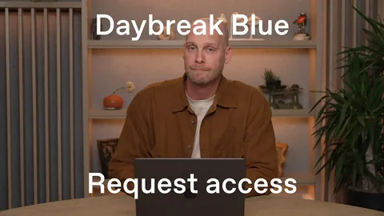

# How to request and enable Daybreak Blue

**OpenAI** · 2026-11-11 · 5:48 · relevance 2/5 · [Watch on YouTube](https://www.youtube.com/watch?v=NS220dAaRMo)

## Summary

An OpenAI admin walkthrough showing how to request, provision and verify access to Daybreak Blue, a program giving cyber defenders frontier model access. The demo covers business verification and the intended-use and terms flow in the admin console's trusted access section, enabling the model workspace-wide or via role-based overrides, confirming access in Codex settings and the model picker, and creating a dedicated API project and key for automation. The main takeaway is that access is gated through layered verification and permissions, and that it can't be enabled on the default API project, so a new project is required.

## Key insights

- Daybreak Blue access starts in the admin console's trusted access section. The steps are third-party business verification with an ID check, then business details, an intended use form and acceptance of Daybreak Blue terms of service. After that, the request moves from in review to approved.
  - _Relies on:_ Daybreak Blue; Admin console > Trusted access section; Third-party ID verification; Intended use form; Daybreak Blue terms of service _(as of 2026-11-11)_
- Enabling Daybreak Blue from the Models section turns it on for every user in the workspace. To restrict it, create a role, add users to it, and enable Daybreak Blue through an edit override on that role.
  - _Relies on:_ Admin console Models section toggle enables for all workspace users; Roles section edit override grants per-role model access _(as of 2026-11-11)_
- Users can confirm access in Codex. A banner in Settings > General shows they are authorized, and a Daybreak toggle appears in the model picker for switching to Daybreak-controlled frontier models.
  - _Relies on:_ Codex settings authorization banner; Daybreak toggle in Codex model picker _(as of 2026-11-11)_
- On platform.openai.com, Daybreak Blue cannot be enabled on the default project. Admins must create a new project, enable Daybreak Blue in its settings, add members, and then create API keys for automation and harnesses.
  - _Relies on:_ platform.openai.com projects; Default project cannot enable Daybreak Blue; API key expiration set to 1 day in demo _(as of 2026-11-11)_

## Tools, models & APIs mentioned

- **Daybreak Blue** (product)
- **Codex** (product)
- **OpenAI Platform** (api)

## How this applies to AX / design systems

The flow is a reference for gated-capability UX in developer portals. It moves from verification, to an in-review state, to approved, then to role-scoped enablement, with an explicit confirmation banner and a model-picker toggle. Parag could borrow the authorization-status banner and the warning that a toggle applies workspace-wide as patterns for an access-request component in the design system. Otherwise its direct relevance is low.

_Relevance 2/5: This is mostly an admin how-to for a security model program, but its gated-access, role-override and access-confirmation patterns are loosely useful for developer portal and AX permission design._

## Best moments

- [0:31](https://www.youtube.com/watch?v=NS220dAaRMo&t=31s): Trusted access section and the business verification flow
- [2:05](https://www.youtube.com/watch?v=NS220dAaRMo&t=125s): Warning that workspace enable applies to all users; switching to role overrides
- [3:05](https://www.youtube.com/watch?v=NS220dAaRMo&t=185s): Codex authorization banner and Daybreak toggle in the model picker
- [3:36](https://www.youtube.com/watch?v=NS220dAaRMo&t=216s): Default API project cannot enable Daybreak Blue, so a new project is needed
