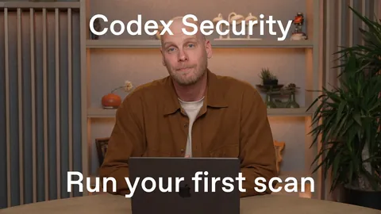

# How to run your first Codex Security scan

**OpenAI** · 2026-11-11 · 6:48 · relevance 3/5 · [Watch on YouTube](https://www.youtube.com/watch?v=hUhr0JiVZZs)

## Summary

An OpenAI cyber deployment engineer walks through Codex Security, a plugin and CLI for AI-driven vulnerability scanning inside Codex. He installs the plugin, configures a scan (repository, Daybreak model, reasoning level, deep scan, additional context focused on an auth service), reviews a finding with summary, attack path and evidence, generates a patch in a new Codex thread and publishes it as a GitHub PR. The takeaway is that the same scan pipeline runs locally in the plugin or via an npm-installed CLI that can be embedded in CI/CD to scale across repositories.

## Key insights

- Codex Security scans can be steered with free-text 'additional context' (e.g., focus on the authentication service) to drive more accurate results, so scoping intent up front is a first-class scan parameter.
  - _Relies on:_ Scan config options: repository, model, reasoning level, deep scan toggle, additional context; Model selected in demo: Daybreak _(as of 2026-11-11)_
- The scan runs in visible stages: prepare scan, understand codebase, build a threat model of attack surfaces, review code for candidate findings, then narrow to a true list of vulnerabilities.
  - _Relies on:_ Stages: preparation, codebase understanding, threat model, candidate findings, validated vulnerabilities _(as of 2026-11-11)_
- Each finding is presented as summary, attack path and evidence, and 'Generate fix' spins up a new Codex thread that passes the vulnerability context into a fix-finding skill.
  - _Relies on:_ Plugin skills include triaging findings and deep scan; Patch generation opens a new Codex thread _(as of 2026-11-11)_
- Fixes are human-reviewed as a diff in Codex and then published directly as a GitHub pull request, preserving the normal code review and merge process as the approval gate.
  - _Relies on:_ Publish to GitHub creates a PR _(as of 2026-11-11)_
- The Codex Security CLI, installed via npm, executes the same scan steps as the plugin and supports triage in the terminal, making it embeddable in CI/CD for multi-repo scanning.
  - _Relies on:_ Codex Security CLI installed with npm install _(as of 2026-11-11)_
- Access requires 'Daybreak Blue' access enabled under Codex general settings before installing the plugin.
  - _Relies on:_ Daybreak Blue access shown in Codex Settings > General _(as of 2026-11-11)_

## Tools, models & APIs mentioned

- **Codex** (product)
- **Codex Security plugin** (product)
- **Codex Security CLI** (sdk)
- **Daybreak** (model)
- **GitHub** (product)
- **npm** (other)

## How this applies to AX / design systems

The scan flow is a clean reference pattern for an agent task-launcher component: target selection, model/effort picker, optional toggles, and a free-text 'focus' field that captures intent. The staged progress (context, threat model, candidates, confirmed) and the finding card (summary, attack path, evidence, patch action) map well to reusable AI component library pieces like a step-progress tracker and an evidence-backed result card. The diff-review-then-publish-PR handoff is a good model for approval UI where an agent's output enters an existing human review process, and the plugin/CLI parity is worth documenting the same way in a developer portal.

_Relevance 3/5: Useful example of an agent workflow UX (scoped intent, staged progress, evidence, human-approved patch to PR) next to his work, but it is a security tool demo rather than design-system or portal guidance._

## Best moments

- [1:35](https://www.youtube.com/watch?v=hUhr0JiVZZs&t=95s): New scan configuration: repo, model, reasoning level, deep scan, additional context
- [2:37](https://www.youtube.com/watch?v=hUhr0JiVZZs&t=157s): Staged scan progress including threat modelling
- [2:56](https://www.youtube.com/watch?v=hUhr0JiVZZs&t=176s): Finding detail UI: summary, attack path, evidence
- [3:07](https://www.youtube.com/watch?v=hUhr0JiVZZs&t=187s): Generate fix in a new Codex thread and review diff
- [4:42](https://www.youtube.com/watch?v=hUhr0JiVZZs&t=282s): Scaling out with the CLI for CI/CD
