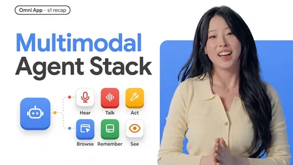

# Multimodal AI agent architecture: Voice, vision, tools & memory

**Google Cloud Tech** · 2026-11-11 · 6:10 · relevance 4/5 · [Watch on YouTube](https://www.youtube.com/watch?v=gg-gXO0tIUY)

## Summary

Season 1 finale of Google Cloud Tech's The Omni App series, recapping how a bidirectional live multimodal agent was built across six layers: voice, ADK, tools, browser control, hybrid memory and real-time vision. The speaker distills the architecture into two design questions: whether an input is a continuous stream or one complete thing, and whether a piece of work blocks the live conversation. The main takeaway is that a useful multimodal agent is a set of boundaries (live path vs background, SQL facts vs semantic vectors, snapshots vs frame streams), and getting those right is what makes it feel like one natural conversation.

## Key insights

- Classify every agent input as continuous (mic, live camera) or complete (screenshot, product photo, typed instruction). Stream what keeps changing and send a single complete item when one is enough. This decision holds whether you use raw Live, ADK or your own wrapper.
  - _Relies on:_ Raw Live API, Google ADK or a custom wrapper change the code path but not the design decision _(as of 2026-11-11)_
- Slow work must never stall a live loop. Acknowledge immediately and move page loads, long tools, memory extraction and generation jobs off the hot path, then bring results back in on the next event such as a snapshot or memory read.
- Split agent memory into exact facts stored as structured data (SQL) and meaning/understanding stored in semantic vector memory. Long memory work runs in the background, off the live path.
  - _Relies on:_ Hybrid memory: SQL for facts, vectors for semantic understanding _(as of 2026-11-11)_
- Live video for agents is not an MP4 but still image frames sent over time. Use a snapshot when the agent needs to look and stream frames when it needs to watch.
- Google ADK separates concerns into three parts: the agent decides behavior, the runner runs it, and the session holds state. You describe the agent and ADK runs the live loop.
  - _Relies on:_ Google ADK: agent / runner / session structure _(as of 2026-11-11)_
- Browser-control agents act by pointing at pixels in a real Chrome window, then use the next screenshot to see what happened. Tools follow the rule that the model decides and your code acts.
  - _Relies on:_ Real Chrome window used for browser control _(as of 2026-11-11)_

## Tools, models & APIs mentioned

- **Google ADK** (framework)
- **Gemini Live (raw live API)** (api)
- **Chrome** (product)

## How this applies to AX / design systems

The 'acknowledge now, finish in the background' rule implies a concrete AI component pattern: an immediate acknowledgement state plus a background-task chip or progress indicator that rehydrates into the conversation when results arrive, so a slow tool never shows up as silence. The stream vs snapshot distinction could drive input components that show clearly when a camera or mic is continuously streaming versus when a single frame was captured, which is a trust and transparency cue for AX. For a developer portal, these two questions would make a good 'design decisions' doc page that frames ADK live agents before any code.

_Relevance 4/5: The blocking vs non-blocking and stream vs snapshot framing maps directly onto AX patterns for live agent feedback, acknowledgement and progress UI, though the video is a short architectural recap without UI specifics._

## Best moments

- [1:01](https://www.youtube.com/watch?v=gg-gXO0tIUY&t=61s): Why an omni app operating inside a workflow differs from a chatbot with voice and vision bolted on
- [2:05](https://www.youtube.com/watch?v=gg-gXO0tIUY&t=125s): Tools rule: a slow tool must not turn into silence
- [2:37](https://www.youtube.com/watch?v=gg-gXO0tIUY&t=157s): Memory split into structured facts and semantic understanding
- [3:10](https://www.youtube.com/watch?v=gg-gXO0tIUY&t=190s): Question 1: continuous streams vs complete inputs
- [4:01](https://www.youtube.com/watch?v=gg-gXO0tIUY&t=241s): Question 2: blocking vs non-blocking work, plus the boundaries summary
