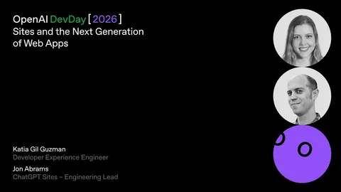

# Sites and the Next Generation of Web Apps | DevDay 2026

**OpenAI** · 2026-11-11 · 20:48 · relevance 5/5 · [Watch on YouTube](https://www.youtube.com/watch?v=QRm7VNMnurA)

## Summary

OpenAI DevDay 2026 talk by Katia (Developer Experience) and John (Sites lead engineer) presenting ChatGPT Sites, a hosting and full-stack app platform built from Codex prompts, plus new features for collaboration and agent interaction. They demo turning a launch-tracking spreadsheet into a site kept fresh by plugins and scheduled tasks, per-viewer personalization via each user's own ChatGPT plugins (Linear), custom annotations embedded in HTML for guided editing, and a public GIF Studio app that exposes WebMCP tools so a user's agent can act on the live UI. The takeaway is that web apps should now be designed for both people and agents, using custom annotations for human editors and WebMCP tools instead of computer-use clicking for agents.

## Key insights

- The ChatGPT in-app browser now supports 'annotation extensibility': developers embed custom annotations in HTML (custom controls, suggested prompts) that tell Codex how a site can be edited, which the speakers call especially useful for design systems and component libraries.
  - _Relies on:_ Feature launched at DevDay 2026; Annotations are embedded directly in the site's HTML; Demo: a status-bar component exposed a size option previewed live, then committed via Codex _(as of 2026-11-11)_
- WebMCP is a new browser standard letting a site expose tools that a user's agent calls in a WebMCP-enabled browser, updating the live app; it is pitched as faster and cheaper than computer-use because the agent queries the backend instead of clicking through UI.
  - _Relies on:_ ChatGPT's in-app browser is WebMCP-enabled; Available site tools are listed in the in-app browser; The Sites plugin automatically implements WebMCP where relevant _(as of 2026-11-11)_
- Because the agent calling WebMCP tools is the user's own agent, it brings the user's data (e.g., Slack DMs, ChatGPT memory) to personalize actions in a third-party app while the user co-edits the result directly in the UI.
  - _Relies on:_ Demo: agent searched Slack DMs to recommend gift items and wrote a personalized message from prior ChatGPT conversations _(as of 2026-11-11)_
- Private sites gate access with Sign-in with ChatGPT, and visitors can now bring their own ChatGPT plugins, so the same site shows each viewer their own data (e.g., their Linear tickets) with read/write, without API keys or custom integrations.
  - _Relies on:_ Sites are private by default; Built-in auth via Sign-in with ChatGPT; Per-viewer plugins launched at DevDay 2026; Demo used Linear connector with read and write access _(as of 2026-11-11)_
- Sites ships with a SQLite database, so scheduled tasks that pull fresh data via plugins update the DB directly and the site refreshes without redeploying; scheduled tasks can now be linked to sites and Codex suggests them.
  - _Relies on:_ Sites includes SQLite; Scheduled tasks for Sites launched at DevDay 2026; Plugins bundle connectors and skills (Drive, Slack, Linear, GitHub) _(as of 2026-11-11)_
- Adoption claims: Sites hosts 8 million sites a couple months after launch and over 70% of OpenAI employees build their own, replacing slide decks and spreadsheets with interactive UIs.
  - _Relies on:_ 8 million Sites hosted; Over 70% of OpenAI employees make Sites _(as of 2026-11-11)_

## Tools, models & APIs mentioned

- **ChatGPT Sites** (product)
- **Codex** (product)
- **WebMCP** (protocol)
- **ChatGPT in-app browser** (product)
- **Sign-in with ChatGPT** (api)
- **ChatGPT plugins** (other)
- **OpenAI Image API** (api)
- **Linear** (product)
- **Slack** (product)
- **Google Drive** (product)
- **SQLite** (other)
- **Astra** (product)

## How this applies to AX / design systems

Prototype custom annotations inside Lit components in the design system (suggested prompts, allowed variant controls like size/status) so agents and non-designer editors can only make on-system changes, effectively governance via markup. Experiment with exposing WebMCP tools from a developer-portal page (e.g., search APIs, generate a snippet, filter endpoints) and document a 'tools for agents' section alongside human docs. For AX, the GIF Studio pattern—agent fills the UI, human prunes and confirms—is a concrete co-editing/approval flow worth codifying as a component pattern.

_Relevance 5/5: WebMCP tool exposure and annotation extensibility for design systems and component libraries directly shape how Parag would design agent-friendly AX and component libraries now._

## Best moments

- [10:43](https://www.youtube.com/watch?v=QRm7VNMnurA&t=643s): Same site shows per-viewer Linear data via each user's connectors
- [12:17](https://www.youtube.com/watch?v=QRm7VNMnurA&t=737s): Annotation extensibility introduced; framed as useful for design systems and component libraries
- [13:20](https://www.youtube.com/watch?v=QRm7VNMnurA&t=800s): Demo of built-in suggested prompt and component-level annotation option
- [15:26](https://www.youtube.com/watch?v=QRm7VNMnurA&t=926s): WebMCP explained vs computer use
- [17:00](https://www.youtube.com/watch?v=QRm7VNMnurA&t=1020s): Agent populates live UI then user co-edits recommendations
