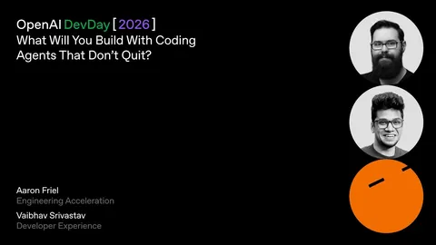

# What Will You Build With Coding Agents That Don’t Quit? | DevDay 2026

**OpenAI** · 2026-11-11 · 27:09 · relevance 4/5 · [Watch on YouTube](https://www.youtube.com/watch?v=U1IVZy9FhVQ)

## Summary

An OpenAI DevDay 2026 talk in which two OpenAI engineers show Codex running long-horizon tasks: multi-day 3D F1 renders and a six-week, 1,000+ hour agent that kept OpenAI's CI healthy. They argue that agents now work best when given a goal, trade-offs, a way to check their work and escalation rules rather than prescriptive plans, and they walk through the Codex features that make this possible (threads, /goal, AGENTS.md, compaction, remote/Cloud environments, plugins, child threads and worktrees, /side, Ultra, heartbeats and scheduled tasks). The takeaway is to pick a recurring task, give it a feedback loop and a budget, and manage the agent like an inbox, at a reported cost of about $16–32 per hour.

## Key insights

- Long-running agents work better with short, outcome-based prompts than with prescriptive plans. The CI agent's starting prompt was only about 200 words and contained the goal, trade-offs, ground rules for messaging colleagues and CI resource use, and no code.
  - _Relies on:_ CI agent starting prompt ~200 words; Last year's ExecPlans prompt was long and included code samples and library choices; Last year ~7 hours of run time was notable _(as of 2026-11-11)_
- Splitting the work into an orchestrator main thread plus sub-agents was a turning point. The main thread triggered tests, collected failures, coordinated and messaged people, while sub-agents did the slow fix-and-retry loops so the agent didn't get stuck on one hard bug.
  - _Relies on:_ Run started on GPT-5.6 Sol in a single thread; Switched to sub-agents about 4 days in; More than 5,800 sub-agent sessions _(as of 2026-11-11)_
- Over six weeks the CI agent opened 100+ PRs per week, pushed 1,000+ commits, sent 600+ Slack messages and merged more than 213 fixes. It deferred to humans' equivalent changes when they already existed.
  - _Relies on:_ Ran 6 weeks, over 1,000 hours; Just under 500,000 tool calls, of which 67,000+ were waits; 213+ merged fixes _(as of 2026-11-11)_
- Supervision patterns: the agent spawned a reviewer agent before proposing risky fixes such as deleting tests, contacted owning researchers to collaborate on a GPU Heisenbug, and reported in its retrospective that its most productive stretch was five days without human messages.
- Ask the agent to keep a running work log of what it has done and what is left to explore (for example via AGENTS.md) so it can resume after interruptions. Built-in compaction lets a single thread run for months without degrading.
  - _Relies on:_ AGENTS.md file; Compaction is built into Codex by default; Threads running ~3 months _(as of 2026-11-11)_
- The cost of the six-week CI agent worked out to about $32 per hour. With GPT-6 Sol this dropped to about $16 per hour, and GPT-6.1 Sol was described as even more token-efficient. The speakers recommend giving the agent an explicit spend or concurrency budget.
  - _Relies on:_ ~$32/hour originally; ~$16/hour with GPT-6 Sol; GPT-6.1 Sol more token-efficient _(as of 2026-11-11)_
- Use child threads (each with its own git worktree) for embarrassingly parallel work, and use Ultra mode, which gives longer reasoning plus internal sub-agents, for a single very hard problem. Use heartbeats (scheduled follow-ups within the same thread, such as checking PR reviews every 30 minutes) to wait on external events.
  - _Relies on:_ /side forks the main thread's context; /goal makes Codex pursue a task until it is done; Scheduled tasks appear in a Scheduled tab in the Codex app _(as of 2026-11-11)_

## Tools, models & APIs mentioned

- **Codex** (product)
- **Codex Cloud** (product)
- **GPT Sol** 5.6 / 6 / 6.1 (model)
- **Astra** (model)
- **AGENTS.md** (other)
- **Blender** (product)
- **GitHub** (product)
- **Linear** (product)
- **Slack** (product)

## How this applies to AX / design systems

The 'director of agents' model, in which a main thread orchestrates child threads and surfaces items needing attention as an inbox in sidebar sections, is a concrete AX pattern worth prototyping as components: a thread tree, a heartbeat/schedule indicator, an escalation and approval card and a budget meter. Explicit ground rules (when to escalate, when to ping on-call, spend caps) suggest a 'delegation brief' form UI for setting the goal, trade-offs, done-criteria and budget before handoff. For developer portals, the shift from prescriptive plans to outcome prompts plus AGENTS.md suggests documenting an AGENTS.md template and work-log conventions as first-class doc pages.

_Relevance 4/5: This is a strong real-world case study of delegation, supervision, escalation and an inbox-style management UI for long-running agents, which maps directly onto AX patterns Parag designs, though it is product-specific to Codex._

## Best moments

- [4:34](https://www.youtube.com/watch?v=U1IVZy9FhVQ&t=274s): Contrast between last year's long prescriptive prompt and today's goal-plus-trade-offs prompting
- [7:37](https://www.youtube.com/watch?v=U1IVZy9FhVQ&t=457s): Switching to an orchestrator with sub-agents and becoming a 'director of agents'
- [8:39](https://www.youtube.com/watch?v=U1IVZy9FhVQ&t=519s): Run statistics and the retrospective finding that the agent was most productive when left alone
- [21:33](https://www.youtube.com/watch?v=U1IVZy9FhVQ&t=1293s): Ultra mode visualization and when to use threads versus Ultra
- [24:09](https://www.youtube.com/watch?v=U1IVZy9FhVQ&t=1449s): Cost breakdown at $32/hour falling to $16/hour
