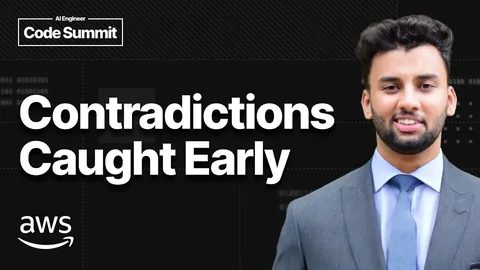

# Your Spec Has Bugs. Catch Them Before Your Agent Codes. - Rajath Mahendrappa Kotyal, AWS

**AI Engineer** · 2026-11-11 · 7:50 · relevance 3/5 · [Watch on YouTube](https://www.youtube.com/watch?v=0EnLxIbAvYk)

## Summary

A short AI Engineer talk from AWS's automated reasoning group introducing a Kiro specification analyzer that checks natural-language specs for conflicts, gaps and ambiguity before a coding agent writes code. The pipeline has an LLM refine wording, translate requirements into SMT-LIB formulas checked by a solver, then sample multiple translations and cluster them by logical equivalence to surface genuine ambiguity, which is escalated to the human as explicit options. The takeaway: the LLM translates, the solver checks, and the human decides, because only the user holds the domain knowledge to be the oracle for spec correctness.

## Key insights

- Run a spec through a three-step check before handing it to a coding agent: LLM rewording, formalization into SMT-LIB formulas, and a satisfiability solver that flags rules that cannot simultaneously hold (e.g. 'place as back order' vs 'no order shall be back order').
  - _Relies on:_ SMT-LIB formulas passed to a SAT/SMT solver returning valid/invalid; Kiro Specification Analyzer, AWS automated reasoning group _(as of 2026-11-11)_
- Detect ambiguity by sampling the LLM's formal translation of a sentence 7–10 times and clustering the results by logical equivalence; multiple clusters indicate the sentence has more than one meaning.
  - _Relies on:_ 7 to 10 sampled translations per requirement; clustering by logical equivalence _(as of 2026-11-11)_
- Classify spec defects into three types: ambiguity within a sentence (e.g. 'remove the record'), conflicts between rules, and gaps where no rule covers a state (e.g. an idle order).
- When ambiguity is found, present the human with concrete alternative interpretations (e.g. delete the record vs retain but hide from users) and abstain or fall back to an LLM judge if no answer is given.
- The speaker cites research claiming unclear prompts cause a 20–40% drop in code accuracy, that 60–90% of 'valid' code is still wrong, and roughly 2x more regressions on deploy.
  - _Relies on:_ 20–40% accuracy drop with unclear prompts; 60–90% of valid code still wrong; 2x more regressions _(as of 2026-11-11)_
- Formal verification cannot be the oracle for spec correctness; the user must remain the final authority because of implicit domain knowledge, and evidence for formalization in agents is still thin.

## Tools, models & APIs mentioned

- **Kiro** (product)
- **Kiro Specification Analyzer** (product)
- **SMT-LIB** (other)
- **SAT/SMT solver** (other)

## How this applies to AX / design systems

The 'interpretation picker' pattern — showing the user two concrete readings of an ambiguous requirement and asking which they mean — is a reusable AX component for agent clarification UI; consider a design-system 'ClarifyChoice' or disambiguation card with keep/abstain options. The conflict/gap/ambiguity taxonomy could drive inline lint-style annotations in a spec editor or developer portal docs authoring flow. It's also a good argument for designing pre-execution review checkpoints where agents surface uncertainty before acting.

_Relevance 3/5: Mainly about coding-agent spec verification, but the human-in-the-loop ambiguity-resolution pattern (presenting interpretations as choices) is a useful AX reference._

## Best moments

- [0:30](https://www.youtube.com/watch?v=0EnLxIbAvYk&t=30s): Concrete back-order conflict example that motivates the tool
- [2:34](https://www.youtube.com/watch?v=0EnLxIbAvYk&t=154s): Three-step refine/formalize/solve pipeline explained
- [4:08](https://www.youtube.com/watch?v=0EnLxIbAvYk&t=248s): Sampling 7–10 translations and clustering by logical equivalence
- [5:09](https://www.youtube.com/watch?v=0EnLxIbAvYk&t=309s): Human disambiguation prompt with two options, plus conflict vs gap definitions
- [7:17](https://www.youtube.com/watch?v=0EnLxIbAvYk&t=437s): Summary: LLM translates, solver checks, human decides
