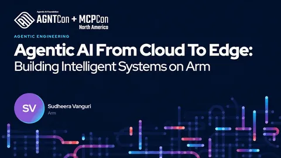

# Agentic AI from Cloud to Edge: Building Intelligent Systems on Arm - Sudheera Vanguri, Arm

**Agentic AI Foundation** · 2026-11-12 · 21:11 · relevance 2/5 · [Watch on YouTube](https://www.youtube.com/watch?v=dECG1NNfK80)

## Summary

A conference talk from Arm's cloud AI software lead on how agentic AI workloads change data-center infrastructure, especially the role of CPUs. She maps five agentic use-case archetypes (software engineering, enterprise automation, scientific research, personal assistants, robotics), argues that tool execution, sandboxing, orchestration and state management run largely on CPUs, and proposes an end-to-end agentic benchmarking framework developed with partners including OpenAI, Meta and Fujitsu. The main takeaway is that system-level efficiency across CPU and accelerator racks, not model or per-core speed, should define agentic infrastructure, and that this needs industry standardization.

## Key insights

- The speaker claims AI-generated tokens already outnumber human-generated tokens by about 7x. She frames agents as 'virtual users' that load systems 24/7, alongside human users.
  - _Relies on:_ AI-generated vs human-generated tokens ratio cited as 7X _(as of 2026-11-12)_
- Agentic use cases fall into five archetypes: software engineering, enterprise automation, scientific/financial research, personal assistants and robotics. Personal assistants and robotics are hybrid edge-cloud deployments, while the first three are mostly cloud.
  - _Relies on:_ Examples cited: Claude Code, Codex, GitHub Copilot, ServiceNow agents, Sierra Agent Studio, Muse, Dots, Claude Duet, Figure _(as of 2026-11-12)_
- An agent is defined as an LLM in a harness with four design patterns: tool use, reasoning/planning, multi-agent orchestration and state/memory across sessions. Moving from stateless chat calls to stateful agents shifts bottlenecks to context management, orchestration and the tool-execution fabric (sandboxes, containers, tool latency).
- Tooling and orchestration run primarily on CPUs, while reasoning and planning are split between CPU and accelerator. Infrastructure therefore needs dense CPUs that run many concurrent agents in isolated micro-VMs without noisy-neighbor issues, plus head-node CPUs that keep accelerators fully utilized.
- Arm proposes benchmarking agentic infrastructure end to end rather than per CPU core, using industry benchmarks as proxies for each use case. Terminal-Bench and SWE-bench are cited as proxies for software engineering.
  - _Relies on:_ Terminal-Bench and SWE-bench named as software-engineering proxies; Framework developed with Fujitsu, Meta and OpenAI; industry work group being formed _(as of 2026-11-12)_
- Using this framework, Arm reported roughly 2x performance per rack for its AGI CPU versus its closest competitor across tooling, orchestration, reasoning and planning workloads. The result was announced at the Open Compute Project conference, with an accompanying white paper.
  - _Relies on:_ Arm AGI CPU; ~2x performance per rack vs closest competitor (transcribed as 'VC2X'); Announced at Open Compute Project conference _(as of 2026-11-12)_

## Tools, models & APIs mentioned

- **Arm AGI CPU** (product)
- **Claude Code** (product)
- **Codex** (product)
- **GitHub Copilot** (product)
- **Muse** (product)
- **Claude Duet** (product)
- **Terminal-Bench** (other)
- **SWE-bench** (other)
- **Sierra Agent Studio** (product)
- **Arm Device Connect** (product)

## How this applies to AX / design systems

This talk barely applies to Parag's work. The one usable idea is the four-pattern agent definition (tools, planning, orchestration, memory) and the 'life of a token' flow (retrieve, plan, execute tools, verify), which could serve as a checklist for which states an agent run-timeline or tool-call component must represent. The description mentions Device Connect for physical-device discovery, which could matter for capability-discovery UX, but the transcript never covers it.

_Relevance 2/5: This is a hardware and infrastructure benchmarking talk with only indirect bearing on agentic UX, design systems or developer portals, and the advertised Device Connect edge content is not covered in the transcript._

## Best moments

- [2:07](https://www.youtube.com/watch?v=dECG1NNfK80&t=127s): The 7x AI-vs-human token stat and the framing of agents as virtual users
- [7:20](https://www.youtube.com/watch?v=dECG1NNfK80&t=440s): Four agentic design patterns and why the stateful shift moves bottlenecks
- [12:32](https://www.youtube.com/watch?v=dECG1NNfK80&t=752s): Life of a token walkthrough for a coding agent building a website
- [17:42](https://www.youtube.com/watch?v=dECG1NNfK80&t=1062s): Benchmark framework and the ~2x performance-per-rack result
