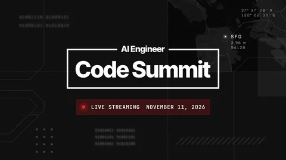

# AIE CODE: Google DeepMind, Anthropic, SpaceXSI, TypeSafe, Lovable, Ramp, etc (System One theme)

**AI Engineer** · 2026-11-12 · 8:58:20 · relevance 4/5 · [Watch on YouTube](https://www.youtube.com/watch?v=ZZ19zhYnDKY)

## Summary

This is the nearly nine-hour Day 1 livestream of AI Engineer Code Summit 2026 in San Francisco, with keynotes and breakout talks from Gimlet Labs, Anthropic, Cloudflare, SpaceX SI, Harvey, Meta, Google DeepMind, Databricks, Factory, Duolingo, Glean, Workday, Lovable, Ramp, Steve Yegge, Simon Willison and others. The recurring argument is that coding agents now write most code, so the hard problems have moved to verification, harnesses, graduated autonomy and fast 'system one' decision models (Jev, Clef, Gemini Decisions) that take bounded classification work off LLMs. The main takeaway is to earn autonomy step by step: use deterministic checks, evidence-based gates and human approval queues, and use cheap, millisecond decision models for routing, judging and intent detection.

## Key insights

- Latency thresholds should drive agent UX. Around 100 ms feels instant, 1 s keeps the user's train of thought, and at about 10 s people switch tasks, yet the median coding-agent turn is 63 s. If inference gets 10x faster, tool calls become the main bottleneck.
  - _Relies on:_ Median coding agent turn 63 seconds (data from June); Sample turn: 80% inference, 18% tool calls; with 10x faster inference, tool calls rise to 67%; Natalie Serino, Gimlet Labs _(as of 2026-11-12)_
- Meta's AI on-call teammate earns autonomy on a ladder. L1 investigates only, L2 drafts fixes that need human approval, and L3 handles low-criticality work on its own. An action is promoted only when mistakes are cheap, caught by tests, CI or review, and the agent has a track record on that exact action. The human surface is a daily digest (for example '23 came in, 3 need you, 18 handled') with one-tap approvals and thread follow-ups.
  - _Relies on:_ Three autonomy levels; high-criticality work stays with humans; Digest posted at 9:00 every morning, plus shift handoffs; About three quarters of new code at Meta is written with AI _(as of 2026-11-12)_
- Workday prototyped intent-driven search. As the user types, a decision model predicts intent and renders a task card (time off, payslip, book meeting, find person) instead of only autocompleting the question. A domain team then fills in each card progressively, and an eval checks that a new card does not collide with existing ones before it is merged.
  - _Relies on:_ Jev decision model; About $20 per million judgments; 96% accuracy across 7 cards plus a chat fallback; Prototype only, not in production _(as of 2026-11-12)_
- Factory's work streams map pipeline stages to autonomy levels. L1 pauses for human review at the spec, the PR and the merge; L4 auto-merges. The owner raises the level based on a measured 'regret-free merge rate' (merges that never need a revert or follow-up fix), compared side by side with human-written PRs.
  - _Relies on:_ Factory Droid wrote 99% of about 800 PRs in one October week; 52% of PRs come from work streams; Programmatic tool calling cut one example from about 1M tokens to about 60k _(as of 2026-11-12)_
- Turn every agent correction into a deterministic lint, type or architecture rule rather than another line in agents.md. SpaceX SI banned useEffect in product code, banned 99% of code comments, and made lint errors tell agents to fix the root cause. Review then shifts to verification artifacts such as videos, screenshots and state charts.
  - _Relies on:_ Grok/Graph Bot team shipped about 11,000 PRs in one month; Revert rate steady at about 0.5%; Uses Chrome DevTools Protocol, TLA+, Lean and the Bombadil property-based UI testing library _(as of 2026-11-12)_
- Replacing a general LLM judge with a few typed yes/no questions answered from tool 'receipts' sharply improved agent-output checking. ZoomInfo's LLM judge was right only 65% of the time and accepted fabricated success reports; a decision model with 7 questions caught 623 versus 294 failed-tool steps, while running 10x faster and 40x cheaper.
  - _Relies on:_ Evaluated on 500 labelled production steps; 37,000 decisions in shadow mode; Accept if probability ≥30%, redo or stop if ≤5%, otherwise escalate to an LLM judge _(as of 2026-11-12)_
- Google DeepMind found a bash-only harness scores about the same as richer tool sets but is roughly 2x cheaper per task, because stronger models chain more commands per call. The speaker argues token efficiency should be reported alongside accuracy, and that MCP code mode with structured outputs is a likely next step.
  - _Relies on:_ Gemini 4 Carbon chained 2.2–3.7 commands per bash call vs 1.3–1.8 for Gemini 3.5 Flash; Gemini Decisions API (Gemini decision one): 150–250 ms latency, $0.10 per 1M tokens, up to 1,000 questions per request; Eval set of about 350 tasks _(as of 2026-11-12)_

## Tools, models & APIs mentioned

- **Jev** (model)
- **Gemini Carbon** 4 (model)
- **Gemini Decisions API** Gemini decision one (api)
- **Cloudflare Clef** (model)
- **Cloudflare Cleric** (model)
- **Cloudflare Workers AI** (product)
- **Claude Fable** 5.2 (model)
- **Claude Opus** 5.5 (model)
- **GPT** 5.6 (model)
- **Claude Code** (product)
- **Cursor** (product)
- **Factory Droid** (product)
- **Ramp Inspect** (product)
- **Lovable** (product)
- **Model Context Protocol** (protocol)
- **Temporal** (framework)
- **Neon** (product)
- **Beads** (other)
- **Bombadil** (framework)
- **TLA+** (other)

## How this applies to AX / design systems

For AX, the Meta autonomy ladder and Factory L1–L4 levels map directly to an approval-UI component set: a level badge, a decision-queue card with a one-tap 'run this' action, and a digest summary that separates 'needs you', 'handled' and 'in progress'. Workday's intent cards are a concrete intent-driven design pattern worth prototyping, with an eval that checks a new card does not collide with existing ones before it ships. For the design system, adopt the SpaceX SI lesson of encoding governance as lint rules with helpful error messages (for example, banning raw tokens or disallowed component APIs) rather than relying on docs. Natalie Serino's 100 ms / 1 s / 10 s latency thresholds are a useful basis for streaming and progress-indicator guidance in the AI component library.

_Relevance 4/5: Several talks give concrete AX patterns Parag could try: autonomy ladders, approval digests and intent-driven UI cards rendered while the user types, plus design-governance lessons on lint-enforced constraints, though much of the day is backend and infra._

## Best moments

- [16:37](https://www.youtube.com/watch?v=ZZ19zhYnDKY&t=997s): Latency thresholds and the 63-second median coding-agent turn
- [1:06:50](https://www.youtube.com/watch?v=ZZ19zhYnDKY&t=4010s): Turning agent corrections into lint rules; useEffect ban as constraint-based governance
- [2:03:49](https://www.youtube.com/watch?v=ZZ19zhYnDKY&t=7429s): Meta autonomy ladder: shadow, pair, then autonomous for low criticality
- [2:06:57](https://www.youtube.com/watch?v=ZZ19zhYnDKY&t=7617s): Daily digest UI with one-tap approvals and conversational drill-down
- [6:29:54](https://www.youtube.com/watch?v=ZZ19zhYnDKY&t=23394s): Workday demo predicting what you want to do and rendering task cards while you type
