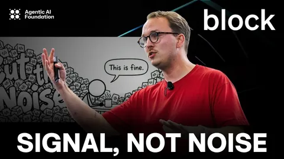

# Cut The Noise: Building a Code Reviewer You Can Trust - Joah Gerstenberg, Block, Inc

**Agentic AI Foundation** · 2026-11-12 · 21:46 · relevance 4/5 · [Watch on YouTube](https://www.youtube.com/watch?v=f6OVURAlYXI)

## Summary

A conference talk by Joah Gerstenberg, a tech lead at Block, on rebuilding the company's AI code reviewer so developers actually trust and act on its findings. He argues that verification is now the bottleneck, that reviewers must be measured offline against a labeled corpus of expert reviews, and that precision must come before recall, using parallel specialist reviewers, a coordinator that tries to disprove findings, a judge, and risk-based routing to control cost. The main takeaway is that trust in agentic systems comes from measurement, protecting human attention by posting only high-confidence findings, and aligning agents with business context before code is written.

## Key insights

- An AI reviewer earns trust by posting fewer findings that are correct (precision) before it tries to catch every issue (recall). At Block, the address rate kept rising even after the team stopped changing the reviewer, because people saw that its findings were accurate.
  - _Relies on:_ Block's AI code reviewer was built in early 2025; Prioritizing precision over recall was also reported by OpenAI (alignment blog), DoorDash and Figma; Figma required the reviewer to be right at least 70% of the time before it could post _(as of 2026-11-12)_
- Use past expert human reviews as a measuring stick for whether the reviewer has enough context, not as examples to imitate. Training the reviewer to copy human comments made it noisy, and Block shut it down for a week to rebuild it.
  - _Relies on:_ Golden corpus of hundreds of expert code reviews; An April bug fix exposed the learned behavior, producing 'the worst comment'; The reviewer was offline for one week during the rebuild _(as of 2026-11-12)_
- Offline, measure precision and recall against a labeled corpus. Online, track the address rate (share of posted findings developers act on) and the post-merge fix rate as proxies.
  - _Relies on:_ Precision example: 7 valid out of 10 posted = 70%; Recall example: 7 found out of 14 known = 50% _(as of 2026-11-12)_
- Even top commercial reviewers miss most issues, and different reviewers catch different ones. That makes stacking several diverse reviewers, with different prompts and models, a viable way to raise recall.
  - _Relies on:_ Review Bench, a benchmark from GitHub engineers; GitHub Copilot reviewer topped the leaderboard at launch with 87.8% and 26% recall; Overlap between Block's findings and other reviewers' was about one in five _(as of 2026-11-12)_
- Architecture: specialist reviewers report findings with confidence scores to a coordinator agent. The coordinator uses company-wide context tools to disprove findings (for example, the feature flag is off), and a judge agent then re-checks the dropped findings so that only fully vetted ones reach humans.
  - _Relies on:_ Open sourced at block/review on GitHub; Uses 6 review agents; Going from 1 to 6 reviewers raised high-severity recall from 32% to 50% _(as of 2026-11-12)_
- Risk-based routing keeps cost down by sending risky diffs to an expensive deep review and low-risk diffs to a cheap one. This also lets autonomous agents merge low-risk changes quickly.
  - _Relies on:_ Meta published a paper on a fine-tuned risk model for diffs; Block routes on privacy/security sensitivity, money movement and SOX compliance _(as of 2026-11-12)_
- The cheapest review happens before the work is done, so bring product, design and engineering conversations into a shared space agents can read. Block's open source projects Buzz and Co-Plan aim to do this.
  - _Relies on:_ Buzz and Co-Plan are Block's open source projects _(as of 2026-11-12)_

## Tools, models & APIs mentioned

- **GPT-5** (model)
- **Claude Opus** 4.5 (model)
- **Review Bench** (other)
- **GitHub Copilot code review** (product)
- **block/review** (framework)
- **Buzz** (product)
- **Co-Plan** (product)

## How this applies to AX / design systems

Precision before recall is a direct AX principle: agent notification, finding and approval components should only surface high-confidence items, and silently dropped items should stay auditable (a 'judge reviewed X dropped findings' disclosure). Address rate is a trust metric worth adding to the AI component library: instrument accept, dismiss and act actions on agent suggestion cards and tool-call approval UI. The reviewer, coordinator and judge chain suggests a provenance or citation pattern that shows why a finding survived, for example 'checked against the feature flag config'. For developer portals, risk-tier badges that decide how much human review a change gets are a concrete pattern to prototype.

_Relevance 4/5: The precision-over-recall principle, the multi-agent filtering chain, and the address-rate trust metric map directly onto how Parag designs agent supervision, trust and approval UI, though the talk is about code review rather than design systems._

## Best moments

- [5:30](https://www.youtube.com/watch?v=f6OVURAlYXI&t=330s): Why human review comments are a measuring stick, not training targets
- [6:06](https://www.youtube.com/watch?v=f6OVURAlYXI&t=366s): The 'worst comment' incident and the one-week shutdown
- [8:16](https://www.youtube.com/watch?v=f6OVURAlYXI&t=496s): Clear definitions of precision, recall, address rate and post-merge fix rate
- [12:53](https://www.youtube.com/watch?v=f6OVURAlYXI&t=773s): Reviewer → coordinator → judge architecture walkthrough
- [15:28](https://www.youtube.com/watch?v=f6OVURAlYXI&t=928s): Cost problem and risk-based routing (Meta paper, Block's criteria)
