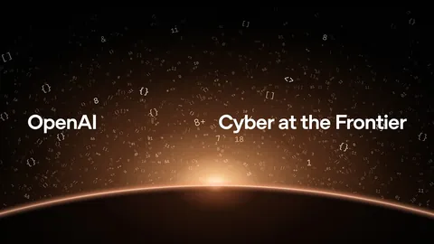

# Cyber at the Frontier: Introducing Daybreak Red Team & Daybreak Defense Factory

**OpenAI** · 2026-11-12 · 34:38 · relevance 4/5 · [Watch on YouTube](https://www.youtube.com/watch?v=YmxpxJZvm4M)

## Summary

OpenAI's Cyber at the Frontier keynote introduces Daybreak, a unified Codex plugin with two products: Daybreak Red Team (early access) and Daybreak Defense Factory (generally available), alongside the GPT-6 Cyber model. Speakers present benchmark and alignment results (ExploitGym, Patch Bench, a honeypot scope eval), real-world campaigns on Firefox, PHP and Linux, and live UI demos of campaign setup, exploit-chain explanation, finding deduplication, owner assignment and background or foreground fixing in Codex. The main takeaway is that defense must become a continuous agentic loop where agents find, validate, patch and re-verify vulnerabilities inside scoped, isolated environments, with humans reviewing evidence-backed PRs.

## Key insights

- Red Team campaign setup is conversational. Codex drafts a campaign spec from connected context (target, uploaded source, duration, max requests per second, credentials, allowed protocols), and the user can iterate on it with the agent before launching.
  - _Relies on:_ Daybreak Red Team is in early access; Campaign spec fields: objective/target, source code, duration, max requests per second, credentials, allowed traffic (HTTP, WebSocket); Context can come from connected tools such as Slack _(as of 2026-11-12)_
- The live campaign screen splits findings on the left from the endpoints the agent fleet is exploring on the right, so users can tweak scope or permissions mid-run. Each finding is explained in three parts: a summary, the architecture/source that caused it, and a step-by-step exploit chain, followed by a minimal patch recommendation handed back to Codex.
  - _Relies on:_ Demo finding: stored SQL injection giving cross-tenant document access via saved search and export job _(as of 2026-11-12)_
- Red Team runs a multi-agent architecture. Agents with specific roles coordinate through a shared task queue and knowledge base, and a supervisor agent monitors the fleet and knowledge base for deviation from the intended goal. OpenAI calls this layered approach 'safety in depth'.
  - _Relies on:_ Shared task queue plus knowledge base; A supervisor agent sits on top of the fleet _(as of 2026-11-12)_
- Defense Factory imports findings from third-party scanners and other tools, collapses duplicates into one 'master finding', assigns a likely code owner from signals in other tools, and validates fixes by running code in reproducible cloud dev environments. Users choose between 'generate fixes' in the background or 'continue fix' to open Codex in the foreground and steer the fix themselves.
  - _Relies on:_ Integrations named: Wiz, Snyk, Daybreak Red Team; Daybreak Defense Factory is available to everyone at launch; Repository settings expose three toggles: secure code review, continuous monitoring on commits, deeper daily scan _(as of 2026-11-12)_
- OpenAI reports cyber benchmark results for GPT-6 Cyber and an unreleased successor, plus a honeypot eval that measures whether the model stays within its authorized scope.
  - _Relies on:_ GPT-6 Cyber scores 52% on ExploitGym vs about 38% for Anthropic's Mythos 5.2; The upcoming cyber model scores nearly double Mythos 5.2 on the same tasks; The upcoming model reaches about 80% on Patch Bench; GPT-6 Cyber stayed in scope 99.9% of evaluated cases without safeguards and 100% with production safeguards _(as of 2026-11-12)_
- Newer models find fresh vulnerabilities in code that older models already scanned, and they chain several low-severity bugs into high-severity exploits, so issues need re-prioritizing every time the model improves.
  - _Relies on:_ Firefox campaign: 81 new high-severity vulnerabilities found, 30 known issues re-prioritized to high; Linux pipeline: nearly 1,000 local privilege escalations validated and patched with GPT-6 Cyber, over 5x the GPT-5.6 Cyber run; GPT-6 Cyber found 10 novel Linux exploitation techniques; The PHP vulnerability had existed for 13 years _(as of 2026-11-12)_
- Customer results presented on stage show agents taking on large shares of security operations work.
  - _Relies on:_ Intuit Night Falcon: 87% of closed findings were confirmed vulnerabilities; Sophos: 52% of managed detection and response cases solved end-to-end by agents, response time cut from 38 minutes to 89 seconds; An Agentic SOC customer tests detection changes against 7 months of telemetry in under an hour, saving 600 analyst hours per quarter _(as of 2026-11-12)_

## Tools, models & APIs mentioned

- **Daybreak Red Team** early access (product)
- **Daybreak Defense Factory** (product)
- **Codex** (product)
- **GPT-6 Cyber** (model)
- **GPT-5.6 Cyber** (model)
- **Mythos** 5.2 (model)
- **Codex Security Cloud** (product)
- **Wiz** (product)
- **Snyk** (product)
- **Amazon Bedrock** (product)
- **Gemini Enterprise Agent platform** (product)
- **ExploitGym** (other)
- **Patch Bench** (other)

## How this applies to AX / design systems

The Red Team flow is a strong reference for AX: a chat-drafted, editable 'campaign spec' card listing scope, rate limits and credentials before the user hands off control, then a split monitoring view of findings next to agent activity. Parag could prototype reusable components for an AI library from it: a scope/permission confirmation card, an agent-fleet progress panel, and a finding detail view structured as summary, architecture and exploit-chain steps. Defense Factory's choice between 'generate fixes' in the background and 'continue fix' in the foreground is a clean pattern to document in design-system guidance on delegation versus co-steering. Evidence-backed PRs, where a patch arrives with a test proving it works, are worth noting as a trust pattern for developer portals.

_Relevance 4/5: The demos show concrete agentic UX patterns that map directly onto Parag's AX and AI component work: delegating a scoped campaign through chat, monitoring an agent fleet, explainable exploit chains, and background versus foreground fix handoff._

## Best moments

- [18:28](https://www.youtube.com/watch?v=YmxpxJZvm4M&t=1108s): Red Team demo: chat-drafted campaign spec with scope, rate limits and credentials
- [19:59](https://www.youtube.com/watch?v=YmxpxJZvm4M&t=1199s): Fleet architecture: shared task queue, knowledge base and supervisor agent
- [21:00](https://www.youtube.com/watch?v=YmxpxJZvm4M&t=1260s): Finding detail UI with architecture view and step-by-step exploit chain
- [26:11](https://www.youtube.com/watch?v=YmxpxJZvm4M&t=1571s): Defense Factory views: deduplication, owner assignment, background vs foreground fix
- [28:46](https://www.youtube.com/watch?v=YmxpxJZvm4M&t=1726s): Three-toggle setup for continuous defense
