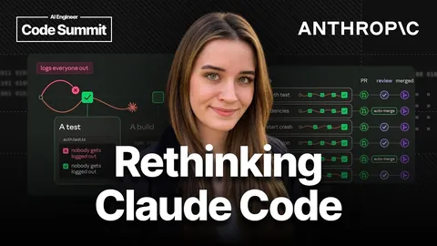

# Rethinking Claude Code Best Practices — Lydia Hallie, Anthropic

**AI Engineer** · 2026-11-12 · 17:32 · relevance 4/5 · [Watch on YouTube](https://www.youtube.com/watch?v=vlfCjWuv4es)

## Summary

A recorded AI Engineer talk by Lydia Hallie (Anthropic, Claude Code team) on how Claude Code best practices change with the Opus 5.5 and Fable 5.2 models. She walks an old-style, human-in-the-loop session forward: upgrade the model, switch to auto mode, trim CLAUDE.md, enforce safety with deny rules, sandboxing and cloud sessions, add verification via hooks and CI, then hand session orchestration to a main orchestrator session. The takeaway is that the old practices still exist but have moved: the model steers, the harness approves and enforces, the environment restricts, and humans mainly start the first session and review risk-weighted output.

## Key insights

- With current models, emphatic instructions like 'IMPORTANT' or 'never do this!' in CLAUDE.md can push the model off track, causing more tool calls and worse results. CLAUDE.md should hold only what Claude cannot see from the code, such as a legacy service that is never directly referenced.
  - _Relies on:_ Opus 5.5; CLAUDE.md; doctor prompt audit command checks CLAUDE.md and skills against the current model _(as of 2026-11-12)_
- Auto mode sends most non-read/edit commands to a separate classifier. You configure what it trusts (repos, buckets, domains, always-allow and never-do lists) in plain English in settings, and that text is what the classifier receives.
  - _Relies on:_ auto mode became the default permission mode in August; by default auto mode trusts only the current folder/repo _(as of 2026-11-12)_
- In Anthropic's study, only about 14% of people caught a clearly dangerous command, while auto mode blocked 89%. Roughly 1 in 10 still got through, so anything that must never happen needs a deny rule, which is checked before the classifier ever sees the call.
  - _Relies on:_ ~14% human catch rate; auto mode blocked 89%; study published in August; deny rules evaluated before auto mode classifier _(as of 2026-11-12)_
- Her rule for what to enforce: if Claude gets it wrong once, can you take it back? Wrong code is reversible and can be left to the model. Lost uncommitted changes or a leaked secret are not, so those need rules. Because permissions cannot limit what a running script reaches, OS-level sandboxing or isolated cloud sessions are needed to stop side effects such as a dependency in npm test reading .env or SSH keys.
  - _Relies on:_ sandbox restricts file reads/writes and hosts, including child processes; sandbox does not cover Claude's own files, MCP servers, or hooks; cloud sessions limit network to package registries and GitHub by default; network secrets are not sent to the model _(as of 2026-11-12)_
- Verification checkpoints that return pass/fail (tests, builds, screenshots) are much shorter to review than a full diff, and hooks guarantee they run. Hook scripts must exit with code 2 to send Claude back to fix the problem; with exit code 1 the task is marked complete anyway.
  - _Relies on:_ hooks on file edit, task completion, session end; exit code 2 sends Claude back; exit code 1 does not _(as of 2026-11-12)_
- Anthropic reviews PRs by risk tier. Every PR first gets a fresh-context Claude review plus a separate group of agents that double-check each bug found. Docs and copy changes need no human, ordinary product changes need one reviewer, and risky changes may need two. CI auto-fix and merge-when-ready further reduce human involvement.
  - _Relies on:_ Anthropic went from ~2,500 changes/day in May to 30,000+/day in September; CI auto-fix; GitHub merge when ready _(as of 2026-11-12)_
- Claude Code projects (beta) runs one orchestrator session that splits work into thread sessions, verifies what comes back and manages context automatically. She recommends a judging model (Fable 5.2) for the orchestrator and a doing model (Opus 5.5) for the threads, configured separately.
  - _Relies on:_ Claude Code projects in beta; Fable 5.2 for orchestrator; Opus 5.5 for threads; no manual compaction/clear needed _(as of 2026-11-12)_

## Tools, models & APIs mentioned

- **Claude Code** (product)
- **Claude Opus** 5.5 (model)
- **Claude Opus** 4.5 (model)
- **Fable** 5.2 (model)
- **Claude Code auto mode** (product)
- **Claude Code hooks** (other)
- **Claude Code projects** beta (product)
- **doctor prompt audit** (other)
- **CLAUDE.md** (other)
- **GitHub** (product)
- **MCP** (protocol)

## How this applies to AX / design systems

The talk's progression (the model steers, the harness approves, the environment restricts, CI verifies) works as a ready-made information architecture for an AX supervision model. It maps onto components such as a risk-tiered approval card, a pass/fail verification checkpoint list, and an orchestrator view with thread status. The reversibility test ('can I take it back?') is a good heuristic for deciding which agent actions get a blocking approval UI and which get passive review. Two developer-portal ideas follow: a plain-English policy editor for classifier settings, and a docs page explaining deny rules versus sandbox versus cloud environment with a layered diagram. Her advice on trimming CLAUDE.md also applies to agent instruction files kept alongside a design system or Lit component library: document only what the code cannot reveal.

_Relevance 4/5: It is a concrete account of how humans shift from approving every step to managing dozens of agents through risk-tiered oversight, verification checkpoints and an orchestrator, which bears directly on AX supervision and trust design, though it is framed around a coding tool._

## Best moments

- [1:03](https://www.youtube.com/watch?v=vlfCjWuv4es&t=63s): The shift from human-in-the-loop to managing dozens of sessions, with the change-volume stats
- [3:04](https://www.youtube.com/watch?v=vlfCjWuv4es&t=184s): Why emphatic CLAUDE.md instructions now hurt, and what the file should contain instead
- [5:42](https://www.youtube.com/watch?v=vlfCjWuv4es&t=342s): Human vs auto mode catch rates, and why deny rules still matter
- [10:54](https://www.youtube.com/watch?v=vlfCjWuv4es&t=654s): Verification checkpoints as a reviewable alternative to reading whole diffs
- [14:30](https://www.youtube.com/watch?v=vlfCjWuv4es&t=870s): Risk-tiered human review and the orchestrator/thread model split
