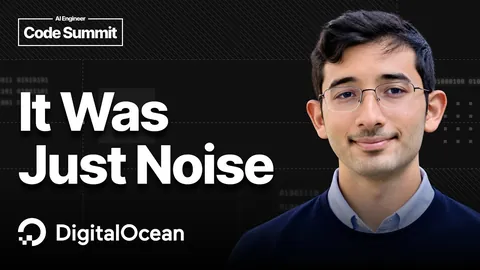

# Stop Shipping LLM Settings That Only Win on Paper - Rohan Pandey & Balaji Varadarajan, DigitalOcean

**AI Engineer** · 2026-11-12 · 5:33 · relevance 2/5 · [Watch on YouTube](https://www.youtube.com/watch?v=cWrYEBlWpcY)

## Summary

A short DigitalOcean demo of an optimization agent that searches for the best vLLM serving configuration for a given model on a GPU droplet. The tool (tuner.py) uses Optuna with Bayesian optimization to run trials against four workload regimes (chat short, chat long, RAG, batch classify), scoring each config on goodput tokens and producing an HTML report plus an optimized YAML recipe. Reported results are a 17.5% goodput improvement for GPT-OSS 120B over 50 trials and roughly doubled throughput with about half the ITL for a DeepSeek R1 Distill model over 9 trials, though the talk itself doesn't cover the noise-validation claims made in the description.

## Key insights

- The agent automates vLLM config search with Optuna running Bayesian optimization. Each trial takes a recipe, benchmarks it, scores it, and has Optuna propose the next recipe, which shrinks the search space compared with manual tuning.
  - _Relies on:_ Optuna as the search tool; Bayesian optimization strategy; vLLM serving recipe _(as of 2026-11-12)_
- Configs are benchmarked against four workload regimes, each with its own input/output token lengths, so the score reflects a mix of traffic shapes rather than a single headline setting.
  - _Relies on:_ Regimes: chat short, chat long, rag, batch classify _(as of 2026-11-12)_
- Runs are launched with tuner.py, which takes a study name, a starting YAML, the hardware, and a trial count. A run takes hours, about 4–5 hours for GPT-OSS 120B.
  - _Relies on:_ tuner.py; example 24 trials; GPT-OSS ~4-5 hours _(as of 2026-11-12)_
- For GPT-OSS 120B, 50 trials gave a 17.5% goodput-token improvement over the default config, with one tuned parameter set to 256.
  - _Relies on:_ GPT-OSS 120B; 50 trials; +17.5% goodput tokens; optimized value 256 _(as of 2026-11-12)_
- For the DeepSeek R1 Distill model, 9 trials (best was trial 9) roughly doubled token throughput and cut inter-token latency by about half.
  - _Relies on:_ DeepSeek R1 Distill; 9 trials; throughput ~2x; ITL ~halved _(as of 2026-11-12)_

## Tools, models & APIs mentioned

- **vLLM** (framework)
- **Optuna** (framework)
- **GPT-OSS** 120B (model)
- **DeepSeek R1 Distill** (model)
- **DigitalOcean Droplets** (product)
- **Kubernetes** (other)
- **AMD MI355** (other)

## How this applies to AX / design systems

This barely applies to Parag's work. The one useful pattern is the output format: a long-running background agent reports back with an HTML report of each trial plus a single artifact (the optimized YAML). That is a reasonable reference for a delegation-and-review summary component in AX, such as a run report showing the best trial and the change from the baseline.

_Relevance 2/5: This is LLM serving and infra tuning work, which sits well outside Parag's design-system and AX focus apart from a minor report-UI angle._

## Best moments

- [1:03](https://www.youtube.com/watch?v=cWrYEBlWpcY&t=63s): Explains how Bayesian optimization and Optuna drive the search loop
- [2:09](https://www.youtube.com/watch?v=cWrYEBlWpcY&t=129s): Walks through the starting recipe and the four workload regimes
- [3:11](https://www.youtube.com/watch?v=cWrYEBlWpcY&t=191s): tuner.py arguments and how long runs take
- [4:01](https://www.youtube.com/watch?v=cWrYEBlWpcY&t=241s): HTML report and the 17.5% goodput result for GPT-OSS
- [4:44](https://www.youtube.com/watch?v=cWrYEBlWpcY&t=284s): DeepSeek R1 Distill result: throughput doubled, ITL halved
