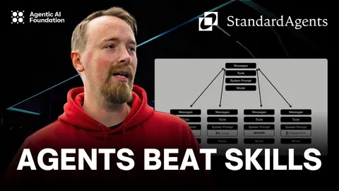

# Why Domain-specific Agents Are the Future - Justin Schroeder, Standard Agents

**Agentic AI Foundation** · 2026-11-12 · 24:39 · relevance 4/5 · [Watch on YouTube](https://www.youtube.com/watch?v=wIPr9GmLRaQ)

## Summary

Conference talk by Justin Schroeder of Standard Agents arguing that today's 'one giant model plus skills/MCP' setup resembles the line-shaft factories of the industrial era, and that work should instead be split into small domain-specific agents. He grounds the case in integration, trust and efficacy, using an HVAC company's fleet-maintenance process and a Gmail agent vs Gmail skill comparison, and shows cheap jagged models excelling at narrow tasks. The takeaway is that domain-specific agents need standards — editable harnesses, portability, pinned models, composability and a shared runtime — plus private per-process evals for governance.

## Key insights

- Businesses adopt agents for three reasons: deep integration into existing business processes, trust (not wanting one all-powerful model with access to everything), and efficacy (the process done right repeatedly). Pitching automation of one existing process end-to-end is more palatable than replacing the whole business with a general agent.
  - _Relies on:_ Example: HVAC company fleet maintenance process: track issue, report, assess priority, schedule repairs, update records, return to fleet _(as of 2026-11-12)_
- A dedicated Gmail agent that only has Gmail tools is more trustworthy than a Gmail skill loaded into a general agent, because it will refuse out-of-scope requests simply by lacking the tools, applying principle of least privilege.
- Scoping an agent to one business process makes evaluation tractable: you can build private evals for that exact process, whereas public benchmarks are described as untrustworthy for model selection.
  - _Relies on:_ Speaker cites Humanity's Last Exam and other public leaderboards as unreliable _(as of 2026-11-12)_
- Model jaggedness can be exploited: assign each small agent the cheapest model that is good at its narrow task. Speaker claims DeepSeek V4 Flash is 137x cheaper than Fable per task, and Tencent's HY3 generated a strong 3D world for 60 cents despite being weak elsewhere.
  - _Relies on:_ DeepSeek V4 Flash 137x cheaper than Fable per task (speaker's claim); Tencent HY3 3D world cost $0.60; Model Zen Garden compares models on identical prompt _(as of 2026-11-12)_
- Agent rules such as step limits matter for business processes: unlike coding agents allowed effectively infinite steps, process agents should bound runs to avoid runaways.
  - _Relies on:_ Codex described as allowed near-infinite steps _(as of 2026-11-12)_
- Proposed standards for domain-specific agents: editable full harness, portable install (npm/pip install an agent), pinned model/provider/quantization for guaranteed efficacy, and composability between agents, run on competing runtimes like Node or Python. Standard Agents plans an open-source spec.
  - _Relies on:_ Standard Agents plans an open-source spec for domain-specific agents _(as of 2026-11-12)_
- For governance, IT should have a platform showing all small agents in the org with jurisdiction over private evals; if a process agent works, don't upgrade its model until deprecation.

## Tools, models & APIs mentioned

- **Standard Agents** (product)
- **Model Context Protocol (MCP)** (protocol)
- **Claude** (model)
- **Codex** (product)
- **DeepSeek V4 Flash** V4 Flash (model)
- **Tencent HY3** 3 (model)
- **Fable** (model)
- **Model Zen Garden** (product)
- **Gmail API** (api)
- **Grok Bot** (product)

## How this applies to AX / design systems

For AX, design an orchestrator UI that surfaces a roster of small scoped agents (Gmail agent, Sheets agent) with explicit capability cards showing tools, step limits and pinned model, so users can see why an agent refuses out-of-scope requests. In an AI component library, consider a 'capability boundary' / refusal message pattern and a per-agent run-limit indicator. For a developer portal, prototype an agent catalog page modeled on package registries (install command, harness contents, pinned model, private eval results) anticipating portable agent specs.

_Relevance 4/5: The trust/scope argument (agents that literally lack tools refuse out-of-scope requests) and the fleet-of-small-agents-under-an-orchestrator model directly shape how AX supervision, capability disclosure and developer-portal agent catalogs should be designed._

## Best moments

- [2:06](https://www.youtube.com/watch?v=wIPr9GmLRaQ&t=126s): Line shaft era metaphor for giant model plus skills/MCP
- [5:35](https://www.youtube.com/watch?v=wIPr9GmLRaQ&t=335s): Three reasons businesses build agents: integration, trust, efficacy
- [10:24](https://www.youtube.com/watch?v=wIPr9GmLRaQ&t=624s): Gmail agent vs Gmail skill trust argument
- [16:45](https://www.youtube.com/watch?v=wIPr9GmLRaQ&t=1005s): Jagged models and Model Zen Garden cost comparison
- [20:17](https://www.youtube.com/watch?v=wIPr9GmLRaQ&t=1217s): Required standards for portable, vendor-pinned, composable agents
