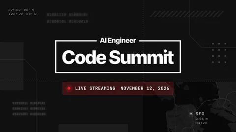

# AIE CODE: Google DeepMind, OpenAI, ArtCraft, Cognition, Exa, Anthropic, Amp, et al

**AI Engineer** · 2026-11-13 · 9:05:10 · relevance 4/5 · [Watch on YouTube](https://www.youtube.com/watch?v=y9JtCCZP2MQ)

## Summary

A nine-hour livestream of Day 2 of AI Engineer Code Summit 2026, featuring keynotes and short talks from OpenAI, Arendelle (Pi), Warp, ArtCraft, Cognition, Exa, Kiro/AWS, Anthropic, Bun, Uber, Google DeepMind (Antigravity and Gemini post-training), Amp, Human Layer/Factory and Thariq Shihipar. The dominant thread is the 'software factory': code-defined, measurable, closed-loop systems of cloud coding agents with online evals, benchmarks and self-improvement, balanced against arguments for human judgment, taste, legibility and an anti-slop manifesto. The main takeaway for builders is that agents now run long horizons autonomously, so the scarce resources are human attention, verifiable feedback loops and interfaces that keep people in control and able to understand what agents did.

## Key insights

- Design CLIs and docs for agents as users: agents pipe output through head/tail/grep instead of filing bugs, so repeated pipe patterns are the bug report; add range/limit/compact flags, put a short summary plus pointer to the full log in the last lines, and treat skill.md, help text and error messages as the interface because agents follow stale docs literally.
  - _Relies on:_ ~20,000 agent calls analysed across 14 CLIs; a quarter piped output, >50% for read-heavy commands; git show and cargo test piped 62% of the time; 83% of pipes fell into patterns seen at least 10 times; Pipe rate fell from 82% to about a quarter after adding selection flags; 95 of 95 searches still passed a no-op flag the stale skill told them to use; Sanity MCP server: >20,000 agents, ~3M tool calls, zero bug reports until a give-feedback tool shipped; Infracost: plain Claude 0/6 hard questions vs 6/6 with CLI filtering + skill, 41% lower cost; DuckDB agent mode cut output read by 59% but saved only ~0.5% of total tokens; Study flagged issues in 97% of real MCP server tool descriptions _(as of 2026-11-13)_
- Google's Antigravity team simplified its agent manager over iterations: instead of exposing every tool call and knob, show only the latest semantic step the agent is doing to reduce cognitive load and enable multitasking; and as models got smarter they shifted from turn-based queued instructions to passing user intent immediately and letting the agent decide orchestration.
  - _Relies on:_ Antigravity used by over 100,000 people inside Google; Agent swarms feature started as a plugin through Antigravity's extensibility system _(as of 2026-11-13)_
- A practical supervision pattern: prompt the agent, at roughly 70% of a session before verification, to produce a short executive summary as a nicely typeset HTML page so the human can understand changes without reading code; similarly Cognition has Devin send video proof of fixes back into Slack.
  - _Relies on:_ P90 agent run time grew from ~2.5 minutes with Opus 4.6 (Dec 2025) to 14+ minutes with latest models in the Pi harness; Prompts per day stayed flat at ~120-190 while agent active time rose to many times a working day _(as of 2026-11-13)_
- Warp defines a software factory as a code-defined, closed-loop system for continuously measuring and improving cloud coding agents: declarative factory config, recorded sessions, online evals (e.g. a redundant-test scorer), self-improvement agents that open PRs against the factory definition, and benchmarks replayed on your own data to compare models, harnesses and skills.
  - _Relies on:_ Warp open-source agentic terminal ~65,000 GitHub stars, used by almost a million developers; Cognition reports 40x merged PR throughput vs 2.7x headcount growth over 12 months; Kiro Crew: ~16,500 PRs merged since Aug 4 launch, 3,000+ in one week, about 1 in 10 are features _(as of 2026-11-13)_
- Anthropic showed memory quality scales with model capability and benefits from a separate 'dreaming' consolidation pass that reflects over transcripts and notes to fix poisoned memories, fill gaps and build wikis; more dreaming compute made the wiki progressively better than raw search.
  - _Relies on:_ Benchmark: CL-Bench (open-source continual learning), 40 sequential database questions with fresh sessions; Sonnet 4.6 barely benefited from memory; Sonnet 5 and Opus improved with the same simple instruction; Raw semantic search baseline ~53% on 25 questions from the acquired Stainless corpus; Fable 5 memory directory far tighter than Claude 3.7's in Pokemon; 1,000 Fable 5.2 agents formalized Fermat's Last Theorem in Lean in ~30 hours using only git and a SQL database _(as of 2026-11-13)_
- Exa argues agent search must be semantic and token-dense: agent queries average ~12 words (10% are 17+), so keyword search underperforms, and returning extracted ~500-character excerpts instead of whole pages cuts tokens ~16x.
  - _Relies on:_ Exa grew from ~12.5M to ~1.3B requests/month over two years; Atlas benchmark: 9% parametric-only, ~28% with keyword search, ~56% with Exa semantic search, ~28% lower cost; Crawl to index latency ~3 minutes at up to 1M pages/second _(as of 2026-11-13)_
- To stay in control of vibe-coded projects, keep a human-readable layer of code (a lint-enforced, English-like spec/scripting layer using real units) separate from agent-owned engine code, so the person can read, tab-complete and tweak behavior directly.

## Tools, models & APIs mentioned

- **Codex app** (product)
- **Pi coding agent** (product)
- **Claude Opus** 4.6 (model)
- **Warp** (product)
- **Devin** (product)
- **Exa** (api)
- **Kiro Crew** (framework)
- **Fable** 5.2 (model)
- **Lean** (other)
- **Bun** (product)
- **Gemini 4 Carbon** (model)
- **Gemini 4 Hydrogen** (model)
- **Antigravity** (product)
- **Amp** (product)
- **Model Context Protocol** (protocol)
- **Claude Code** (product)
- **tapes.dev** (product)
- **Optuna** (framework)
- **GPUI** (framework)
- **Foldkit** (framework)
- **TraceTune** (product)
- **Relate** (other)
- **Submit Queue (Uber)** (other)
- **anti-slop ESLint plugin** (other)

## How this applies to AX / design systems

Parag can lift Antigravity's evolution into an agent-activity component: a collapsed 'latest semantic step' status row with expandable tool-call detail, rather than a wall of tool calls, plus an evidence/summary artifact card (HTML executive summary, video proof) for review-and-approve flows. For the developer portal, the 'pipe tax' talk suggests a doc page on designing APIs/CLIs for agents (compact output, range flags, 'showing 20 of 300' pagination hints, agent mode, skill.md and llms.txt as first-class docs) and an experiment mining agent transcripts as product analytics on the docs themselves. The anti-slop and human-readable-spec ideas support a design-system governance stance: keep tokens/component specs as the human-owned legible layer agents must respect, enforced by lint rules.

_Relevance 4/5: Multiple talks directly address agent supervision UX (Antigravity's simplified agent manager, executive-summary HTML reviews, evidence videos in Slack, human-readable spec layers) and agent-facing docs/CLI design that map onto AX and developer portal work, though most content is engineering-process focused._

## Best moments

- [50:20](https://www.youtube.com/watch?v=y9JtCCZP2MQ&t=3020s): Armin on human attention as the limit and HTML executive summaries for reviewing agent work
- [1:46:46](https://www.youtube.com/watch?v=y9JtCCZP2MQ&t=6406s): Pipe tax talk: agent transcripts as product analytics for CLI/MCP design
- [4:08:51](https://www.youtube.com/watch?v=y9JtCCZP2MQ&t=14931s): Anthropic on memory vs dreaming consolidation
- [6:08:26](https://www.youtube.com/watch?v=y9JtCCZP2MQ&t=22106s): Antigravity: judgment, simplifying the agent manager UI, building for the right time window
- [8:51:12](https://www.youtube.com/watch?v=y9JtCCZP2MQ&t=31872s): Thariq on the 'smooth interior' and keeping a human-readable spec layer
