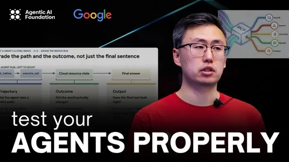

# Building an Agentic Eval Pipeline: Battle-Tested Lessons... - Kurtis Van Gent & Haoyu Wang, Google

**Agentic AI Foundation** · 2026-11-13 · 22:25 · relevance 3/5 · [Watch on YouTube](https://www.youtube.com/watch?v=0cBJ4X1LS1A)

## Summary

Google Cloud Databases engineers Kurtis Van Gent (MCP core maintainer, transport WG lead) and Haoyu Wang present how they evaluate agents that use their MCP tools and skills, using critical user journey (CUJ) based evals. They argue unit tests can't show whether an agent picks and sequences tools correctly, so they run natural-language CUJs with simulated multi-turn users, grade both the tool-call path and the real cloud resource end state, use deterministic checks before structured LLM-judge scorecards calibrated against humans, and reset real resources between runs. The takeaway is that evals expose silent regressions from harness changes (tool search, skill truncation), justify or retire skills via ablation, and showed long-running operations should move to MCP tasks rather than agent polling; their framework EvalBench is open source.

## Key insights

- Write evals as critical user journeys phrased the way a user asks (e.g. 'Show me my top customers'), not as instructions to call a specific tool. Because every agent accepts natural language, the same eval set can compare harnesses such as Claude Code and Codex.
  - _Relies on:_ CUJ = critical user journey; Harnesses mentioned: Antigravity, Claude Code, Codex, Gemini CLI _(as of 2026-11-13)_
- True multi-turn evals need a simulated user. An LLM follows a 'plan prompt' playbook to answer the agent's clarifying questions (e.g. which region), so you can check that the agent asked the right questions as well as whether it reached the goal. Frameworks like Harbor only support a single user turn.
  - _Relies on:_ Harbor eval framework supports only single user turn per the speakers _(as of 2026-11-13)_
- Grade the path and the outcome, not the agent's final sentence. Check that the expected tools were called, in order, without unnecessary extra calls, and verify the real cloud resource state (region, availability, schema) matches what is expected.
- Prefer deterministic scoring, such as running the golden query and comparing the data, and checking tool parameters. For the remainder, use checkbox-style LLM-judge scorecards and recalibrate them against human raters.
- Harness token optimizations can silently hurt tool and skill selection. When Claude Code rolled out tool search, it changed how the team built tools. Some harnesses also truncate or drop skill descriptions when there are many skills, which only evals reveal.
  - _Relies on:_ Claude Code tool search / deferred tool loading; Large MCP tool schemas can cost thousands of tokens upfront _(as of 2026-11-13)_
- Run ablation evals with each skill on vs off (same model, harness and CUJs) and plot goal completion against token cost. Keep skills that win on both or that substantially raise completion (e.g. a migration runbook), and retire old skills that add tokens without moving completion.
- For long-running operations like creating a database instance, agents poll repeatedly ('is it done?'), and each poll re-reads the conversation history and burns tokens, while blocking server-side risks timeouts. Their evals showed MCP tasks are the better fit: the call returns a task ID and the harness waits for a notification at no model cost.
  - _Relies on:_ MCP tasks return a task ID and the harness monitors them; Google Cloud has 50+ managed MCP servers _(as of 2026-11-13)_

## Tools, models & APIs mentioned

- **EvalBench** (framework)
- **MCP Toolbox for Databases** (framework)
- **Model Context Protocol** (protocol)
- **MCP tasks** (protocol)
- **Claude Code** (product)
- **Codex** (product)
- **Gemini CLI** (product)
- **Antigravity** (product)
- **Harbor** (framework)
- **Cloud SQL** (product)
- **BigQuery** (product)
- **OpenTelemetry** (framework)

## How this applies to AX / design systems

For AX design, the long-running-operation finding argues for a dedicated 'task in progress' component: a task ID, a status/progress state and a completion notification, rather than chat-based polling. The simulated-user clarification pattern maps to designing clarifying-question UI and to writing CUJ-style scenarios for usability tests of agent flows. For developer portals, the CUJ framing and skill ablation charts (goal completion vs token cost) could become doc patterns, such as a 'journeys' page per MCP server and an eval-results panel next to tool docs. Use path-plus-outcome grading as the mental model for tool-call trace UI that shows the tools called, their order and the verified end state.

_Relevance 3/5: Strong on eval methodology and MCP tool/skill design, which sits next to Parag's AX and developer portal work, but it is backend eval infrastructure rather than interaction or design-system guidance._

## Best moments

- [4:08](https://www.youtube.com/watch?v=0cBJ4X1LS1A&t=248s): Defines CUJ-based evaluation, with user-phrased tasks instead of tool instructions.
- [5:41](https://www.youtube.com/watch?v=0cBJ4X1LS1A&t=341s): Multi-turn journeys with a simulated user answering the agent's clarifying questions.
- [7:23](https://www.youtube.com/watch?v=0cBJ4X1LS1A&t=443s): Grading the tool-call path and the cloud resource state, not the agent's final claim.
- [17:03](https://www.youtube.com/watch?v=0cBJ4X1LS1A&t=1023s): Skill ablation evals and the goal-completion vs token-cost chart.
- [19:08](https://www.youtube.com/watch?v=0cBJ4X1LS1A&t=1148s): Agents polling long-running operations, and why MCP tasks solve it.
