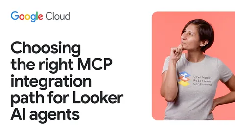

# Decide which Looker MCP integration is right for you?

**Google Cloud Tech** · 2026-11-13 · 4:43 · relevance 3/5 · [Watch on YouTube](https://www.youtube.com/watch?v=24WH740Xn9M)

## Summary

A short Google Cloud Tech explainer comparing two ways to connect AI agents to Looker over MCP: the built-in Looker-managed MCP server and the open-source, self-hosted MCP Toolbox for Databases. It contrasts admin-toggled, instance-wide tool enablement with OAuth login against file-based (tools.yaml) per-agent tool scoping that spans multiple data sources, and demos each setup (VS Code Looker extension vs Agent Development Kit plus Cloud Run). The takeaway is that the managed server suits teams wanting instant setup, native OAuth and zero maintenance, while Toolbox suits teams needing custom tool scoping, multi-database reach and engineering control.

## Key insights

- In the Looker-managed MCP server, tool enablement is instance-wide: admins toggle individual tools on or off in the Looker UI. They cannot enable a tool for one agent and disable it for another at the server layer, so per-agent scoping must come from roles on service accounts or user permissions.
  - _Relies on:_ Looker-managed MCP server built into Looker core / Looker original; Tool toggles are instance-wide; Scoping via roles, service accounts or user access _(as of 2026-11-13)_
- MCP Toolbox for Databases is self-hosted and configured via a tools.yaml file. This lets teams define separate tool sets for different agents or tasks and run them on separate servers, exposing only a narrow subset of functions per workflow.
  - _Relies on:_ MCP Toolbox for Databases is open source; Tools defined in tools.yaml; Can deploy to Cloud Run to share with others _(as of 2026-11-13)_
- Toolbox currently has a wider catalog of pre-built tools than the managed server. It can combine governed LookML metrics with external sources such as Knowledge Catalog or Spanner in one agent flow.
  - _Relies on:_ Sources mentioned: LookML, Knowledge Catalog, Spanner _(as of 2026-11-13)_
- The managed server uses OAuth with standard Looker SSO in a browser window, so no API keys or credentials are stored locally. Clients such as the VS Code Looker extension must first be registered by an admin.
  - _Relies on:_ VS Code Looker extension used as registered client; OAuth + Looker SSO, no local credentials _(as of 2026-11-13)_
- Choosing between the two shifts governance ownership. With the managed server, Looker admins flip switches in a UI. With Toolbox, development teams own config files and server infrastructure.

## Tools, models & APIs mentioned

- **Looker** (product)
- **Looker Managed MCP Server** (product)
- **MCP Toolbox for Databases** (framework)
- **Model Context Protocol** (protocol)
- **Agent Development Kit** (sdk)
- **VS Code Looker extension** (product)
- **Cloud Run** (product)
- **Spanner** (product)
- **Knowledge Catalog** (product)

## How this applies to AX / design systems

The admin pattern of toggling MCP tools instance-wide, versus scoping tools per agent, is a useful reference for designing a tool-permission or tool-catalog component in a developer portal. Show which tools are enabled, at what scope (instance, role, agent), and who owns the setting. The OAuth/SSO consent hand-off during an agent chat is a concrete flow to model in an AI component library as an auth-interrupt or approval state. Developer portal docs could include a similar 'managed vs self-hosted' decision page or comparison table.

_Relevance 3/5: This is useful background on enterprise MCP governance, tool scoping and OAuth patterns that inform developer-portal and AX design, but it is Looker-specific and has little direct UI guidance._

## Best moments

- [0:30](https://www.youtube.com/watch?v=24WH740Xn9M&t=30s): How managed MCP admins toggle tools, and the limit that toggles are instance-wide
- [1:33](https://www.youtube.com/watch?v=24WH740Xn9M&t=93s): Toolbox's self-hosted model with per-agent tool configurations
- [2:35](https://www.youtube.com/watch?v=24WH740Xn9M&t=155s): Demo of admin client registration and the OAuth/SSO login flow in VS Code
- [3:35](https://www.youtube.com/watch?v=24WH740Xn9M&t=215s): tools.yaml configuration with ADK and deployment to Cloud Run
- [4:07](https://www.youtube.com/watch?v=24WH740Xn9M&t=247s): Summary decision criteria for choosing between the two
