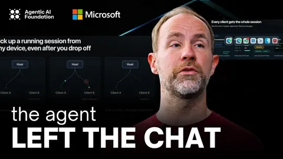

# The Agent Has Left the Chat - Harald Kirschner, Microsoft

**Agentic AI Foundation** · 2026-11-13 · 25:33 · relevance 5/5 · [Watch on YouTube](https://www.youtube.com/watch?v=TZMu0LhTG6k)

## Summary

Harald Kirschner from the VS Code team presents the Agent Host Protocol (AHP), an open Microsoft spec that moves agent sessions out of a single app into a host process that many clients can connect to. He demos a plan started in VS Code, continued in the Agents window, and opened via vscode.dev on a phone against a remote dev box, then covers snapshots, replay, first-writer-wins conflict handling, sub-agents as separate chats, MCP state sync, and automations. The takeaway is that once session state is standardized like LSP did for languages, the agent UI no longer has to be an editor: inboxes, boards, and even games become viable clients.

## Key insights

- AHP separates where an agent runs (host) from where it is controlled (clients). A joining client receives a snapshot of the full conversation, workspace state, tool calls and pending approvals, so any surface can render and act on the same live session.
  - _Relies on:_ Agent Host Protocol is an open spec under the Microsoft org on GitHub; VS Code agent host runs as a separate process, moved out of the extension host; Supported harnesses in VS Code: GitHub Copilot, Claude, Codex _(as of 2026-11-13)_
- Multi-client control resolves conflicts with a first-wins rule, so two clients answering the same approval don't stack up conflicting approvals. A reconnecting client replays the snapshots it missed after a dropped connection.
  - _Relies on:_ First interacting client wins on conflicting actions; Replay of missed snapshots on reconnect is handled in the protocol _(as of 2026-11-13)_
- Developers want to see background sub-agents, because an agent blocked waiting on five sub-agents looks idle. AHP therefore models sub-agents as separate chats, including their tool calls, and these can be popped out into their own session view.
  - _Relies on:_ Sub-agents represented as separate chats in the AHP spec _(as of 2026-11-13)_
- AHP syncs MCP server state, including auth needs and broken servers, into the protocol so clients can show when MCP needs attention. Client customizations such as skills travel to remote hosts.
  - _Relies on:_ MCP state synchronized in AHP; Customizations transferred from client to remote hosts _(as of 2026-11-13)_
- AHP versioning and positioning: 0.2 shipped in May and 1.0 was cut in early October. The talk contrasts it with ACP, which is one agent in one editor, and A2A, which is agents handing off work, while AHP is for watching and steering. An AHP–ACP gateway lets ACP-compatible harnesses plug in.
  - _Relies on:_ AHP 0.2 released May; AHP 1.0 cut beginning of October; AHP ACP gateway project on GitHub _(as of 2026-11-13)_
- Automations can be scheduled and run on the host with no client connected. The npx AHP Inspector tool exposes session summaries, dispatched actions and metadata changes for debugging.
  - _Relies on:_ npx AHP Inspector published on GitHub _(as of 2026-11-13)_
- Microsoft consolidated Copilot surfaces onto one harness, the Copilot SDK, which covers Copilot CLI, the Copilot app, VS Code and code review. The speaker claims a June benchmark showed better results and lower token cost than the model vendors' own harnesses.
  - _Relies on:_ Copilot SDK powers Copilot CLI, GitHub Copilot app, VS Code, Copilot code review; Benchmark from June claimed better performance with lower token cost _(as of 2026-11-13)_

## Tools, models & APIs mentioned

- **Agent Host Protocol (AHP)** 1.0 (protocol)
- **VS Code** (product)
- **GitHub Copilot SDK** (sdk)
- **Claude SDK** (sdk)
- **Codex** (product)
- **Model Context Protocol** (protocol)
- **Language Server Protocol** (protocol)
- **ACP** (protocol)
- **A2A** (protocol)
- **AHP Inspector** (other)
- **vscode.dev** (product)
- **Dev Tunnels** (product)
- **Plan Work** (product)
- **AGENTS.md** (other)

## How this applies to AX / design systems

Use AHP's state model as a reference schema for framework-agnostic Lit components. The model covers snapshot, turns, tool calls, approvals, sub-agent chats and MCP status, which suggests components like <agent-approval-card>, <subagent-status>, <mcp-auth-banner> and <session-inbox-item> that render the same session on desktop and mobile. Define design-system guidance for multi-client edge cases: approval already resolved on another device (first-wins), replay catch-up after reconnect, and an agent blocked on background sub-agents. A concrete experiment is prototyping the speaker's 'agent inbox' pattern as an intent-driven alternative to a chat list. A developer portal could document AHP vs ACP vs A2A as a comparison page.

_Relevance 5/5: AHP defines the session, approval, sub-agent and tool-call state that multi-surface agentic UIs need, and the speaker explicitly frames it as the basis for new agent UI patterns like inboxes, which maps directly onto Parag's AX and AI component library work._

## Best moments

- [5:23](https://www.youtube.com/watch?v=TZMu0LhTG6k&t=323s): Introduces AHP: one host, many clients, any harness
- [7:23](https://www.youtube.com/watch?v=TZMu0LhTG6k&t=443s): Demo: approval waiting in VS Code, continued in the Agents window
- [11:29](https://www.youtube.com/watch?v=TZMu0LhTG6k&t=689s): Same session opened in vscode.dev in a browser on a phone
- [16:06](https://www.youtube.com/watch?v=TZMu0LhTG6k&t=966s): Snapshot join, first-wins conflicts and replay explained
- [22:55](https://www.youtube.com/watch?v=TZMu0LhTG6k&t=1375s): Agent inbox, board and game UIs built on AHP state
