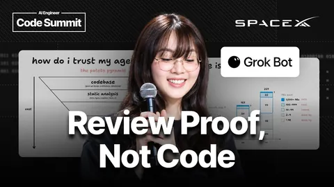

# All Code Is Slop (Except Mine) — Lauren Tan, SpaceXSI

**AI Engineer** · 2026-11-14 · 17:32 · relevance 4/5 · [Watch on YouTube](https://www.youtube.com/watch?v=O_zcc6Xl12g)

## Summary

Lauren Tan (poteto), who works on Grok Bot at SpaceXSI, explains how her team scales AI coding agents to thousands of pull requests while keeping quality high. Her core argument is an inverse 'trust pyramid': invest first in deterministic constraints (architecture, API design, lint rules, types, tests), then runtime and formal verification, and only lastly prose like rules, skills and agents.md. The takeaway is that every agent correction should become a deterministic check, so that code review shrinks to reviewing verification artifacts and agents can auto-merge most PRs.

## Key insights

- Whenever you correct an agent, encode the correction as a deterministic check (lint rule, type, dependency-graph ban, API redesign) rather than adding a line to rules or agents.md. Code is more reproducible and more trustworthy than prose.
  - _Relies on:_ Trust pyramid order: code/architecture -> lint/types/tests -> runtime and formal verification -> prose (rules, skills, agents.md) _(as of 2026-11-14)_
- Ban APIs that need nuance to use well. Dune bans React useEffect in product code, allowing it only inside framework APIs, which removes the whole class of misuse from code review.
  - _Relies on:_ Dune: internal client framework for Grok Bot, described as 'Next.js for Electron apps'; useEffect banned in product code _(as of 2026-11-14)_
- The team banned about 99% of code comments because agents use comments and Markdown to justify workarounds, and because comments go stale and can't be enforced. Lint rules carry the guidance instead, with error messages that tell the agent to fix the root cause.
  - _Relies on:_ At Cursor, agents spread setTimeout/requestAnimationFrame/requestIdleCallback quick fixes with justifying comments, which caused GC jank _(as of 2026-11-14)_
- Directory structure can carry context. Top-level electron/renderer and electron/main directories, with imports between them banned by a dependency analyzer and lint rules, stopped agents from pulling main-thread code into the renderer.
- A 'feature map', a site map of app features from the user's point of view, gives agents and humans a shared vocabulary for runtime verification. Pairing it with custom CLIs reduces token usage and keeps verification testable.
  - _Relies on:_ Runtime verification uses Chrome DevTools Protocol _(as of 2026-11-14)_
- Formal verification and property-based UI testing are now economical with agents. TLA+ model-checks cross-device notification flows, Lean proves a custom virtualization library is free of flicker, and Bombadil runs property tests on the UI. Most token spend now goes to verification.
  - _Relies on:_ TLA+ for model checking; Lean for proofs; Bombadil property-based UI testing; Cited claim: 70% of daily tokens go to verification _(as of 2026-11-14)_
- With these foundations, the Grok Bot team shipped 11,000 PRs in one month with a revert rate steady around 0.5%, a daily stable release and 227 contributors in October, while app performance improved.
  - _Relies on:_ 11,000 PRs last month; ~0.5% revert rate; 227 contributors in October; speaker shipped 3,000 PRs in a month; took 6 months to reach this point _(as of 2026-11-14)_

## Tools, models & APIs mentioned

- **Grok Bot** (product)
- **Cursor** (product)
- **pstack** (framework)
- **Dune** (framework)
- **TLA+** (other)
- **Lean** (other)
- **Bombadil** (framework)
- **Chrome DevTools Protocol** (protocol)
- **Electron** (framework)
- **React** (framework)
- **agents.md** (other)

## How this applies to AX / design systems

For a Lit/Web Components design system, turn usage guidance (banned props, token misuse, raw colors instead of tokens) into custom lint rules whose error messages point agents to the correct component or token, instead of adding to docs that agents will ignore. A user-facing 'feature map' and a statechart skill are directly useful artifacts for AX: they give agents and designers a shared vocabulary and let reviewers check intent visually. The idea of review shrinking to verification artifacts (videos, screenshots, state diagrams) suggests an approval and review UI pattern worth prototyping in an AI component library or developer portal.

_Relevance 4/5: The pattern of turning design-system guidance into enforceable lint rules and feature maps maps directly onto component governance and agent-friendly libraries, though the talk is engineering-focused rather than about UX._

## Best moments

- [2:07](https://www.youtube.com/watch?v=O_zcc6Xl12g&t=127s): Trust pyramid: where to invest in an agent's environment
- [5:14](https://www.youtube.com/watch?v=O_zcc6Xl12g&t=314s): Dune bans useEffect: removing nuance-heavy APIs
- [8:20](https://www.youtube.com/watch?v=O_zcc6Xl12g&t=500s): Why they banned 99% of comments in favour of lint rules
- [9:52](https://www.youtube.com/watch?v=O_zcc6Xl12g&t=592s): Verification artifacts and the feature map concept
- [13:29](https://www.youtube.com/watch?v=O_zcc6Xl12g&t=809s): 11,000 PRs, 0.5% revert rate and performance results
