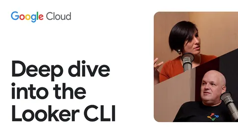

# Deep dive into the Looker CLI

**Google Cloud Tech** · 2026-11-16 · 16:12 · relevance 3/5 · [Watch on YouTube](https://www.youtube.com/watch?v=3FmEdUNeqIw)

## Summary

A Google Cloud Tech interview in which Chrissie Goodrich talks with Mike DeAngelo, author of the original Ruby CLI 'gazer', about its Go rewrite as Looker CLI and how it was redesigned for agents. Mike demos meta tree/search for command discovery, an agent (Antigravity) cleaning up test dashboards, and a health pulse check, and he contrasts CLIs with MCP servers for full API coverage. The main takeaway is that a CLI exposing the entire API surface at fine granularity, with JSON templates and self-describing help, lets agents discover tools on demand instead of loading hundreds of tool descriptions into context.

## Key insights

- Keep an MCP server to roughly 50 tools or fewer, because every tool description consumes context. APIs with several hundred endpoints are better exposed through a CLI, which puts nothing in context up front.
  - _Relies on:_ ~50 MCP tools suggested as a practical ceiling; Looker API has several hundred commands _(as of 2026-11-16)_
- Give agents an empty JSON body template instead of asking them to build request payloads from scratch, because agents fill templates far more reliably. Looker CLI does this with a template switch on its API commands.
  - _Relies on:_ Looker CLI template switch on API commands outputs an empty JSON body _(as of 2026-11-16)_
- When designing for agents, expose fine-grained primitives rather than high-level glue commands. A dashboard import that takes 15–20 API calls can be orchestrated by the agent itself instead of being hard-coded.
  - _Relies on:_ Importing a dashboard takes ~15-20 API calls (dashboard, filters, elements, layouts) _(as of 2026-11-16)_
- Self-discovery commands let agents learn a large CLI on demand, supplemented by Looker skills. 'meta tree' shows the full command hierarchy and 'meta search <keyword>' finds the relevant commands.
  - _Relies on:_ Looker CLI meta tree; Looker CLI meta search; Looker skills _(as of 2026-11-16)_
- Looker CLI was rewritten from Ruby (gazer) to Go and now ships near-monthly releases that track each new Looker version's API calls. It also absorbs health checks from the open-source tool Henry.
  - _Relies on:_ gazer written in Ruby ~8 years ago; rewritten in Go; Health Pulse command checks DB connections, dashboard performance, dashboard errors, explore performance, schedule failures _(as of 2026-11-16)_
- For destructive agent tasks, the agent can produce a breakdown for human audit before deleting anything. Mike's example was listing all 'test*' dashboards and looks so they can be reviewed before deletion.

## Tools, models & APIs mentioned

- **Looker CLI** (product)
- **gazer** (product)
- **Looker** (product)
- **Antigravity** (product)
- **Gemini** (model)
- **Claude** (model)
- **ChatGPT** (product)
- **Model Context Protocol** (protocol)
- **Henry** (other)
- **LookML** (other)

## How this applies to AX / design systems

For AI developer portals, document a 'CLI vs MCP' decision page: an MCP server with a curated set of tools for broad audiences, and a full-surface CLI for technical users. Portals could also publish empty JSON request templates per endpoint for agents to fill. The audit-before-delete flow is a pattern for approval UI components: show the agent's planned destructive actions as a reviewable list before execution. The developer-to-agent persona handoff Chrissie describes supports designing tools that work identically for hands-on and delegated use.

_Relevance 3/5: It offers useful background on CLI-vs-MCP tool design and agent-friendly developer tooling, which bears on developer portal and AX thinking, though the content is Looker-specific and not about UI._

## Best moments

- [5:50](https://www.youtube.com/watch?v=3FmEdUNeqIw&t=350s): Agent cleans up test dashboards with a natural-language command.
- [6:54](https://www.youtube.com/watch?v=3FmEdUNeqIw&t=414s): Why MCP tool count is limited and when to use a CLI instead.
- [9:02](https://www.youtube.com/watch?v=3FmEdUNeqIw&t=542s): Empty JSON template switch and why agents fill templates well.
- [10:04](https://www.youtube.com/watch?v=3FmEdUNeqIw&t=604s): Designing finer-grained tools for agents versus glue code for developers.
- [12:44](https://www.youtube.com/watch?v=3FmEdUNeqIw&t=764s): Health Pulse demo via Antigravity.
