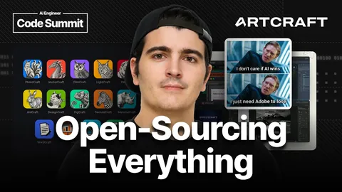

# How I cloned Adobe with AI — Brandon Thomas, ArtCraft

**AI Engineer** · 2026-11-16 · 19:56 · relevance 3/5 · [Watch on YouTube](https://www.youtube.com/watch?v=UCL4K36SHp0)

## Summary

Brandon Thomas of ArtCraft describes how his team used AI coding agents and Rust to build open source approximations of Adobe Creative Suite apps, Microsoft Office, Figma, CAD and more, framed as reclaiming the open early web from subscription platforms. The core demo claim is that large structured prompts (separating UI/UX, specifying every tool, data structures, file importers, and making everything MCP- and CLI-compatible) produced a working Photoshop approximation in about 24 hours, now at roughly 60% parity, with a 4,000-contributor community and reusable UI component libraries emerging. The takeaway is that agents can build mature-app clones fast when humans focus on schema/API design and let agents run on 'immutable' desktop/app work, with an autonomous 'Autocraft' software factory planned to close the issue-to-PR-to-evals loop.

## Key insights

- ArtCraft built a functional Photoshop approximation in about 24 hours by writing large upfront prompts that separate UI/UX from logic, plan every tool, define data structures and file importers, and require MCP and CLI compatibility.
  - _Relies on:_ ~24 hours to first Photoshop approximation; parity rose from 50% to just past 60% _(as of 2026-11-16)_
- Making every app MCP- and CLI-first lets users command apps and watch them assemble creative projects live, which the speaker positions as the path from familiar Adobe-like UIs toward future, more agentic interfaces.
  - _Relies on:_ Team deliberately copies Adobe look-and-feel for artists' muscle memory first; net-new agentic UIs planned later _(as of 2026-11-16)_
- Non-technical artists and studios vibe-coded their own workflow UIs on top of ArtCraft APIs using Claude Code, suggesting constrained, per-role apps that strip unused surface area are a real user need.
  - _Relies on:_ Micro drama studios doing $30-50k/month fulfillment built custom interfaces in-house _(as of 2026-11-16)_
- Recommended split for human review: keep humans on backend, schema migrations and API design, but let agents run with full confidence on desktop apps, games and other 'basically immutable' work without full human-in-the-loop.
- Rust was chosen over Electron for native performance, low defect rates, cross-platform reach including NetBSD and tablets, and Wasm web deployment; agents drive Rust fine even for engineers new to it, but compile times and CI capacity are the main bottlenecks.
  - _Relies on:_ Rust; Wasm deployment; CI 'falling over', team self-hosting CI on co-located servers _(as of 2026-11-16)_
- The community is decomposing the cloned apps into reusable UI/UX component and primitive libraries (2D and 3D) so non-technical contributors can build new apps from them.
  - _Relies on:_ ~300 community apps in development; ~4,000 contributors; speaker cites 300,000 GitHub stars and ~1.7M downloads/day; ~25% of users on Linux _(as of 2026-11-16)_
- Autocraft, a planned open source autonomous software factory, ingests and triages issues, does agentic development, and logs all decisions as training data for evals and post-training on decision trees.
  - _Relies on:_ Autocraft not yet released; to be open sourced _(as of 2026-11-16)_

## Tools, models & APIs mentioned

- **ArtCraft** (product)
- **Autocraft** (product)
- **PDF Craft** (product)
- **Solid Craft** (product)
- **Model Context Protocol (MCP)** (protocol)
- **Rust** (other)
- **WebAssembly (Wasm)** (other)
- **Claude Code** (product)
- **Electron** (framework)
- **CodeRabbit** (product)

## How this applies to AX / design systems

The 'MCP and CLI first-class' requirement is a useful pattern to bring to the AI component library: every component action should be addressable by an agent, with UI that visibly shows the agent assembling work. The decomposition of agent-built apps into reusable 2D/3D primitives echoes design-system governance questions, worth a note on how agent-generated components get audited into a Lit library. The human-review split (humans own schemas/APIs, agents own UI surfaces) could inform developer-portal docs on where approval UI is required versus where agents run unsupervised.

_Relevance 3/5: Useful background on agent-built apps, MCP/CLI-first app design and decomposing apps into reusable component libraries, but it is a talk on a movement more than concrete AX or design-system guidance._

## Best moments

- [7:20](https://www.youtube.com/watch?v=UCL4K36SHp0&t=440s): Artists vibe-coding their own workflow interfaces on top of ArtCraft APIs
- [9:23](https://www.youtube.com/watch?v=UCL4K36SHp0&t=563s): How the large prompts were structured to clone Photoshop in 24 hours, including MCP/CLI compatibility
- [10:25](https://www.youtube.com/watch?v=UCL4K36SHp0&t=625s): Choosing Adobe parity for muscle memory before building agentic interfaces
- [15:43](https://www.youtube.com/watch?v=UCL4K36SHp0&t=943s): Decomposing apps into reusable UI component libraries for non-technical contributors
- [17:16](https://www.youtube.com/watch?v=UCL4K36SHp0&t=1036s): Human vs agent review split and the Autocraft software factory
