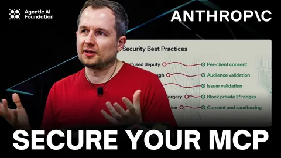

# MCP Security, Two Years In - Den Delimarsky, Anthropic

**Agentic AI Foundation** · 2026-11-16 · 23:11 · relevance 4/5 · [Watch on YouTube](https://www.youtube.com/watch?v=b0v2zCLOdcM)

## Summary

A conference talk by Den Delimarsky, an MCP lead maintainer at Anthropic, reviewing nearly two years of MCP security across three pillars: the protocol spec, the official SDKs, and deployment best practices. He traces MCP's move from do-it-yourself auth to an opinionated OAuth 2.1 model with external identity providers, then covers SDK conformance testing and coordinated disclosure. The main takeaway is that MCP is moving from human-in-the-loop consent prompts to agent-first authorization through enterprise-managed auth, DPoP, workload identity federation and workload authorization grants that give agents their own short-lived, policy-bearing identity.

## Key insights

- MCP deliberately dropped free-form auth (API keys, certificates) in favour of OAuth 2.1. Later spec revisions let servers delegate the authorization server to enterprise IdPs such as Okta or Entra ID instead of implementing one themselves, so that every client connects to every server the same way.
  - _Relies on:_ Initial spec November 2024 left auth to developers; March 2025 spec adopted OAuth 2.1 with the MCP server acting as authorization server; June spec separated the authorization server so external IdPs (Okta, Entra ID) can plug in; Latest spec released in July; next spec revision planned for March _(as of 2026-11-16)_
- Enterprise-managed authorization (EMA, also called ID-JAG or XAA) lets an admin connect an MCP server once so that nobody in the organization ever sees a consent prompt. It also prevents users from accidentally connecting personal accounts such as a personal Gmail.
  - _Relies on:_ Built in partnership with Okta; Live in Claude today; Applies to agents as well as employees _(as of 2026-11-16)_
- Production incidents drove specific spec mitigations: per-client consent against confused-deputy attacks, a ban on token passthrough, and validation of both token audience and issuer to block mix-up attacks.
  - _Relies on:_ Issuer validation launched in the latest spec version _(as of 2026-11-16)_
- Security is enforced through SDK conformance tests rather than guidance alone. Roughly a third of about 116 conformance scenarios are authorization- or security-related, and SDK tiers set expectations for how quickly security issues get fixed.
  - _Relies on:_ About 116 conformance scenarios, close to a third security-oriented; Tiered SDK system defines release and update expectations; Coordinated vulnerability disclosure across SDKs _(as of 2026-11-16)_
- DPoP binds bearer tokens to a device key, for example one generated by a TPM chip, so a stolen token is unusable. Workload identity federation replaces vault-stored static secrets with short-lived, platform-issued credentials.
  - _Relies on:_ DPoP = Demonstrating Proof of Possession; Workload identity federation uses cloud platform identity (GCP, Azure, AWS, Kubernetes) _(as of 2026-11-16)_
- The workload authorization grant (WAG) is positioned as the path to agent identity: agents get short-lived tokens with embedded policy claims, such as Slack workspace and channel, so downstream services can make authorization decisions instead of relying on a human's borrowed token.
  - _Relies on:_ WAG driven by Paul Carlton; intended as an OAuth standard; Adopted in Claude's agent that runs in Slack (transcribed as 'Cloud Tag') _(as of 2026-11-16)_
- MCP adoption scale makes any security mistake costly: cumulative SDK and reference server downloads reached 4.17 billion, and the TypeScript SDK alone has close to 300,000 dependent public GitHub repositories.
  - _Relies on:_ 4.17 billion cumulative downloads, up from 3 billion in September; ~300,000 public GitHub repos depend on the TypeScript SDK; ~25,000 depend on the Python SDK; SDKs in TypeScript, Python, Go, Java, Rust, C# _(as of 2026-11-16)_

## Tools, models & APIs mentioned

- **Model Context Protocol** (protocol)
- **OAuth** 2.1 (protocol)
- **Okta** (product)
- **Microsoft Entra ID** (product)
- **DPoP** (protocol)
- **Workload Authorization Grant (WAG)** (protocol)
- **Workload Identity Federation** (protocol)
- **Claude** (product)
- **MCP TypeScript SDK** (sdk)
- **MCP Python SDK** (sdk)
- **HashiCorp Vault** (product)

## How this applies to AX / design systems

The consent model is moving from a user clicking 'approve' to admin-managed connections and agent-owned identities, so AX approval UI needs new patterns: an admin console for one-time MCP server connection, and end-user views that show which agent identity acted and within what scope (e.g. workspace or channel claims). In an AI component library, the tool-call and approval components should be able to display agent identity, token scope and expiry rather than only a per-call confirm button. For developer portals, the auth story maps cleanly onto doc pages: an IdP integration guide, a token passthrough anti-pattern page, audience and issuer validation checklists, and a conformance and SDK-tier status page.

_Relevance 4/5: The shift from per-user consent prompts to admin-managed and agent-identity authorization directly reshapes the consent, delegation and trust UI Parag designs for agentic experiences and developer portals, though the talk itself is protocol-level rather than design-focused._

## Best moments

- [5:41](https://www.youtube.com/watch?v=b0v2zCLOdcM&t=341s): Why the June spec moved authorization servers out to professional IdPs: 'easy to do the right thing'
- [14:22](https://www.youtube.com/watch?v=b0v2zCLOdcM&t=862s): Conformance tests as an enforceable contract, with roughly a third of scenarios security-focused
- [16:00](https://www.youtube.com/watch?v=b0v2zCLOdcM&t=960s): Why the 'person clicks approve' consent model no longer scales for long-running agents
- [17:02](https://www.youtube.com/watch?v=b0v2zCLOdcM&t=1022s): Enterprise-managed auth: admin connects once, users never see consent prompts
- [20:40](https://www.youtube.com/watch?v=b0v2zCLOdcM&t=1240s): Workload authorization grant as the path to agent identity with policy claims
