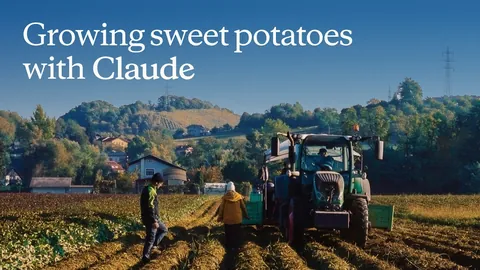

# A season on the farm with AI

**Claude** · 2026-11-17 · 3:12 · relevance 1/5 · [Watch on YouTube](https://www.youtube.com/watch?v=RRj07Hc3ikU)

## Summary

A short Anthropic brand story about Martina Wanis, a Vienna-born biologist growing sweet potatoes on her partner's family farm in Slovenia, who used Claude throughout a growing season. She describes sending photos of non-sprouting mother tubers to Claude, getting a researched protocol, then iterating on it when nutrient deficiencies appeared, while her partner Jan implemented (and sometimes pushed back on) the ideas. The takeaway is that a non-expert AI user, treating Claude as an ongoing season-long collaborator and tracking results, ended up with a reusable protocol and her best harvest yet.

## Key insights

- The user's workflow was multimodal and iterative: she sent photos of the problem (about a third of mother tubers not sprouting), got a researched protocol, then revised it when nutrient deficiencies showed up later in the season.
  - _Relies on:_ About one third of mother tubers were not sprouting; Photos were sent to Claude to diagnose the issue _(as of 2026-11-17)_
- AI suggestions were not filtered for real-world feasibility, so the human who had to implement them (Jan) got frustrated. Not all ideas were realistic, which shows a need for the assistant to account for execution cost and constraints.
- Treating the assistant as a season-long companion, combined with tracking everything, produced a protocol she plans to reuse in future years, plus an earlier harvest from stronger planting material.
  - _Relies on:_ A single tracked yield of 12 kilograms and 85 grams was cited as her best result _(as of 2026-11-17)_

## Tools, models & APIs mentioned

- **Claude** (product)

## How this applies to AX / design systems

It barely applies. The only loose AX takeaway is that long-running delegation should include a feasibility or effort check before suggestions reach the human who has to carry them out.

_Relevance 1/5: This is a consumer testimonial with no design, agent, component or developer-portal content, so it offers almost nothing for Parag's AX or design-system work._

## Best moments

- [1:03](https://www.youtube.com/watch?v=RRj07Hc3ikU&t=63s): She starts using Claude with no understanding of AI and sends photos of the sprouting problem.
- [1:35](https://www.youtube.com/watch?v=RRj07Hc3ikU&t=95s): The protocol is iterated, and her partner gets frustrated with unrealistic AI ideas he has to implement.
- [2:07](https://www.youtube.com/watch?v=RRj07Hc3ikU&t=127s): The outcome: a reusable protocol, an earlier harvest and tracked results.
