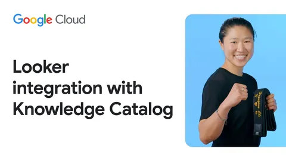

# Ground AI Agents with Looker and Knowledge Catalog on Google Cloud

**Google Cloud Tech** · 2026-11-17 · 5:34 · relevance 2/5 · [Watch on YouTube](https://www.youtube.com/watch?v=QsGQQYj1vEY)

## Summary

A short Google Cloud Tech demo showing how integrating Looker's semantic layer with Knowledge Catalog grounds Gemini agents using a taekwondo dataset. It compares a baseline agent writing raw SQL against BigQuery with a governed Looker agent that uses Knowledge Catalog metadata, lineage, PII tags and indexed policy PDFs. The takeaway is that a semantic layer plus a context catalog makes agent answers more accurate, cheaper in turns and tokens, and enforceable for privacy governance.

## Key insights

- An agent writing raw SQL against raw tables lacked business rules (the 'under 50' team bracket means ages 31–50), burned multiple turns inspecting schemas, and silently guessed wrong. Grounding the agent in a semantic layer fixed the answer and used fewer turns and tokens.
  - _Relies on:_ Baseline agent: LLM writing raw SQL directly against BigQuery; Governed agent: Looker semantic layer + Knowledge Catalog; Under 50 pairs/team bracket = ages 31–50 _(as of 2026-11-17)_
- Silent wrong answers are the core trust risk: a domain expert would catch the error, but an analyst would not know the wrong age bracket was used. This argues for surfacing which definitions and assumptions an agent applied.
- The governed agent converts text to intent and lets Looker generate the optimized SQL. It returns a deep link to a Looker Explore so the user can keep adjusting filters, drill down or take actions like sending a Slack message in a governed UI.
  - _Relies on:_ Looker Explore link generated by agent; Slack action from Looker _(as of 2026-11-17)_
- Tagging fields as PII in Knowledge Catalog lets the agent automatically redact or hide them at answer time. The demo tagged member license, weight and height as sensitive.
  - _Relies on:_ Knowledge Catalog field-level PII tagging _(as of 2026-11-17)_
- Unstructured documents uploaded to Cloud Storage and indexed in Knowledge Catalog can be combined with live Looker metrics. In the demo, a grant policy PDF was used to compute eligibility and payout per athlete.
  - _Relies on:_ Cloud Storage; Knowledge Catalog indexing of PDFs _(as of 2026-11-17)_
- Integrating Looker with Knowledge Catalog auto-indexes LookML models, explores, views and dashboards. An exploration agent in Knowledge Studio can then build a visual context graph with upstream lineage to BigQuery tables, which supports impact analysis before schema changes.
  - _Relies on:_ Knowledge Studio UI; Lineage: dashboard → Explore → view → BigQuery source tables _(as of 2026-11-17)_

## Tools, models & APIs mentioned

- **Looker** (product)
- **Knowledge Catalog** (product)
- **Knowledge Studio** (product)
- **BigQuery** (product)
- **Gemini** (product)
- **Cloud Storage** (product)
- **LookML** (other)
- **Slack** (product)

## How this applies to AX / design systems

This mostly applies indirectly, through AX patterns rather than tooling. In an AI component library, consider an 'assumptions/definitions used' disclosure on agent answers, a redaction state for PII-masked fields, and a 'continue in governed tool' handoff link like the Looker Explore deep link. The visual lineage graph is also a reference pattern for showing provenance in agent citations within developer portals.

_Relevance 2/5: This is mainly a data-platform product demo, though it offers some indirect AX patterns around trust, governed answers and redaction._

## Best moments

- [1:04](https://www.youtube.com/watch?v=QsGQQYj1vEY&t=64s): Exploration agent builds a visual context graph with lineage
- [2:09](https://www.youtube.com/watch?v=QsGQQYj1vEY&t=129s): Side-by-side comparison of baseline vs governed agent
- [2:40](https://www.youtube.com/watch?v=QsGQQYj1vEY&t=160s): Baseline agent silently guesses the wrong age bracket (trust issue)
- [3:42](https://www.youtube.com/watch?v=QsGQQYj1vEY&t=222s): Handoff to a governed Explore and PII tagging with redaction
- [4:14](https://www.youtube.com/watch?v=QsGQQYj1vEY&t=254s): Combining a policy PDF with live metrics
