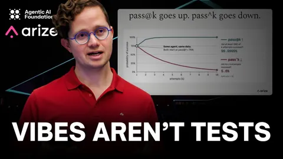

# Stop Vibe-Testing: Run Real Agent Evals - Laurie Voss, Arize AI

**Agentic AI Foundation** · 2026-11-17 · 26:33 · relevance 4/5 · [Watch on YouTube](https://www.youtube.com/watch?v=1kP4dQtUT50)

## Summary

Laurie Voss (Head of DevRel at Arize AI, NPM co-founder) gives an MCP Conf talk arguing teams should replace 'vibe-testing' of agents with repeatable evals built on traces. He opens with an MCP-vs-CLI GitHub eval (equal correctness, but MCP 6x costlier and 5x slower on hardest tasks, yet MCP wins on OAuth/consumer access), then walks through code evals, LLM judges, human calibration, pass@k vs pass^k, capability vs regression evals, and a five-part judge prompt recipe. The takeaway: read traces first, define what 'good' means explicitly, use binary judge outputs calibrated against a human golden set, grade outcomes and state plus trajectories, and feed judge explanations back to a coding agent to close the improvement loop.

## Key insights

- In Arize's GitHub-repo management eval, MCP and CLI tied on correctness, but on the hardest tasks MCP cost about 6x more and took about 5x longer; MCP still wins for consumer/enterprise use because OAuth lets users grant access via a friendly browser prompt and admins control access.
  - _Relies on:_ GitHub MCP server vs GitHub CLI; MCP: 6x cost, 5x time on hardest tasks; correctness: tie; MCP uses OAuth; CLI uses API keys _(as of 2026-11-17)_
- Use pass@k (succeeds at least once in k tries) for coding-style agents and pass^k (succeeds every time) for customer-facing agents like support; demos are pass@k, production is pass^k.
  - _Relies on:_ pass@k vs pass^k; example: 20% failure rate means 20% of customers get wrong answers _(as of 2026-11-17)_
- Split evals into capability evals (target ~50% pass rate as a hill to climb) and regression evals (expected 100%); graduate capability evals into the regression suite as the agent matures.
  - _Relies on:_ capability eval target ~50%; regression eval target 100% _(as of 2026-11-17)_
- Effective LLM-judge prompts have five parts: a role, explicit good/bad criteria derived from reading traces, data clearly delimited (XML tags for Claude), labeled examples (test with and without to detect overfitting), and a constrained binary answer plus optional N/A rather than 1-10 scores, which cluster at 7.
  - _Relies on:_ Claude prefers XML tags; 1-10 scores tend to return 7; binary + N/A output recommended _(as of 2026-11-17)_
- Grade the outcome and actual system state rather than the agent's claimed path, but also inspect trajectories: Arize's agent Alex once called the same tool 43 times in one run while every span reported fine.
  - _Relies on:_ Arize agent 'Alex' called same tool 43 times in one run; check database state, e.g. refund actually created _(as of 2026-11-17)_
- Agent-as-a-judge outperforms plain LLM-as-a-judge: a Meta and KAUST paper found ~90% agreement with expert consensus vs ~70% for an LLM judge; judges should be calibrated against a human golden dataset and cross-provider to avoid self-preference, length and confidence bias.
  - _Relies on:_ Meta & KAUST paper: agent judge ~90% vs LLM judge ~70% agreement; Arize AX ships agent-as-a-judge; judges prefer longer, confident, own-model outputs _(as of 2026-11-17)_
- Anthropic's April postmortem on six weeks of Claude Code quality complaints concluded the fix was a broad suite of per-model evals run on every system prompt change, since reviews, unit/e2e tests and dogfooding had all passed.
  - _Relies on:_ Anthropic postmortem, April; 6 weeks of Claude Code quality complaints; fix: per-model evals for every system prompt change _(as of 2026-11-17)_

## Tools, models & APIs mentioned

- **Arize AX** (product)
- **Model Context Protocol** (protocol)
- **GitHub MCP server** (product)
- **GitHub CLI** (product)
- **Claude Code** (product)
- **Claude** (model)
- **ChatGPT** (product)

## How this applies to AX / design systems

The 'define what good looks like' step is design work: Parag could co-author explicit binary rubrics for agent outputs (e.g., a citation component must ground claims, an approval card must state the action) and turn them into judge criteria. The MCP-vs-CLI finding is an AX argument for OAuth-style consent flows in developer portals, worth a doc page contrasting setup UX for MCP connectors vs API keys. Trace/span anatomy (tool calls, timing, cost) and trajectory failures like the 43-call loop suggest components for a trace viewer or tool-call timeline in the AI component library that surface loops and claimed-vs-actual state to supervising users.

_Relevance 4/5: Evals and trace-reading directly inform how Parag would define 'good' agent behaviour, design trace/approval UIs and document agent quality in developer portals, though the talk is engineering-focused rather than UX-focused._

## Best moments

- [1:02](https://www.youtube.com/watch?v=1kP4dQtUT50&t=62s): MCP vs CLI eval results and why MCP still wins on OAuth for consumers
- [11:21](https://www.youtube.com/watch?v=1kP4dQtUT50&t=681s): pass@k vs pass^k explanation
- [12:26](https://www.youtube.com/watch?v=1kP4dQtUT50&t=746s): Capability vs regression evals mental model
- [17:26](https://www.youtube.com/watch?v=1kP4dQtUT50&t=1046s): Five-part recipe for a working LLM judge prompt
- [21:47](https://www.youtube.com/watch?v=1kP4dQtUT50&t=1307s): Grade outcome and state, plus trajectory failure (43 tool calls)
