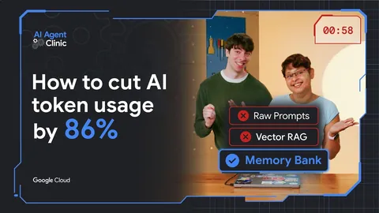

# Why your AI agent keeps forgetting (and getting slower)

**Google Cloud Tech** · 2026-11-17 · 15:19 · relevance 3/5 · [Watch on YouTube](https://www.youtube.com/watch?v=RvJ6UpR2oj8)

## Summary

An AI Agent Clinic episode from Google Cloud Tech where Laxmi Harikumar and Miles Libbey upgrade Scribant, an open-source voice-to-action agent built with ADK, with long-term memory and context compaction. They compare memory approaches (flat prompting, naive RAG, knowledge graphs), wire in Vertex AI Memory Bank, replace a 10-line transcript feed to the intent classifier with a ~40-word rolling window, and build a token telemetry dashboard. The takeaway is that pairing distilled persistent memory with aggressive rolling-window compaction lets high-frequency streaming agents stay fast and cheap while remembering users across sessions.

## Key insights

- For a streaming agent that ticks every 2 seconds, feeding the intent classifier only the latest ~40 words instead of the full transcript or 10 lines cut classifier token usage by about 86%. Sending a rolling summary instead of the full stream saved about 70%.
  - _Relies on:_ Scribant processes speech ticks every 2 seconds; Rolling window ~40 words vs previous 10 lines; ~86% token savings with 40-word window; ~70% savings with rolling summary; Demo: ~200 words of speech compressed to 92 tokens (~400 characters) summary _(as of 2026-11-17)_
- Naive vector-DB RAG over chat history fails at stateful facts: given 'moved from New York to San Francisco' it retrieves both statements and the model can't tell which is current. A memory layer needs deduplication and conflict resolution, not just retrieval.
- Vertex AI Memory Bank runs asynchronously outside the main loop and handles entity extraction, deduplication, conflict resolution and fact updates, storing distilled facts with created/updated timestamps. In the demo it injected ~24 tokens of memory versus ~1,400 tokens for a raw RAG approach.
  - _Relies on:_ Vertex AI Memory Bank; ~24 tokens injected vs ~1,400 raw RAG tokens; Memory entries include resource name, fact, created and updated dates _(as of 2026-11-17)_
- Scribant's execution gate keeps the agent pipeline read-only. It generates proposal cards and nothing touches Google Calendar or Jira until the user clicks Approve, while the agent deliberately stays silent and doesn't interrupt the speaker.
  - _Relies on:_ Integrations: Google Calendar, Google Drive, Jira; Google Cloud Speech-to-Text for transcription; Deterministic date resolver converts relative phrases to exact dates _(as of 2026-11-17)_
- Compaction can be semantic (summary) or rule-based (pruning things like intermediate tool-call results). Its goals are staying under prompt limits, keeping latency low and avoiding 'lost in the middle' degradation.
- The ADK pipeline runs two specialist agents in parallel, one maintaining a rolling summary and one extracting action items. Deterministic code, not the LLM, resolves relative dates.
  - _Relies on:_ Agent Development Kit (ADK) _(as of 2026-11-17)_

## Tools, models & APIs mentioned

- **Vertex AI Memory Bank** (product)
- **Agent Development Kit (ADK)** (framework)
- **Google Cloud Speech-to-Text** (api)
- **Scribant** (product)
- **Google Antigravity** (product)
- **Gemini Enterprise Agent Platform** (product)
- **Jira** (product)
- **Google Calendar** (product)

## How this applies to AX / design systems

Scribant's read-only proposal cards plus an explicit Approve step are a clean reference for an approval/proposal-card component in an AI component library, and are worth documenting as an AX pattern. The Memory Bank entries (fact, created and updated dates, deletable, configurable retention) suggest a 'what the agent remembers' memory inspector component so users can review and delete stored facts. The token telemetry dashboard (transcript, summary, window and efficiency) could inspire an observability panel pattern in a developer portal's agent docs.

_Relevance 3/5: Mostly an engineering talk on memory and token efficiency, but its read-only proposal cards with explicit approval, non-interrupting ambient agent and user-visible memory facts are useful AX patterns next to Parag's work._

## Best moments

- [1:03](https://www.youtube.com/watch?v=RvJ6UpR2oj8&t=63s): Demo of ambient, non-interrupting agent sorting speech into four action buckets
- [2:37](https://www.youtube.com/watch?v=RvJ6UpR2oj8&t=157s): Three-stage architecture and read-only execution gate with approve step
- [4:15](https://www.youtube.com/watch?v=RvJ6UpR2oj8&t=255s): Comparison of flat prompting, naive RAG and knowledge graphs for memory
- [8:06](https://www.youtube.com/watch?v=RvJ6UpR2oj8&t=486s): What Memory Bank entries look like (facts with created/updated dates)
- [12:01](https://www.youtube.com/watch?v=RvJ6UpR2oj8&t=721s): Token dashboard: 92-token summary, 40-word window, 86% savings, 24 vs 1,400 tokens
