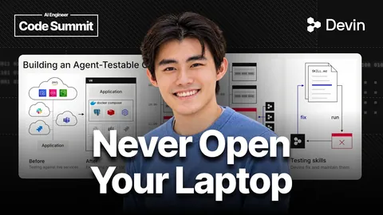

# 40x More Merged PRs With 2.7x the Engineers — Walden Yan, CPO, Cognition

**AI Engineer** · 2026-11-18 · 14:08 · relevance 4/5 · [Watch on YouTube](https://www.youtube.com/watch?v=U92J5mCDLMc)

## Summary

Walden Yan, co-founder and CPO of Cognition, explains how the company grew merged PRs 40x in a year while engineering headcount grew only 2.7x. He walks through the software-factory practices behind it: self-driving PRs by default with escalations, small pods with vertical ownership, Slack-first workflows with video proof, fully local Docker Compose environments in hourly-rebuilt VMs, and agents that analyze and optimize the factory itself. The main takeaway is to shift from giving agents tasks to giving them measurable, long-running jobs, illustrated by GPU inference tuning and an Android app maintained by Devin for 44 days.

## Key insights

- Cognition reports merged PR throughput grew 40x over roughly 12 months while engineering headcount grew 2.7x, which the speaker frames as each engineer being more than 10x more productive at equal or higher PR quality.
  - _Relies on:_ 40x merged PRs in ~12 months; 2.7x engineering headcount growth; Claimed >10x per-engineer productivity _(as of 2026-11-18)_
- Agent-driven development works best when supervision happens in chat through evidence: Devin replies in Slack with a PR plus a video showing the fix, so humans review recordings instead of opening an IDE or GitHub.
  - _Relies on:_ Devin tagged in Slack bug-report channels; Devin returns PR plus video proof of the fix _(as of 2026-11-18)_
- To let agents test their own changes, Cognition made every service runnable locally with Docker Compose, mocked all third-party services, and rebuilt per-agent VM snapshots every hour. Devin is the first responder whenever those builds fail.
  - _Relies on:_ Docker Compose for all services; Mocked third-party services; VMs rebuilt hourly from latest code _(as of 2026-11-18)_
- Cloud agents can maintain their own testing know-how: Devin writes and updates its own 'skills' describing how to test the codebase as it changes. A daily channel where agents propose factory optimizations surfaces fixes such as shaving about a minute off CI or catching 20% more bugs via a lint change.
  - _Relies on:_ Devin writes its own testing skills; Example: ~1 minute CI saving from node setup change; Example: ~20% more bugs caught before AI code review via lint script change _(as of 2026-11-18)_
- The recommended delegation model is 'jobs, not tasks': give an agent a measurable goal such as P99 latency, layout shift or onboarding retention, and let it add telemetry, set alerts, break down work and send daily progress reports.
  - _Relies on:_ Example goal: P99 latency; Agent creates DataDog alerts and weekly Slack reports _(as of 2026-11-18)_
- Given a throughput goal and a permanent GPU allocation, agents spent about a week finding eight or nine optimizations for Nvidia Vera Rubin GPUs. Throughput went from worse than GB300 to significantly better, with a human giving final approval on each strategy.
  - _Relies on:_ Nvidia Vera Rubin GPUs; Compared against GB300; ~1 week; 8-9 strategies discovered; Human final approval _(as of 2026-11-18)_
- An Android app was built and maintained by Devin over 44 days by mirroring the iOS app, with permanent hooks on the iOS codebase, Slack feedback monitoring and pixel-level live QA. On most days there were no human messages, and Devin merged 40-50 PRs on those days.
  - _Relies on:_ 44 days; 40-50 PRs/day on some days; Pixel-for-pixel QA against iOS app; Escalates only key decisions to humans _(as of 2026-11-18)_

## Tools, models & APIs mentioned

- **Devin** (product)
- **Slack** (product)
- **Linear** (product)
- **Docker Compose** (framework)
- **Datadog** (product)
- **GitHub** (product)
- **Nvidia Vera Rubin** (other)
- **Nvidia GB300** (other)

## How this applies to AX / design systems

The Slack-first flow, where an agent replies with a PR plus a video proof, suggests an 'evidence card' component for the AI component library: a recording or screenshot, a diff summary and approve/escalate actions, built as a framework-agnostic Lit element. The 'jobs not tasks' model points to a goal-delegation UI with a metric target, telemetry setup, a progress timeline and daily digests. That is a richer AX pattern than chat prompting and worth prototyping. For design systems, the iOS-to-Android pixel-parity loop hints at agents keeping component implementations in sync across platforms against a reference, a possible experiment for cross-framework token and component parity.

_Relevance 4/5: The Slack-first delegation, video-as-proof evidence, escalation-only supervision and 'jobs not tasks' model are concrete agentic UX patterns Parag can turn into design experiments, though the talk is mainly about engineering org and infrastructure._

## Best moments

- [0:42](https://www.youtube.com/watch?v=U92J5mCDLMc&t=42s): Headline chart: 40x merged PRs vs 2.7x headcount
- [3:16](https://www.youtube.com/watch?v=U92J5mCDLMc&t=196s): Slack bug report to Devin PR with video proof, a key supervision UX pattern
- [4:50](https://www.youtube.com/watch?v=U92J5mCDLMc&t=290s): Local Docker Compose and hourly-rebuilt VMs so agents can test
- [7:55](https://www.youtube.com/watch?v=U92J5mCDLMc&t=475s): Jobs not tasks: the P99 latency goal-delegation example
- [11:34](https://www.youtube.com/watch?v=U92J5mCDLMc&t=694s): Android app maintained by Devin over 44 days with minimal human messages
