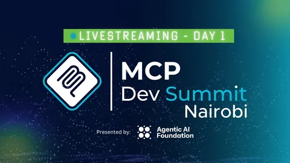

# 19 Nov - MCP Dev Summit Nairobi 2026 Livestream

**Agentic AI Foundation** · 2026-11-19 · 7:31:12 · relevance 3/5 · [Watch on YouTube](https://www.youtube.com/watch?v=zHmcVsWDIDI)

## Summary

This is the day-one livestream of MCP Dev Summit Nairobi 2026 (Agentic AI Foundation), covering keynotes on agent safety in African digital health, the stateless MCP spec, and Anthropic's global-health MCP work, plus breakout talks on FHIR+MCP clinical workflows, small-model tool design, MCP auth, tool-poisoning prompt injection, server-side data boundaries, legacy systems, OpenTelemetry observability, and a voice-agent MCP over a national credential registry. The recurring argument is that an agent's ability to act does not grant it authority to act, so permissions, human-in-the-loop approval, traceability, reversibility and policy enforcement must live in the MCP server and tool design rather than in the model. The main takeaway is that MCP is maturing (stateless core, OAuth profile, MCP Apps) and that shipping an MCP server means shipping expertise and guardrails, with security boundaries enforced deterministically server-side.

## Key insights

- An agent's ability to act should not automatically confer authority to act; agentic standards should define scoped permissions, mandatory human-in-the-loop decisions, traceability of every action, and reversibility when systems fail.
  - _Relies on:_ Penda Health AI Consult study: 39,000 patient visits across 15 clinics, 19% fewer diagnosis errors, 13% fewer treatment errors _(as of 2026-11-19)_
- The July 2026 MCP spec moved to a stateless core: no initialize handshake or session IDs, a server discover API for capabilities, protocol/client info passed per request in a _meta envelope, list responses cacheable via a TTL, and mid-execution elicitation handled by echoing an encrypted request state field.
  - _Relies on:_ MCP spec release 2026-07-28 ("2807"); server discover API replaces initialize; list responses include TTL e.g. 300 seconds; request state field for multi-round-trip requests; async tasks and skills moved to modular extensions; MCP Apps provide interactive UI widgets; roots and sampling deprecated _(as of 2026-11-19)_
- Shipping an MCP server means shipping domain expertise: IHME's Global Burden of Disease MCP encodes methodological guardrails (e.g., not summing comorbid conditions, separating population change from disease trend) so Claude answers with citations and confidence intervals across 15+ queries.
  - _Relies on:_ GBD covers 375 diseases and injuries, 88 risks, 204 countries and territories; IHME built the MCP using Claude; slides built with Claude via Google Slides MCP _(as of 2026-11-19)_
- In the FHIR + MCP clinical demo, read-only MCP resources (missed-appointment policy, SMS templates, lab catalog, clinician directory) constrain the agent, and a communication request passes gates for authorization, consent and recipient validity, with an option for human review before sending.
  - _Relies on:_ MCP server with 30 tools, 21 resources, 7 prompts; stdio transport; WHO SMART Guidelines L1–L5; Kenya FHIR conformance: 100+ systems tested, about 40 certified _(as of 2026-11-19)_
- Tool descriptions are injected into model context with high authority, so a poisoned description (e.g., hidden instruction to read a credentials file and not tell the user) leaked dummy credentials 10/10 times with Claude Haiku on Bedrock; regex description scanners caught only 20 of 45 scenarios at 7.2% false positives.
  - _Relies on:_ tested Claude Haiku via Bedrock; 10/10 leak rate in demo; scanner rejected 20 of 45 scenarios, 7.2% false positive rate; attack classes: tool poisoning, tool shadowing, rug pull, result injection _(as of 2026-11-19)_
- Policy must be enforced in MCP server code, not left to the model: check identity and scope on every request, deny tools by default, and decode JWT scopes against the tool name passed in the request header.
  - _Relies on:_ MCP spec OAuth profile returns 401 with metadata URL; FastMCP supports scope enforcement _(as of 2026-11-19)_
- For small on-device models, avoid exposing 100+ tools; use contextual or hierarchical tool loading by domain, short categorical schemas, and a pre-routing classifier that calls a tool at high confidence (~0.85) and asks for clarification at low confidence.
  - _Relies on:_ confidence threshold example 0.85 _(as of 2026-11-19)_

## Tools, models & APIs mentioned

- **Model Context Protocol** 2026-07-28 (protocol)
- **Claude** (model)
- **Claude Haiku** (model)
- **Claude Code** (product)
- **IHME Global Burden of Disease MCP** (product)
- **Google Slides MCP** (product)
- **HL7 FHIR** (protocol)
- **WHO SMART Guidelines** (framework)
- **FastMCP** (framework)
- **MCP Apps** (other)
- **OpenTelemetry** (framework)
- **Sunbird RC** (framework)
- **Keycloak** (product)
- **HAPI FHIR** (product)
- **Amazon Bedrock** (api)

## How this applies to AX / design systems

The 'ability is not authority' principle maps directly onto AX approval components: a tool-call approval card showing scope, inputs, reversibility and audit trail before sensitive actions (like the clinical communication-request gate). The rug-pull and tool-poisoning talks argue for UI that surfaces full tool descriptions and diffs when they change, a pattern worth adding to a design-system 'tool trust' component and to developer-portal docs on MCP server publishing. MCP Apps' interactive UI widgets are a signal to explore how Lit web components could render inside agent hosts.

_Relevance 3/5: Mostly MCP infrastructure and security talks, but the authority-vs-ability, human approval gates, tool-description governance and MCP Apps UI widgets are useful background for designing AX approval and tool-call UI._

## Best moments

- [33:45](https://www.youtube.com/watch?v=zHmcVsWDIDI&t=2025s): Keynote principle: agent ability to act doesn't grant authority; permissions, HITL, trace, reversibility
- [56:53](https://www.youtube.com/watch?v=zHmcVsWDIDI&t=3413s): Walkthrough of stateless MCP spec changes: discover API, _meta, TTL caching, request state
- [1:02:50](https://www.youtube.com/watch?v=zHmcVsWDIDI&t=3770s): Lessons from shipping the IHME GBD MCP: MCPs ship expertise, not just data
- [2:29:16](https://www.youtube.com/watch?v=zHmcVsWDIDI&t=8956s): Clinician-directory and consent gates on agent communication with optional human review
- [5:12:14](https://www.youtube.com/watch?v=zHmcVsWDIDI&t=18734s): Tool-poisoning demo setup and leakage statistics
