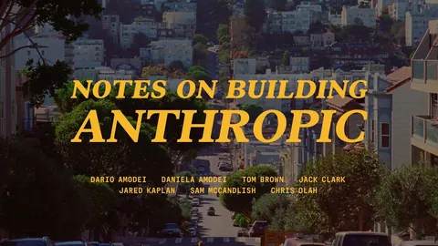

# The making of Anthropic

**Anthropic** · 2026-11-19 · 14:41 · relevance 2/5 · [Watch on YouTube](https://www.youtube.com/watch?v=sof3vW4mHTs)

## Summary

A short documentary from Anthropic in which its co-founders recount why they left OpenAI-era work to start the company, from the scaling-laws insight through incorporation as a public benefit corporation. It traces the early research-lab chaos, the HHH (helpful, harmless, honest) assistant goal, the first Claude in 2022, the 'years of suck' after the March 2023 launch, the turnaround with Claude 3 Opus, Sonnet 3.5 and Claude Code, and the staged Glasswing release of the cyber-capable Mythos model. The main takeaway is that Anthropic frames frontier capability and safety as linked, and treats restricted, mission-driven releases as the reason the PBC structure exists.

## Key insights

- Anthropic chose to incorporate as a public benefit corporation so that the mission can outrank profit or shareholder value in specific decisions.
  - _Relies on:_ Incorporated as a public benefit company on January 26, 2021 _(as of 2026-11-19)_
- The founding bet was the 'big blob of compute' scaling trend: more compute and data yield predictably more capability and new emergent abilities, without hand-teaching planning or tool use.
  - _Relies on:_ Trend noticed around 2018 by Dario Amodei _(as of 2026-11-19)_
- Early assistants were built toward 'helpful, harmless, honest'. Helpfulness and harmlessness came first, and honesty lagged badly: early models confidently endorsed an all-potato diet.
  - _Relies on:_ HHH motto from a 2021 internal doc targeting a conversational assistant to create, edit and explain software; Model code-named Junior in mid-2022, later called Claude _(as of 2026-11-19)_
- The founders say Claude was far behind the frontier at public launch. Competitiveness came from compute plus stacked algorithmic 'compute multipliers', leading to Claude 3 Opus and then Sonnet 3.5, which made models useful for programming.
  - _Relies on:_ Claude public release March 2023; Claude 3 Opus; Sonnet 3.5 _(as of 2026-11-19)_
- Claude Code began as an internal tool once Sonnet 3.5 made coding viable: it could act on your computer to solve problems, and its external release created a new wave of demand.
  - _Relies on:_ Claude Code; Sonnet 3.5 _(as of 2026-11-19)_
- Mythos, a model with expert-level ability to find software vulnerabilities and exploits, was released through Project Glasswing only to a limited set of companies, so cyberdefenders could find and patch vulnerabilities while broader safeguards were built.
  - _Relies on:_ Mythos model in limited testing; Project Glasswing restricted-access release; Framed as 2026 being 'when the risks start to get real' _(as of 2026-11-19)_
- Anthropic reports using Claude in biology work, including what looks like a newly discovered gene-editing mechanism, and expects dozens of such discoveries per month within a few months.

## Tools, models & APIs mentioned

- **Claude** (model)
- **Claude 3 Opus** 3 (model)
- **Claude Sonnet** 3.5 (model)
- **Claude Code** (product)
- **Mythos** (model)
- **AWS** (product)

## How this applies to AX / design systems

Direct application is limited. Glasswing is a useful reference for gated-access UX in developer portals, such as tiered model availability, access-request flows and clear messaging about why a capability is restricted. The 'helicopter test' and HHH framing could inform simple trust and honesty heuristics in agent UI copy, but the video contains no design or component guidance.

_Relevance 2/5: This is mostly company history and safety narrative with little direct bearing on AX, design systems or developer-portal design._

## Best moments

- [2:15](https://www.youtube.com/watch?v=sof3vW4mHTs&t=135s): The 'big blob of compute' scaling insight behind the company.
- [7:35](https://www.youtube.com/watch?v=sof3vW4mHTs&t=455s): The 2021 HHH assistant document and the honesty failures of early models.
- [8:36](https://www.youtube.com/watch?v=sof3vW4mHTs&t=516s): The helicopter test as an informal capability eval.
- [10:11](https://www.youtube.com/watch?v=sof3vW4mHTs&t=611s): From Claude 3 Opus and Sonnet 3.5 to the origin of Claude Code.
- [12:29](https://www.youtube.com/watch?v=sof3vW4mHTs&t=749s): The decision to release Mythos via Project Glasswing.
