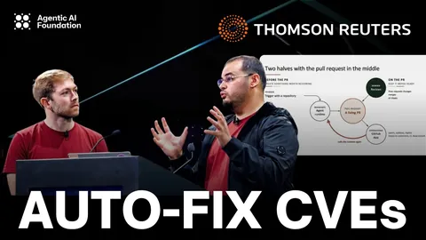

# We Built AI Agents To Fix Security Findings in Production

**Agentic AI Foundation** · 2026-11-19 · 25:30 · relevance 3/5 · [Watch on YouTube](https://www.youtube.com/watch?v=OOXETYR3MWU)

## Summary

A conference talk from Thomson Reuters' product security team describing two specialized AI agents (SAST and SCA) plus an orchestration system that auto-remediates security findings across thousands of repositories. The core argument is that vulnerability discovery is outpacing remediation, and closing that gap needs deterministic pre-computation (ranked fix locations via an MCP, minimum library upgrade sets, OpenRewrite recipes), gated checks, and treating the pull request as a living object the agent keeps mergeable and revisable. The main takeaway is that offloading repeatable decisions to deterministic tools and designing the PR as the human-agent collaboration surface is what gets agent-written fixes actually merged.

## Key insights

- Pre-computing ranked candidate fix locations through taint-analysis source/sink reasoning and handing them to the agent via an MCP, instead of letting it patch every reported sink, cut LLM-generated code about 3x per vulnerability class per repo.
  - _Relies on:_ ~3x less LLM code on average across multiple reports and vulnerability classes; Fix locations computed before the agent starts and exposed via an MCP server _(as of 2026-11-19)_
- For dependency upgrades, using OpenRewrite as a deterministic upgrade engine plus a computed minimum set of libraries to bump reduced input tokens dramatically, freeing context for fixing build and test errors.
  - _Relies on:_ Spring Boot 2.6.7 to 3.x upgrade: ~40K input tokens down to ~500; OpenRewrite is an open source library of upgrade recipes, e.g. Java 21 migration _(as of 2026-11-19)_
- Agent PRs got closed until they matched team conventions; a structured PR with what was done, what was not done, files touched, a remediation summary table and reviewer guidance, plus team-configurable branch naming and ticket links, raised developer trust and merge rates.
- Treat the agent's PR as a live object: a GitHub app feeds review comments and events back to rerun the agent, which re-applies all verification checks before committing, and autonomously rebases stale PRs because red agent PRs were closed by developers essentially 100% of the time.
  - _Relies on:_ GitHub app used to capture PR events and retrigger agents _(as of 2026-11-19)_
- Gate before opening a PR: verify a working baseline build first, run on an isolated copy, require no new findings and a reduced finding count, and cap retries by budget/time/runs, reverting everything if gates fail; enforce agent boundaries in code rather than prompts because prompts are easier to circumvent.
  - _Relies on:_ Ephemeral VMs destroyed after each run; Amazon Bedrock used as always-available model _(as of 2026-11-19)_
- Over the last two weeks the system raised 242 PRs, of which 84 merged and 29 closed, at an organization of ~10,000 developers; the team says it is open sourcing the code flow solver, MCP and observability stack.
  - _Relies on:_ 242 PRs raised, 84 merged, 29 closed in 2 weeks; ~10,000 developers; NIST: 263% rise in reported vulnerabilities 2020-2025; ~60K forecast for 2026 _(as of 2026-11-19)_

## Tools, models & APIs mentioned

- **OpenRewrite** (framework)
- **Amazon Bedrock** (api)
- **GitHub App** (product)
- **Model Context Protocol** (protocol)
- **Spring Boot** 2.6.7 to 3.x (framework)

## How this applies to AX / design systems

The structured agent-PR template (done / not done / files touched / remediation table / review guidance) is a ready pattern for an 'agent work summary' component in an AI component library, and could inform a handoff/review card in the design system. The revision loop, where comments become agent instructions that re-run checks, maps to approval and iteration UI for supervised delegation in AX. The finding that stale or red agent output gets rejected suggests designing freshness and readiness status indicators for agent artifacts, and the code-enforced boundaries point toward documenting agent permissions explicitly on developer portal pages.

_Relevance 3/5: It is mainly a security-engineering case study, but its lessons on PR structure, revision loops, stale-PR maintenance and code-enforced boundaries are transferable AX patterns for agent delegation and trust._

## Best moments

- [6:31](https://www.youtube.com/watch?v=OOXETYR3MWU&t=391s): Explains source/sink taint analysis and why ranked fix locations via MCP beat fixing every sink
- [10:01](https://www.youtube.com/watch?v=OOXETYR3MWU&t=601s): OpenRewrite token reduction: 40K to 500 input tokens on Spring Boot upgrade
- [17:04](https://www.youtube.com/watch?v=OOXETYR3MWU&t=1024s): Why agent PRs were closed and the structured PR format that built trust
- [19:08](https://www.youtube.com/watch?v=OOXETYR3MWU&t=1148s): Revision process and keeping stale PRs mergeable; red agent PRs closed nearly always
- [22:16](https://www.youtube.com/watch?v=OOXETYR3MWU&t=1336s): Key lessons and production numbers (242 PRs, 84 merged)
