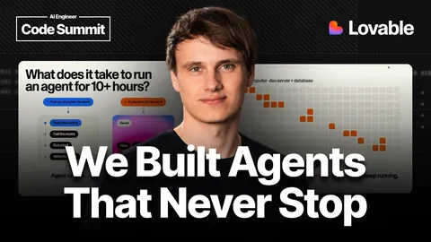

# What it takes to set intelligence free — Fabian Hedin, CTO, Lovable

**AI Engineer** · 2026-11-19 · 22:26 · relevance 4/5 · [Watch on YouTube](https://www.youtube.com/watch?v=pZWPq_ZAmM4)

## Summary

Lovable CTO Fabian Hedin recounts how the company nearly failed with a premature 2023 multi-agent framework, retreated to a single-LLM loop in late 2024, and is now running long-running agents in production again. He walks through the architecture enabling unbounded agent runtime: per-agent inboxes, a Git-inspired append-only forkable trajectory separated from prompt rendering, stateless workers, checkpointed and forkable sandbox computers with copy-on-write memory, and a Rust rewrite of Vite. The takeaway is that reliable long-running agents depend on durable state, cheap forking and inner/outer verification loops that extend all the way to product and business metrics.

## Key insights

- Lovable's 2023 multi-agent framework (orchestrator spawning specialist front-end/back-end agents) made the product worse; reverting to one main LLM plus small retrieval LLMs in late 2024 was more responsive and reliable. Multi-agent only worked once model intelligence caught up.
  - _Relies on:_ Product originally called GPT Engineer (2023, GPT-4 era); Simpler single-LLM system adopted late 2024 _(as of 2026-11-19)_
- Model the agent's history as an append-only event log where each event points to a parent, enabling Git-like forks of parallel agents without duplicating shared history; merges are not supported because their semantics are unclear.
  - _Relies on:_ Trajectory = append-only log with parent pointers; Forking supported, merging not _(as of 2026-11-19)_
- Keep the full task history (every tool call, success/failure, platform event) separate from the prompt, then render prompts per model so compaction/summarization can differ by context length.
- Stateless agent workers that persist to the task history after every turn let Lovable deploy ~700 times per day without interrupting agents running 10+ hours; the previous 30-minute agent limit was removed.
  - _Relies on:_ ~700 deploys/day (about every two minutes); Former agent limit 30 minutes, now unbounded (10+ hours); Over a billion tokens per minute in production _(as of 2026-11-19)_
- Sandboxes are checkpointed (disk, memory, running processes) after every agent turn from a 'golden checkpoint', enabling ~230 ms project start, sub-second resume, and cheap forks via copy-on-write RAM and streamed memory boot.
  - _Relies on:_ Golden checkpoint copied in about 230 milliseconds; Each sandbox needs a few hundred MB of memory; Copy-on-write on RAM pages for forks (used by 'drafts' feature) _(as of 2026-11-19)_
- Forking Vite and rewriting it in Rust (dropping Node.js) cut preview time from 40 seconds to 3 seconds, code starts 2x faster and memory footprint 6.5x lower.
  - _Relies on:_ Preview 40s -> 3s; 2x faster code starts; 6.5x lower memory footprint _(as of 2026-11-19)_
- Verification should run as an inner loop within a turn (build, lint, type, runtime errors, headless browser exploration) and an outer loop between turns (visitor behaviour, automatic A/B tests, payment conversions) so agents optimise business outcomes, not just code.

## Tools, models & APIs mentioned

- **Lovable** (product)
- **GPT Engineer** (product)
- **GPT-4** (model)
- **Vite** (framework)
- **Rust** (other)
- **Node.js** (other)
- **GitHub** (product)
- **Git** (other)

## How this applies to AX / design systems

The chat-left / preview-right layout framed as 'describe intent, see outcomes' is a reference pattern for intent-driven AX surfaces and developer portal playgrounds. The event-history debug slider that re-renders UI at any of 156 events suggests a 'timeline scrubber' component for agent supervision and audit in an AI component library, and forkable trajectories map to a 'drafts/branches' UI for comparing parallel agent attempts. The inner/outer verification loops could inform status and approval components that show build, lint and browser checks inline, plus outcome metrics between turns.

_Relevance 4/5: The chat-plus-preview intent interface, event-history scrubbing, drafts/forks and outcome-oriented feedback loops are concrete AX patterns Parag can borrow, though most of the talk is infrastructure._

## Best moments

- [2:01](https://www.youtube.com/watch?v=pZWPq_ZAmM4&t=121s): Why the elaborate multi-agent framework failed and the retreat to simplicity
- [9:52](https://www.youtube.com/watch?v=pZWPq_ZAmM4&t=592s): Inbox model and Git-inspired forkable trajectory design
- [11:28](https://www.youtube.com/watch?v=pZWPq_ZAmM4&t=688s): Separating prompt rendering from task history for per-model compaction
- [12:29](https://www.youtube.com/watch?v=pZWPq_ZAmM4&t=749s): Debug slider replaying UI across 156 events — supervision UI idea
- [19:40](https://www.youtube.com/watch?v=pZWPq_ZAmM4&t=1180s): Inner vs outer verification loops tied to business metrics
