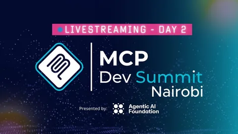

# 20 Nov - MCP Dev Summit Nairobi 2026 Livestream

**Agentic AI Foundation** · 2026-11-20 · 8:48:56 · relevance 4/5 · [Watch on YouTube](https://www.youtube.com/watch?v=BOlf10RUB4s)

## Summary

Full-day livestream of MCP Dev Summit Nairobi 2026 (Agentic AI Foundation) with keynotes and sessions on MCP internationalization, offline home assistants, A2A+MCP for health claims, edge/cloud model swarms, OAuth for MCP, trauma-informed chatbot guardrails, 'unknown' tool states, supply-chain security, agent payments, progressive disclosure and Kubernetes runtime enforcement. Recurring argument across talks: agents should propose while deterministic tools, humans and infrastructure enforce, with honest states (pending/unknown/failed), scoped permissions and localized, context-aware UX. Main takeaway for builders: design MCP servers and agent UIs around explicit intent previews, human approval outside model context, honest status reporting and fewer, better-scoped tools.

## Key insights

- MCP internationalization (SEP-2792) borrows HTTP Accept-Language/Content-Language negotiation: clients send the user's OS language preferences to every MCP server (header for HTTP, metadata for stdio) and servers reply with localized tool titles, MCP App UI and data where available. Approved by core maintainers; expected in the end-of-March release, with agent support around April.
  - _Relies on:_ SEP-2792 (PR number in modelcontextprotocol repo); Accept-Language header / stdio metadata, Content-Language response; MCP moved to twice-yearly releases; next end of March; Speaker: Sam Morrow, GitHub MCP server lead _(as of 2026-11-20)_
- Not all content should be machine-translated by the model: legal text needs verbatim official-language sources (Irish takes precedence in Irish law) and creative text relies on human localization, so servers should decide per content type whether to ship official translations.
  - _Relies on:_ Republic of Ireland: Irish text takes precedence in conflicts; Example model: Gemini 3.8 Flash mistranslating Harry Potter terms _(as of 2026-11-20)_
- Tool results need a third state, 'unknown', alongside success/failed: when a write call returns no verifiable handle, reporting 'failed' makes agents retry (duplicate deployments, wasted tokens) and 'success' is a false claim. Write tools should return a unique ID for verification and agents should not retry immediately on failure.
  - _Relies on:_ Case: deployment controller MCP over Pipops MCP; create-project returned no project ID; Four cases: lost connection, no handle, not finished (e.g. 100 of 500 emails), unverified claim _(as of 2026-11-20)_
- Trustline (Korapay) separates deciding, authorizing and executing: the LLM only proposes a payment intent with a summary, the fare is held ~15 minutes, PIN entry happens in a WhatsApp Flow the model never sees, and a scoped Kora payment token (single merchant, amount bounds, signed) is required before settlement; payment states map to completed/pending/failed/unchanged-on-unknown.
  - _Relies on:_ WhatsApp Flows (Meta) for PIN entry; KPT = Kora payment token; Planned interoperability with ACP and AP2 protocols; Agent wallets with spending limits; out-of-bounds requires human approval _(as of 2026-11-20)_
- Progressive disclosure for MCP: tools/list returns a whole catalog and causes context bloat, token cost and wrong-tool selection; Neo4j's agent memory server cut 16 exposed tools to a 6-tool core profile with extended tools revealed on demand. Rubric: model-chosen actions are tools, reusable context is a resource, procedures are skills, must-always-happen steps are invisible plumbing, and who-may-act is authorization.
  - _Relies on:_ Neo4j agent memory MCP: 16 tools reduced to 6-tool core; Short-term, long-term, reasoning memory in a context graph; Progressive disclosures working group in MCP contributors Discord _(as of 2026-11-20)_
- Keyword-triggered, single-turn guardrails that hard-stop and refer out fail vulnerable users (missed implicit danger, over-firing on a stubbed toe); GRIT's proposed Zuzie architecture classifies risk over several turns, stores risk metadata in state, routes to normal vs high-risk personas, explains handovers transparently and keeps the conversation going.
  - _Relies on:_ Zuzie chatbot by Gender Rights in Tech (South Africa), WhatsApp-based; Community violation-alert data (Ushahidi survey) fed via MCP into referral intelligence _(as of 2026-11-20)_
- MCP supply-chain risk is real: a spoofed postmark-mcp npm package was clean for 15 versions then added a hidden BCC. An audit of the MCP registry (~47,000 servers) found ~30% had no findable source, and among 400 scanned repos the average OpenSSF Scorecard was 3.9 with 91% unsigned releases; builders should sign (Sigstore), publish SBOMs and users should pin versions and grant least access.
  - _Relies on:_ Audit date 20 Oct; 14,489 servers without source; Scorecard avg 3.9/10; 92% no code review; 53% known vulnerabilities; Tools: OpenSSF Scorecard, Sigstore, OSV-Scanner _(as of 2026-11-20)_

## Tools, models & APIs mentioned

- **Model Context Protocol** (protocol)
- **MCP Apps** (protocol)
- **MCP Inspector** (product)
- **GitHub MCP server** (product)
- **Goose** (product)
- **Gemma** 4 (model)
- **Gemini** 3.5 Flash (model)
- **A2A** (protocol)
- **OAuth** 2.1 (protocol)
- **RMCP (Rust)** (sdk)
- **WhatsApp Flows** (api)
- **OpenSSF Scorecard** (other)
- **Sigstore** (other)
- **Neo4j Agent Memory** (framework)
- **Cilium** (framework)
- **Tetragon** (framework)
- **Hubble** (product)
- **GLiNER** 2 (model)
- **AP2** (protocol)

## How this applies to AX / design systems

Several patterns map straight to an AI component library: an intent-preview card with hold timer and approve/reject, a secure approval step rendered outside the model context, and a tool-call status component with explicit pending/unknown/failed/cancelled states (plus 'verify yourself' affordance) instead of binary success. MCP Apps plus the i18n SEP suggest Lit components that honor Content-Language and locale tokens so tool titles and embedded UIs localize automatically. For developer portals, a page on 'designing MCP tool surfaces' could cover progressive disclosure (core vs extended tool profiles), returning verifiable IDs, and supply-chain trust signals (signed releases, Scorecard) shown on server listings. The GRIT talk is a strong reference for transparent handover UX when an agent escalates to a human.

_Relevance 4/5: Several sessions directly inform agentic UX patterns Parag designs: approval flows outside model context, intent previews with holds, three-state tool outcomes, localized MCP Apps UI and progressive disclosure of tools._

## Best moments

- [52:58](https://www.youtube.com/watch?v=BOlf10RUB4s&t=3178s): MCP i18n: Accept-Language mapped to MCP and localized tool titles
- [55:29](https://www.youtube.com/watch?v=BOlf10RUB4s&t=3329s): Localized MCP Apps UI example and accessibility argument
- [5:28:17](https://www.youtube.com/watch?v=BOlf10RUB4s&t=19697s): GRIT: why single-turn guardrails and hard referrals fail users
- [5:32:14](https://www.youtube.com/watch?v=BOlf10RUB4s&t=19934s): 'Unknown' as an honest tool result and the four rules
- [7:29:28](https://www.youtube.com/watch?v=BOlf10RUB4s&t=26968s): Trustline WhatsApp demo: intent summary, hold, hidden PIN, success/failure messages
