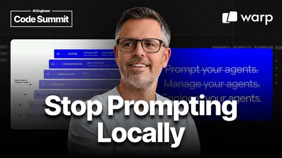

# Engineer Your Coding Agents Like Any Other System — Zach Lloyd, Warp

**AI Engineer** · 2026-11-20 · 18:31 · relevance 3/5 · [Watch on YouTube](https://www.youtube.com/watch?v=0LeT996Hz3E)

## Summary

A conference talk by Zach Lloyd, founder and CEO of Warp and former Google Docs engineering lead, arguing that teams should move from locally prompted coding agents to cloud-based "software factories". He defines a factory as a code-defined, closed-loop system for continuously measuring and improving cloud coding agents, then walks through an infrastructure stack and demos Warp's live team view, metrics, online evals, self-improvement PRs and custom benchmarks. The takeaway is to treat agents as a new engineering primitive: record every run, score it with evals, benchmark on your own data, and let agents propose PRs that improve the factory definition.

## Key insights

- Local, interactive, one-at-a-time prompting caps agent throughput at human speed. Per-developer setups (own models, skills, MCPs) also make cost efficiency, security and governance hard to manage centrally.
- Define the whole factory declaratively in a Terraform-style config: agents, triggers, workflow blueprint, policies, repos, available MCPs and where agents run. This enables branching to test configurations, rolling back, and letting agents propose changes to the factory itself.
  - _Relies on:_ Terraform-style declarative factory definitions in Warp factories _(as of 2026-11-20)_
- Lloyd recommends a layered stack. From the bottom up: factories as code, data and context (record all conversations, artifacts, videos and screenshots), sandboxed multi-platform compute, swappable inference (multiple models and harnesses), orchestration, and an API/MCP-first surface that integrates with Slack, Linear, Jira and GitHub.
  - _Relies on:_ Harnesses named: Claude Code, Codex, Py, Warp; Integrations: Slack, Linear, Jira, GitHub _(as of 2026-11-20)_
- Run online evals across all recorded agent sessions, with another agent scoring each run. Warp's example eval flags redundant or unnecessary tests, a common coding-agent failure mode.
  - _Relies on:_ Warp eval example: redundant test detection _(as of 2026-11-20)_
- Self-improvement means an agent reads eval failures, looks for patterns, and opens a PR against the factory definition rather than a human reviewing the scores.
- Model and harness leaderboards don't settle which configuration is best for you. Build a benchmark from your own real tasks and replay it across models, harnesses, skill sets and factory configs, then plot cost against quality and aim for the low-cost, high-quality quadrant.
  - _Relies on:_ Compared to public benchmarks SWE-bench and Terminal Bench _(as of 2026-11-20)_
- Factory metrics should go beyond DORA measures like cycle time to include degree of automation (human interactions per PR), throughput and cost. These come from central recording, with no per-laptop installs needed.
  - _Relies on:_ DORA metrics; human interactions per PR metric _(as of 2026-11-20)_

## Tools, models & APIs mentioned

- **Warp** (product)
- **Claude Code** (product)
- **Codex** (product)
- **Terraform** (other)
- **MCP** (protocol)
- **Opus** (model)
- **SWE-bench** (other)
- **Terminal Bench** (other)
- **Slack** (product)
- **Linear** (product)
- **Jira** (product)
- **GitHub** (product)

## How this applies to AX / design systems

The Google Docs-style live view of every agent's run (who, trigger source, artifact, conversation) is a concrete AX supervision pattern worth prototyping as a reusable 'agent run card' and 'fleet view' component. The self-improvement-as-PR idea suggests an approval UI where agent-proposed config changes are reviewed like diffs. A developer portal could document factory-as-code schemas and show eval scores and cost-versus-quality charts as standard components. The talk is mostly engineering-focused, though, so these are extrapolations rather than design guidance.

_Relevance 3/5: Useful background on how engineering orgs will supervise fleets of coding agents, and the live team view, eval scoring and self-improvement PR patterns hint at AX supervision UI, but it is not about design systems or portals directly._

## Best moments

- [3:35](https://www.youtube.com/watch?v=0LeT996Hz3E&t=215s): Definition of a software factory and what it is not
- [8:20](https://www.youtube.com/watch?v=0LeT996Hz3E&t=500s): Walkthrough of the factory infrastructure stack layers
- [11:26](https://www.youtube.com/watch?v=0LeT996Hz3E&t=686s): Demo of live team view of all agent runs — supervision UI pattern
- [13:29](https://www.youtube.com/watch?v=0LeT996Hz3E&t=809s): Online eval example: detecting redundant tests
- [15:01](https://www.youtube.com/watch?v=0LeT996Hz3E&t=901s): Self-improvement via agent-authored PRs to the factory definition
