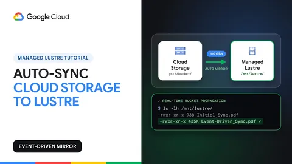

# How to mirror Cloud Storage buckets to Managed Lustre

**Google Cloud Tech** · 2026-11-20 · 6:50 · relevance 1/5 · [Watch on YouTube](https://www.youtube.com/watch?v=MpDi3iDZF4k)

## Summary

A Google Cloud Tech tutorial by Senior PM Barak Epstein showing how to set up Managed Lustre Cloud Storage mirror, a unidirectional, event-driven sync from a Cloud Storage bucket to a Managed Lustre parallel file system. He verifies the instance, creates a least-privilege custom IAM role for the service agent, creates the mirror with the gcloud CLI, demonstrates real-time object sync on a Compute Engine VM, toggles deletion retention and tears the mirror down. The takeaway is that the mirror removes manual copy scripts for AI/ML training data, and its production behavior follows four predictable rules: hydration rates, Cloud Storage wins naming conflicts, deletion propagation can be toggled, and unmirrored directories are left alone.

## Key insights

- Managed Lustre Cloud Storage mirror is a one-way sync. Storage Transfer Service listens for object create, update and delete events in the bucket and pushes each change, both data and metadata, into Lustre, so no manual transfer scripts are needed.
  - _Relies on:_ Unidirectional sync from Cloud Storage to Managed Lustre; Event-driven via Storage Transfer Service bucket events _(as of 2026-11-20)_
- Proactive hydration warms data and metadata at up to 100 GB/s initially and 3.5 GB/s on an ongoing basis.
  - _Relies on:_ Initial hydration up to 100 GB per second; Ongoing hydration up to 3.5 GB per second _(as of 2026-11-20)_
- For least privilege, create a custom project-level IAM role with only the minimum bucket and object permissions. Bind that role to the Managed Lustre service agent on the source bucket only.
  - _Relies on:_ Managed Lustre uses the GCS service agent as its background identity to read from the bucket _(as of 2026-11-20)_
- Deletion propagation can be toggled. The deleted-files-retained flag keeps Lustre copies of objects deleted in GCS, such as checkpoints, and the no-deleted-files-retain flag syncs deletions to free space.
  - _Relies on:_ deleted files retained flag; no deleted files retain flag _(as of 2026-11-20)_
- In a naming conflict, Cloud Storage wins: bucket updates overwrite local edits in the mirrored directory. Structural collisions are skipped and logged to Cloud Logging, and unmirrored Lustre directories are never touched.
  - _Relies on:_ Conflicts logged to Cloud Logging _(as of 2026-11-20)_

## Tools, models & APIs mentioned

- **Google Cloud Managed Lustre** (product)
- **Cloud Storage** (product)
- **Storage Transfer Service** (product)
- **gcloud CLI** (other)
- **Compute Engine** (product)
- **Cloud Logging** (product)

## How this applies to AX / design systems

This barely applies to Parag's work. At most, the walkthrough's sequence of verify, grant least privilege, create async, check status and tear down is a useful reference structure for a step-by-step tutorial page in a developer portal.

_Relevance 1/5: This is an infrastructure and storage-ops tutorial for ML training pipelines with no bearing on agentic UX, design systems, Web Components or developer portal design._

## Best moments

- [0:34](https://www.youtube.com/watch?v=MpDi3iDZF4k&t=34s): Explanation of the event-driven mirror architecture
- [1:35](https://www.youtube.com/watch?v=MpDi3iDZF4k&t=95s): Service agent setup and the custom least-privilege IAM role
- [3:43](https://www.youtube.com/watch?v=MpDi3iDZF4k&t=223s): Live demo of a new file syncing to the Lustre mount
- [5:14](https://www.youtube.com/watch?v=MpDi3iDZF4k&t=314s): The four production rules, including hydration throughput numbers
