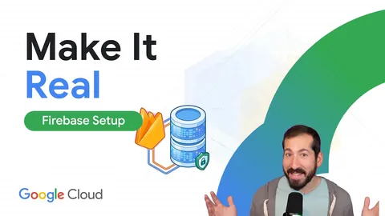

# From prototype to real Firebase backend (no code)

**Google Cloud Tech** · 2026-11-21 · 16:08 · relevance 3/5 · [Watch on YouTube](https://www.youtube.com/watch?v=0aUIWT6W_oU)

## Summary

An episode of Google Cloud Tech's Build It series where Devin Chasanoff connects a smart personal trainer app built in Google Antigravity to Firebase Auth and Cloud Firestore without writing code. He first asks Gemini whether any skills or MCP servers should be installed, then has the agent walk him through Firebase Console setup one step at a time (project, web app keys, email/Google sign-in, Firestore with security rules, service account key) before seeding 41 exercises and testing sign-in and the AI coach. The takeaway is that an agentic IDE can guide a human through manual console steps interactively, with the human acting as the agent's hands for actions it can't perform.

## Key insights

- Before starting a backend integration, prompt the coding agent to check whether any skills or MCP servers should be installed so it has predefined rules and context for the task.
  - _Relies on:_ Google Antigravity workspace skills; MCP servers; Gemini as the agent _(as of 2026-11-21)_
- Ask the agent to give 'one step at a time' and wait for confirmation, which turns a long setup checklist into a paced, conversational human-in-the-loop guide.
- The agent wrote the full Firebase integration over about 14 minutes assuming credentials existed, then output a summary, verification results and an env-file template for the human to fill in.
  - _Relies on:_ Agent run took ~14 minutes; Credentials go into a local environment file _(as of 2026-11-21)_
- Agent instructions about console UI drifted from the real Firebase Console (e.g., authentication now sits under Security, Firestore under Databases and storage), so guided flows must tolerate UI mismatch.
  - _Relies on:_ Firebase Console navigation: Security > Authentication; Databases and storage > Firestore _(as of 2026-11-21)_
- The agent asked explicit permission before running a seeding script, which loaded 41 canonical exercises into a Firestore exercises collection — an example of an approval gate for side-effecting actions.
  - _Relies on:_ 41 exercises seeded; Cloud Firestore exercises collection _(as of 2026-11-21)_
- The agent verified success by reading server logs (Firebase ID token verified, session authenticated, profile connected) and correctly rebutted a false bug report caused by user error.
  - _Relies on:_ Firebase ID token verification; Firebase Admin SDK with Node.js service account key _(as of 2026-11-21)_

## Tools, models & APIs mentioned

- **Google Antigravity** (product)
- **Gemini** (model)
- **Firebase** (product)
- **Cloud Firestore** (product)
- **Firebase Authentication** (product)
- **Firebase Admin SDK** (sdk)
- **Model Context Protocol** (protocol)

## How this applies to AX / design systems

The 'one step at a time, I'll confirm' pattern is a concrete AX interaction model worth designing as a component: a stepwise guided-task card with done/confirm controls, rather than dumping a checklist. The permission prompt before running the seed script and the 'explain what this does' command map directly to approval and explanation UI in an AI component library. For developer portals, consider an agent-guided onboarding flow for API key setup that tolerates console UI drift and verifies success from logs.

_Relevance 3/5: Useful background on agent-guided human-in-the-loop workflows and permission prompts in Antigravity, but it's mostly a Firebase setup walkthrough rather than AX, design systems or portal content._

## Best moments

- [0:32](https://www.youtube.com/watch?v=0aUIWT6W_oU&t=32s): Prompting the agent to check for skills/MCP servers before starting
- [2:10](https://www.youtube.com/watch?v=0aUIWT6W_oU&t=130s): Agent's 14-minute run summary with verification results and env instructions
- [2:38](https://www.youtube.com/watch?v=0aUIWT6W_oU&t=158s): 'One step at a time' prompt pattern for guided setup
- [9:25](https://www.youtube.com/watch?v=0aUIWT6W_oU&t=565s): Permission prompt before running database seeding script
- [14:34](https://www.youtube.com/watch?v=0aUIWT6W_oU&t=874s): Agent correctly pushes back on a user-error bug report
