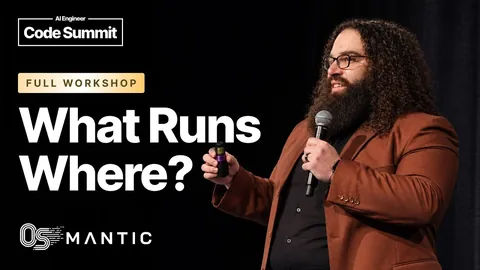

# What Runs Where? Local AI in Production — Ahmad Osman, Osmantic

**AI Engineer** · 2026-11-21 · 56:09 · relevance 2/5 · [Watch on YouTube](https://www.youtube.com/watch?v=GKSQYbELDzw)

## Summary

A CODE Summit 2026 talk by Osmantic founder Ahmad Osman on running AI locally in production: hardware choice, quantization, inference engines, batching, harnesses and the economics of owning versus renting GPUs. He argues open source AI is an optimization problem and local AI is a user experience problem, showing that small specialized models plus per-model, per-chip, per-workflow engines can match frontier quality for many agent tasks. The takeaway is to pick hardware and models from your own workload traces rather than public benchmarks, give local agents a complete harness (including search), and expect continual learning to require local models.

## Key insights

- Agent workloads are often bottlenecked by waiting on tool execution such as shell commands rather than tokens per second, so modest hardware can still be useful for agents.
  - _Relies on:_ Example: a single RTX 3090; OpenRouter data, October 2026: agents have generated more tokens than humans since February 2026 _(as of 2026-11-21)_
- Local models fail at tasks involving tools or hardware released after their training cutoff unless the harness gives them web search. Adding search let a local Qwen model change GPU fan RGB colors after it had failed without search.
  - _Relies on:_ Qwen 3.5 27B on an RTX 5090 hooked up to Claude Code; Opus could do the task because it had search access _(as of 2026-11-21)_
- Choose hardware by workload. Prefill is compute-bound and decode is memory-bandwidth-bound. For parallel agent requests, a discrete GPU with batching vastly outperforms Macs and unified-memory boxes, which run requests sequentially.
  - _Relies on:_ RTX Pro 6000 reached nearly 1300 tok/s with 50 parallel requests; DGX Spark bandwidth 273 GB/s; M5 Ultra about 1.2 TB/s, yet two DGX Sparks beat the M5; Qwen 3.6 27B locally at 51 tok/s decode vs GPT-5.5 via OpenAI cloud at 34 tok/s _(as of 2026-11-21)_
- Uniform 4-bit quantization can wreck a model. Dynamic, layer-aware quantization keeps heavily used layers at higher precision, and quantized-model recall has improved sharply as a result.
  - _Relies on:_ GLM 5.3 at 4-bit retains about 94% accuracy vs DeepSeek 3.1 at 76.1% a year earlier; Unsloth dynamic quantization _(as of 2026-11-21)_
- Your own agent traces from frontier models can feed an eval, synthetic-data and RL pipeline that trains a small specialized model, which can reach frontier quality at a fraction of the cost.
  - _Relies on:_ Airbnb reported frontier quality from a 2B-parameter model at 1% of the cost _(as of 2026-11-21)_
- Public benchmarks disagree so widely on the open-vs-closed gap that they are unreliable for model selection. Evaluate on your own hardware and tasks instead, measuring time to first token, tokens per second per user or agent, requests per second and task accuracy.
  - _Relies on:_ HLE diamond shows a gap of more than 50%; Terminal Bench shows open models ahead by 2 points; Artificial Analysis index v5 ranks Haiku 5.5 above DeepSeek V4.1 Flash _(as of 2026-11-21)_
- Markdown-file memory and skills in harnesses become bloated over time. The speaker's proposed path to continual learning, which he argues must run locally, is engrams, decision models and weight edits.
  - _Relies on:_ DeepSeek engram tables released in early 2026; Speaker's tweet dated November 4 _(as of 2026-11-21)_

## Tools, models & APIs mentioned

- **ODS** (product)
- **Portal harness** (framework)
- **Qwen** 3.6 27B (model)
- **GPT** 5.5 (model)
- **DeepSeek** V4.1 Flash (model)
- **Claude Opus** 5.5 (model)
- **Claude Haiku** 5.5 (model)
- **GLM** 5.3 (model)
- **llama.cpp** (framework)
- **vLLM** (framework)
- **Claude Code** (product)
- **Codex CLI** (product)
- **Modal CLI** (product)
- **RTX Pro 6000** Blackwell (other)
- **DGX Spark** (other)
- **OpenRouter** (product)
- **Artificial Analysis Intelligence Index** v5 (other)

## How this applies to AX / design systems

The main transferable idea is that a bad first-run experience (e.g., an agent with no search tool) permanently loses users. That argues for a developer-portal 'local setup' page that defaults to a working harness and explains which capabilities, such as search, are enabled. In agent UIs, the point that agents mostly wait on tool execution suggests designing progress and status components around tool-run states rather than token streaming. Otherwise this talk is largely infrastructure and has little bearing on design systems or Lit components.

_Relevance 2/5: Mostly hardware and inference-engine content; the 'local AI is a UX problem' framing and first-run harness failures are only indirectly useful for AX and developer portal design._

## Best moments

- [7:11](https://www.youtube.com/watch?v=GKSQYbELDzw&t=431s): Why agents are bottlenecked by tool execution rather than tokens per second.
- [21:13](https://www.youtube.com/watch?v=GKSQYbELDzw&t=1273s): Opening framing: open source AI is an optimization problem, local AI is a UX problem.
- [33:07](https://www.youtube.com/watch?v=GKSQYbELDzw&t=1987s): Story showing local agents fail without a search tool, framed as a UX problem.
- [36:45](https://www.youtube.com/watch?v=GKSQYbELDzw&t=2205s): Airbnb case: a specialized 2B model built from traces at 1% of the cost.
- [47:58](https://www.youtube.com/watch?v=GKSQYbELDzw&t=2878s): Argument that continual learning must be local and that markdown-memory harnesses become bloated.
