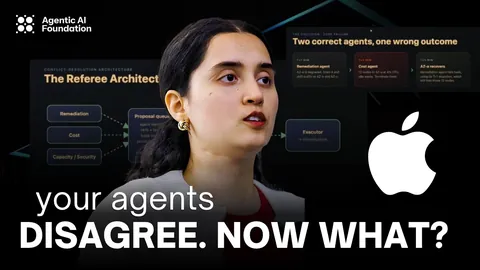

# Multi-Agent SRE: What Happens When Your Agents Want Opposite Things - Aditi Mewada, Apple

**Agentic AI Foundation** · 2026-11-22 · 20:04 · relevance 3/5 · [Watch on YouTube](https://www.youtube.com/watch?v=xDnheQC5GIg)

## Summary

A conference talk by Aditi Mewada (Apple engineer, speaking independently) on failure modes when multiple SRE agents with conflicting objectives act on the same production infrastructure. She proposes a 'referee' architecture where agents only propose actions into a queue, and a deterministic, LLM-free referee detects conflicts, ranks by an org-defined priority registry, and grants time-limited leases before an executor acts, with ties escalated to a human. The takeaway is that agent disagreements must be 'visible, ranked and reversible', with autonomy rolled out gradually from observe to propose to act-and-notify to autonomous.

## Key insights

- Separate proposing from acting: agents only emit structured proposals (agent identity and owner, verb + target, base version, priority, ETA, evidence) into a queue, and a separate executor performs approved actions.
  - _Relies on:_ Proposal fields: agent identity, verb + target, base version, priority, ETA, evidence _(as of 2026-11-22)_
- The referee should be pure deterministic code with no LLM, performing three steps: detect conflicts, rank by priority, and lease the target. Stale plans (base version ≠ current state version) are sent back to re-plan, outranked proposals are deferred, and ties go to the on-call human.
  - _Relies on:_ Referee steps: detect, rank, lease; Outcomes: stale→replan, outranked→defer, tie→human, else lease+execute _(as of 2026-11-22)_
- Leases carry a time-to-live of roughly the proposal ETA × 2 (or ×3) to allow bounded retries; after expiry the action is stopped and the next proceeds.
  - _Relies on:_ Lease TTL = proposal ETA * 2 (adjustable to 3) _(as of 2026-11-22)_
- Conflict pairs (e.g., scale up vs scale down, drain zone vs terminate nodes) should be predefined from incident data, letting non-clashing actions run in parallel; repeated opposing proposals on the same target (e.g., 3 times in 10 minutes) signal a policy bug to escalate to a human.
  - _Relies on:_ Example threshold: 3 opposing proposals within 10 minutes _(as of 2026-11-22)_
- Suggested priority order: safety/security > availability/SLO > performance > cost, plus domain pre-checks like minimum headroom (e.g., two AZs always up), incident freezes, and cost caps (e.g., block if over $500/hour).
  - _Relies on:_ Example cost cap: $500 per hour; Example invariant: two availability zones always working _(as of 2026-11-22)_
- Roll out agent autonomy in stages: observe → propose → act-and-notify with human approval and postmortem trail → autonomous for small tasks with restore snapshots and canaries (e.g., 20% traffic) before 100%. Always escalate priority ties, repeated conflicts and large blast-radius actions to humans.
  - _Relies on:_ Canary example: 20% of traffic _(as of 2026-11-22)_
- Cited stats motivate the problem: PagerDuty reports ~70% of orgs run 2+ agents in production and 85% want better error detection; a Cloud Security Alliance survey is cited as attributing 65% of production incidents to AI agents.
  - _Relies on:_ PagerDuty: 70% with 2+ agents in production, 85% need better error detection; CSA survey: 65% of production incidents by AI agents (as stated) _(as of 2026-11-22)_

## Tools, models & APIs mentioned

- **PagerDuty** (product)

## How this applies to AX / design systems

The proposal schema (agent identity, verb+target, evidence, ETA, priority) maps cleanly onto an approval-card component in an AI component library, and the stale/outranked/tie/leased states suggest a status vocabulary for agent action UI. The observe → propose → act-and-notify → autonomous ladder is a strong frame for an AX 'autonomy level' setting and for a developer-portal doc page on agent governance. A concrete experiment: design a multi-agent conflict view showing competing proposals side by side with evidence and a human tie-break action.

_Relevance 3/5: Infrastructure-focused, but the propose/approve/lease model, autonomy ladder and human-handoff rules are directly reusable patterns for designing agent supervision and approval UX._

## Best moments

- [2:37](https://www.youtube.com/watch?v=xDnheQC5GIg&t=157s): Concrete collision scenario: remediation vs cost agent causing an outage
- [3:42](https://www.youtube.com/watch?v=xDnheQC5GIg&t=222s): Four failure modes: stale state, override wars, deadlock, cascading
- [5:35](https://www.youtube.com/watch?v=xDnheQC5GIg&t=335s): Referee architecture diagram and proposal schema
- [9:14](https://www.youtube.com/watch?v=xDnheQC5GIg&t=554s): Walkthrough of referee code: version check, rivals, clash, rank, lease
- [16:15](https://www.youtube.com/watch?v=xDnheQC5GIg&t=975s): Staged autonomy rollout and human handoff rules
